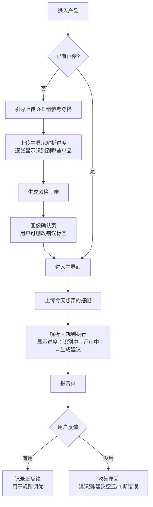

# 01 · 产品需求文档（PRD）

> 本文回答**「为谁解决什么问题、做到什么程度算成功」**。
> 技术实现细节、评分算法、API 契约见 [00-baseline](./00-baseline.md)、[02-architecture](./02-architecture.md)、[03-rule-engine-and-scoring](./03-rule-engine-and-scoring.md)、[04-api-and-data-contract](./04-api-and-data-contract.md)。

版本：v0.1 ｜ 日期：2026-10-31 ｜ 状态：待评审

---

## 1. 背景

### 1.1 问题是什么

目标人群在「每天穿什么」这件事上，同时承受三层摩擦：

| 层次 | 具体表现 | 现有解法为什么不够 |
|---|---|---|
| **决策摩擦** | 早晨认知资源最紧张时，要做高频、低价值、无标准答案的决策 | 小红书/博主给的是"流行什么"，不是"你该穿什么"，看完更焦虑 |
| **反馈缺失** | 穿出门前没有任何可信的客观反馈；同事朋友只会客气 | 通用大模型能说"这套不错"，但说不出"为什么不适合你" |
| **个性化缺失** | 每个人身材、职业、审美基线都不同，推荐却是同一套 | 现有产品要么是商品导购（有商业偏向），要么是纯灵感流（无判断） |

### 1.2 为什么现在做

1. **多模态模型第一次能到"单品级"解析**：颜色、版型、材质、品类可结构化，这是规则引擎能跑起来的前提。三年前做不到。
2. **通用审美打分已经饱和**：让大模型给一套衣服打分并说好听的话，今天任何人都能做。这不是差异化。
3. **真正的空白是"贴合个人的可解释判断"**：市面产品（详见 [06-market-scan](./06-market-scan.md)）绝大多数是「衣橱管理 + 灵感推荐」或「AI 试穿」，几乎没有做「针对你这个人的穿搭评审」。

### 1.3 我们的核心赌注

> **用户不缺穿搭灵感，缺的是一个敢下判断、并且说得出理由的顾问。**

由此推出三条产品原则（贯穿全文，评审时用它来否决需求）：

| 原则 | 含义 | 反面案例（应被否决） |
|---|---|---|
| **P1 判断优先于灵感** | 产品必须敢于说"不适合"，而不是永远夸 | "这套很百搭哦～建议试试看" ← 废话 |
| **P2 每分必可溯** | 每个扣分必须能指到规则 + 视觉证据 + 改法 | "整体协调性略欠佳" ← 不可执行 |
| **P3 个人化优先于通用审美** | 分数是"适不适合你"，不是"好不好看" | 同一套衣服给所有人同一分 ← 失去存在意义 |

### 1.4 市场证据：这个品类已经死过一批（2026-10 调研，详见 [06-market-scan](./06-market-scan.md)）

上述判断不是逻辑推演，有三组硬数据支撑，**其中两组是坏消息，必须正视**：

| # | 证据 | 数字 | 对我们的含义 |
|---|---|---|---|
| **E1** | **「AI 穿搭打分」是已饱和但零赢家的品类** | App Store 美国区搜 `outfit rating` / `rate my outfit` / `outfit score` 返回的 40 个 App，**绝大多数评分人数 0–16**；中国区全部 0–4；该层最高 `GRWM` 仅 1,869 | ⚠️ **不是"抢先做"，是"这条路已被几十个团队试过且全部失败"**。「能打分」零差异化 |
| **E2** | **衣橱有量、打分无量** | 中国区：尽简衣橱 **23,729** 评分 / 穿衣助手 6,463 / 今日装 4,756；而穿搭日记 **2**、小衣橱 **3** | ⚠️ 用户愿为「管理我的衣橱」付费，**不愿为「给我打个分」来**。若画像不可感知/不可回看/不可分享，用户不会为打分留存 |
| **E3** | **「个人画像驱动评审」未发现有人做** | 按三条件（学习既有穿搭 / 用于评审 / 可解释）核对 9 个候选，无一同时满足；最接近的三个各差一步 | ✅ 我们的 P0-3 + P0-6/P0-7 组合是**空的**。但空白≠机会：**这是"难而正确"，不是"容易没人做"** |

**E3 的关键细节（防止我们误判竞品）**：`穿搭日记` 的「个人辨识度（1分）」**不是**"像不像你"——它全程没有上传参考穿搭的入口，该维度只能理解为"这套搭配本身有没有辨识度"。**这恰好是我们最直接的分野：它测的是衣服，我们测的是你和衣服的关系。**

**补充两条已被证伪的假设**：
- Google **Doppl 已关停**（官方帮助页标题即为"Download items in Doppl before app shuts down"）→ 大厂做 AI 试穿也未必跑通，不要把"大厂在做"当成方向正确的证据
- 本赛道**不存在可采购的「穿搭规则/风格判断」B2B 供应商**（Vue.ai 已转型银行 AI、Stylumia 更名 Orbix、Heuritech 被收购）→ 判断层必须自建，**这既是成本也是护城河，且可外售**

---

## 2. 目标与非目标

### 2.1 MVP 要验证的三个假设

| 假设 | 内容 | 验证指标 | 门槛 |
|---|---|---|---|
| **H1 意愿** | 用户愿意为建立画像付出「上传 3–5 组穿搭」的成本 | 画像完成率（开始上传 → 画像生成成功） | ≥ 50% |
| **H2 价值** | 用户认为报告"有判断力"，而不是"正确的废话" | 报告有用率（看到报告后点「有用」或采纳 ≥1 条建议） | ≥ 40% |
| **H3 正确性** | 系统打分与专业搭配师打分有实质相关性 | 人工标注 20 套，Spearman 相关系数 | ≥ 0.6 |

> **H2 是生死线**。H1/H3 不达标可以调；H2 不达标说明产品方向错了，必须重做价值主张。

> **⚠️ H1 的风险等级要上调（依据 §1.4 E2）**：竞品是**集体绕开**"上传画像"这一步去做零输入通用打分的——因为那最容易上线、最好套壳。这说明 H1 不只是"流失点"，而是**整个品类从未被验证过的核心假设**。
> 因此：**"先给示例报告、后建画像"的 A/B 必须提前到 M1，不能等到 M4 才验证。** 若 H1 在 M1 就被证伪，整个 P0 范围需要重排。

### 2.2 非目标（MVP 明确不做）

| 不做 | 为什么 |
|---|---|
| 商品库 / 导购 / 购买链路 | 一旦接商品，就变成有商业偏向的推荐，破坏 P1 的中立判断 |
| 生成上身效果图 / 虚拟试穿 | 技术栈完全不同（生成式渲染），且是"看效果"而非"做判断"，偏离核心 |
| 社交 / 社区 / 关注 | 冷启动阶段没有内容生态，做了也没有用户 |
| 实时摄像头识别 | 场景不匹配——用户是在衣柜前想，不是在路上照 |
| 多语言 | 规则资产是中文语境产物（如"通勤知性"），翻译会失真 |
| 训练双塔模型 | MVP 用预训练嵌入已够；训练需要用户反馈数据，此时没有 |
| 用户填报三围身高体重 | 摩擦极高且很多人不愿填；MVP 只用图片可见信息 |

---

## 3. 用户

### 3.1 人群细分与选择

| 候选人群 | 痛点强度 | 付费意愿 | 数据可得性 | 判断难度 | 结论 |
|---|---|---|---|---|---|
| **一线/新一线城市 25–35 岁职场人** | 高（每天通勤，场合要求明确） | 中高 | 高（有拍照习惯） | 中（职场着装规则清晰） | ✅ **MVP 主打** |
| 18–24 岁大学生 | 高（社交场景密集） | 低 | 高 | 高（风格极分散、规则难写） | ⏸ 二期 |
| 30–40 岁宝妈 | 高（场合切换频繁） | 中 | 中（不愿上传自己照片） | 中 | ⏸ 二期 |
| 男性职场 | 中高 | 中 | 低（拍照习惯弱） | **低（规则最清晰）** | 🔜 **二期首选扩量方向** |

**选职场女性为 MVP 主场的理由**：场景边界清晰（通勤/会议/约会/周末），规则可写、可验证，能用 50 条规则打出有说服力的效果。男性市场规则更简单但上传意愿低，适合在验证完价值主张后作为第二个战场。

### 3.2 目标用户画像（Proto-persona）

> **林悦，29 岁，上海，互联网公司产品经理**
> - 每天 7:40 起床，要在 15 分钟内决定穿什么并出门
> - 衣柜约 120 件，但"常穿的只有 20 件"
> - 关注了几个穿搭博主，但"她们穿好看因为她们瘦/高，学不来"
> - 买过贵的衣服却"不知道怎么搭，一直压箱底"
> - 有过"穿得太随意去汇报被领导看了一眼"的记忆，之后对重要场合有焦虑
> - **关键行为**：会在镜子前自拍一张，犹豫要不要发朋友圈/问闺蜜

**她的真实台词**（用于文案与提示词设计）：
- "我知道这套不难看，但我不确定它是不是**我**的样子。"
- "别跟我说'很百搭'，告诉我**哪里不对、怎么改**。"

### 3.3 Jobs-To-Be-Done

| # | Job | MVP 是否覆盖 |
|---|---|---|
| J1 | 早晨打开衣柜，**帮我决定**今天穿什么 | ❌ 二期（需要推荐生成 + 场景/天气上下文） |
| J2 | 我搭好了一套，**帮我判断**这样行不行 | ✅ **MVP 核心** |
| J3 | 新买的衣服，**给我几个搭配方案** | ❌ 二期 |
| J4 | 我想知道**我的风格到底是什么** | ✅ 副产物（画像页自然给出） |

> MVP 只做 **J2**。J1/J3 需要"生成"能力，是二期；而"判断"能力是生成能力的地基——判断做不准，生成的方案也没人信。

---

## 4. 用户故事与验收标准

| ID | 用户故事 | 优先级 | 验收标准（摘要，详细见 baseline §2.1） |
|---|---|---|---|
| US-1 | 作为用户，我想上传 3–5 组我平时爱穿的搭配，让系统认识我的风格 | P0 | 支持多图批量上传；30s 内出画像；画像显示 top-3 风格标签 + 置信度 |
| US-2 | 作为用户，我想看到系统"理解"了我的风格，而不是黑箱 | P0 | 画像页必须展示**它从哪张图、哪件单品得出的标签**（可回溯） |
| US-3 | 作为用户，我想上传一套今天想穿的搭配，让它给我打分 | P0 | 单套上传 → 20s 内出报告（P95） |
| US-4 | 作为用户，我想知道这套**为什么**适合/不适合我 | P0 | 每个扣分项都有：规则名 + 证据 + 改法（100% 可追溯） |
| US-5 | 作为用户，我不想只被告知"不好"，我想知道怎么改 | P0 | 至少给 1 条可执行建议，含"把 X 换成 Y"级别的具体动作 |
| US-6 | 作为用户，我想知道这套跟我**平时风格**的偏离在哪 | P0 | 展示"风格匹配度"+ 漂移方向（如"通勤知性 → 运动休闲"） |
| US-7 | 作为用户，我想看到和我风格相近的参考搭配 | P1 | 展示 top-3 风格锚点（双塔召回结果） |
| US-8 | 作为用户，我不想系统瞎猜——不确定时要告诉我 | P0 | 置信度 < 阈值时显式提示"看不清/信息不足"，不硬给分 |
| US-9 | 作为用户，我希望我的照片被妥善处理 | P0 | 原图可删除；只保留结构化特征；隐私说明可读 |

### 4.1 关键验收场景（Gherkin）

```gherkin
场景: 硬规则否决时必须给出可行动理由
  假如 用户画像为「极简 / 通勤知性」
  并且 上传的搭配含 上装=红色高饱和针织 / 下装=军绿工装裤 / 鞋=亮面黑皮鞋
  当 系统生成报告
  那么 verdict 应为 "不适合"
  并且 vetoed 应为 true
  并且 rule_hits 中至少有一条 severity=hard
  并且 suggestions 至少 1 条，且含具体替换动作（不是"建议调整配色"）

场景: 信息不足时不得硬给分
  假如 上传图片严重过曝，VLM 识别出颜色置信度 < 0.4
  当 系统生成报告
  那么 confidence 应 < 0.5
  并且 报告顶部应提示需要重新上传
  并且 不得输出 "强烈推荐" 或 "不适合" 这类强判断

场景: 同一输入必须同一输出
  假如 同一用户画像 + 同一套搭配 + 同一规则版本
  当 系统生成报告两次
  那么 total_score 必须完全相同（浮点比较到 0.1）
  并且 rule_hits 顺序必须完全相同
```

---

## 5. 功能需求

### 5.1 功能清单

| 模块 | 功能 | 优先级 | 说明 |
|---|---|---|---|
| **画像** | 参考穿搭批量上传 | P0 | 支持 1–10 张，推荐 3–5 组 |
| | 单品自动解析 | P0 | VLM 输出结构化属性 |
| | 画像生成与展示 | P0 | top-3 风格 + 置信度 + 来源回溯 |
| | 画像手动修正 | P1 | 用户可删掉/纠正错误标签——**这是信任的关键** |
| | 画像持久化与更新 | P1 | 新增穿搭可增量更新画像 |
| **评审** | 单套搭配上传 | P0 | 支持一张全身照 |
| | 搭配结构化 | P0 | 区分上/下/外套/鞋/配饰层级 |
| | 规则引擎执行 | P0 | 50 条规则，可解释 |
| | 双塔相似度 | P0 | 作为 D2 特征 |
| **报告** | verdict + 总分 + 维度分 | P0 | 5 维度雷达图 |
| | 规则命中明细 | P0 | 可展开看证据 |
| | 改进建议 | P0 | 按优先级排序，含具体替换动作 |
| | 风格锚点 | P1 | 召回相似搭配 |
| | 报告分享/保存 | P2 | 导出图片 |
| **系统** | 异步任务 + 进度反馈 | P0 | 长耗时需给反馈，否则用户流失 |
| | 失败降级与重试 | P0 | VLM 失败时明确告知，不静默 |
| | 埋点与监控 | P0 | 见 §8 |

### 5.2 关键交互流程



### 5.3 冷启动摩擦控制（H1 的关键）

「上传 3–5 组穿搭」是 MVP 最大的流失点。对策优先级：

| 对策 | 效果 | 优先级 |
|---|---|---|
| 支持相册批量多选（一次选 5 张） | 高 | P0 |
| 上传过程中**实时显示**识别到的单品（让用户感到"在理解我"） | 高 | P0 |
| 允许「先看一个示例报告」再决定是否建画像 | 中高 | P1 |
| 只需 1 组即可生成「弱画像」，后续可补 | 中 | P1 |
| 从用户已有的相册/社交内容导入 | 高但合规复杂 | P2 |

> **设计判断**：宁可让用户先看到报告、再补充画像（先给价值再要数据），也不要一开始就挡住用户要 5 张图。建议 A/B 验证「先画像」vs「先报告」。

### 5.4 报告的信息层级（产品核心）

报告是本产品唯一的"产品"。信息层级必须做到：**3 秒看懂结论，30 秒看懂原因，3 分钟能改。**

```
┌─────────────────────────────────────────┐
│  [大号] 72 分  ·  适合                     │  ← 3 秒：结论
│  风格匹配度 81%｜通勤知性 → 运动休闲       │
│  ⚠ 2 处可以改进                           │
├─────────────────────────────────────────┤
│  ● 五维雷达图（可点每个维度展开）           │  ← 30 秒：原因轮廓
│    D1 色彩 16/20  D2 风格 18.5/25 ...     │
├─────────────────────────────────────────┤
│  最该改的一条（置顶，只放一条）              │  ← 行动：一个动作
│  把军绿工装裤换成藏青锥形西裤                │
│  预计 +6.5 分 ↓ 展开原因                   │
├─────────────────────────────────────────┤
│  ▸ 全部规则命中（2 条）  [展开]             │  ← 3 分钟：深挖
│  ▸ 评分依据与规则版本                       │
│  ▸ 这套和你常穿的 3 套很像 [缩略图]          │
└─────────────────────────────────────────┘
```

**硬性设计约束**：
- 置顶建议**只能有 1 条**。多条会稀释行动力（反指标见 §8）。
- 每个维度分数必须可点开看到「触发了哪些规则、扣了几分」。
- 必须展示规则集版本号——企业客户审计时需要。

---

## 6. 非功能需求

| 类别 | 要求 |
|---|---|
| **性能** | 画像生成 P95 ≤ 30s；报告生成 P95 ≤ 20s；前端首屏 ≤ 2s |
| **可用性** | 模型调用失败必须有降级路径，不得直接 500 给用户；核心链路成功率 ≥ 99% |
| **确定性** | 同一（画像, 搭配, 规则版本）必须同分同序（审计要求） |
| **隐私** | 原图短期存储（建议 ≤ 7 天）后可删；只长期保留结构化特征；提供"删除我的所有数据" |
| **合规** | 明确告知用户图片用于 AI 分析；不得将用户照片用于训练除非明示授权；建议做生成式 AI 服务备案（面向公众提供时） |
| **可审计** | 每份报告记录模型版本、规则集版本、prompt 版本 |
| **可运维** | 规则热更新不需重新部署；规则改动可灰度、可回滚 |

---

## 7. 规则资产生产体系（企业级关键）

这是**区别于"套壳 AI 产品"的核心**。1000 条规则不是写一次就完，而是一条内容生产线。

| 角色 | 职责 | 产能目标 |
|---|---|---|
| **规则作者**（专业搭配师/形象顾问） | 用 DSL 写规则，附正负测试用例 | 10–20 条/人周 |
| **规则评审**（资深 + 工程） | 判冲突、判可执行性、判解释文案质量 | — |
| **工程** | 规则上线、灰度、回归、命中率监控 | — |

### 7.1 从 50 到 1000 的产能路径

| 阶段 | 规则数 | 时间 | 关键动作 |
|---|---|---|---|
| MVP | 50 | 已完成设计 | 覆盖 5 大分类的基础常识 |
| V1 | 200 | +6 周 | 按品类细分（上装/下装/外套/鞋/配饰各自的规则） |
| V2 | 500 | +8 周 | 按场景细分（通勤/约会/运动/正式/度假） |
| V3 | 1000 | +12 周 | 按风格流派细分（极简/法式/美式复古/日系等） |

### 7.2 规则质量门槛

- 每条规则必须有 ≥1 正例 + ≥1 负例
- 上线前必须跑全量回归，通过率 100%
- 上线后监控「命中率」与「被用户投诉率」；命中率 > 60% 的规则需复核（可能条件过宽），命中率 < 0.5% 的规则需复核（可能条件过窄或已被废弃）
- 每条规则有 `source` 字段，标明是领域专家、论文、逆向对标还是学习所得

---

## 8. 成功指标

### 8.1 北极星指标

> **有效报告率** = （看完报告后点「有用」或采纳 ≥1 条建议的报告数） / 生成成功的报告总数

选它的理由：直接对应 H2（价值验证），且不可被"多生成"刷高。

### 8.2 指标树

| 层级 | 指标 | 目标 |
|---|---|---|
| 北极星 | 有效报告率 | ≥ 40% |
| 输入-激活 | 画像完成率 | ≥ 50% |
| 输入-激活 | 首个报告到达时长（注册→首份报告） | ≤ 5 分钟 |
| 输入-留存 | 7 日再使用率 | ≥ 25% |
| 输入-质量 | 人机 Spearman | ≥ 0.6 |
| 输入-质量 | 扣分可追溯率 | 100% |
| 输入-性能 | 报告 P95 延迟 | ≤ 20s |
| 输入-成本 | 单份报告模型成本 | ≤ ¥0.5（参考 05 文档测算） |

### 8.3 反指标（防止"指标好看但产品变差"）

| 反指标 | 为什么设 | 红线 |
|---|---|---|
| **平均建议数/报告** | 建议越多越显得有用，但用户越不想行动 | ≤ 3 条 |
| **"强烈推荐"占比** | 如果 80% 都强烈推荐，说明没有判断力 | ≤ 25% |
| **"不适合"占比** | 过度否定会让用户怀疑系统 | ≤ 15% |
| **平均上传图片数** | 上升说明用户在被过度索取数据 | — |

### 8.4 埋点清单

`report_view` / `suggestion_click` / `suggestion_adopt` / `report_feedback(useful|useless, reason)` / `profile_created` / `profile_edit` / `upload_abandon` / `rule_hit`（每次报告上报命中 rule_id 列表，用于规则调优）

---

## 9. 依赖与风险

| 依赖 | 影响 | 缓解 |
|---|---|---|
| VLM 的单品/颜色识别质量 | 直接决定规则是否误触发（baseline R-01） | 颜色用色卡聚类回退；置信度低时降级为 soft 规则并标注 |
| 1000 条规则的内容产能 | 决定护城河深度 | 提前建 DSL 与规则治理流程；MVP 就按 1000 条设计 schema |
| 专业搭配师供给 | 规则质量 | 规则评审机制；用论文/行业资料做冷启动 |

**产品级风险**：

| 风险 | 说明 | 应对 |
|---|---|---|
| **"正确的废话"** | LLM 生成的建议听起来对但无法执行 | 强制"把 X 换成 Y"格式；人工抽审；用户反馈闭环 |
| **用户不信冷机器** | 打分被质疑"你凭什么" | 每条扣分给证据与规则名；给"专家规则"背书 |
| **上传摩擦导致画像不完整** | H1 失败 | 见 §5.3 冷启动设计 |
| **规则误判引发负面口碑** | 一次离谱打分就会流失 | 置信度不足时不下强判断；软性措辞；显式"可反驳"入口 |

---

## 10. 里程碑

| 阶段 | 内容 | 产出 | 估时 |
|---|---|---|---|
| M0 | 设计定稿 | 本套文档（00–08） | 1 周 |
| M1 | 单品解析链路 | 图片 → 结构化 Garment，准确率抽检过关 | 2 周 |
| M2 | 画像 + 双塔召回 | 画像页可看、召回可展示 | 2 周 |
| M3 | 规则引擎 + 报告 | 50 条规则跑通，报告符合契约 | 3 周 |
| M4 | 前端可用 | 端到端可演示 | 2 周 |
| M5 | 评测与调优 | 20 套人工标注，Spearman 达标 | 2 周 |

> 合计约 12 周（不含规则内容生产并行投入）。

---

## 11. 开放问题（需决策）

| # | 问题 | 备选 | 建议 |
|---|---|---|---|
| Q1 | 先画像还是先报告？ | A 强制画像；B 先给示范报告 | 建议 B，A/B 测试 |
| Q2 | 是否允许用户不上传自己的照片，只上传衣服平铺图？ | 允许/不允许 | 允许，可降低隐私顾虑，但会损失"穿着效果"信息 |
| Q3 | 报告措辞的"硬度" | 直接否定 / 委婉 | 直接但具体，避免"不好看"这类价值判断，只说"不适合这个场景/你的风格" |
| Q4 | 是否对外展示"打分体系"（让用户知道有 5 个维度） | 展示/隐藏 | 展示——透明度是信任来源 |
| Q5 | 男性市场何时启动 | — | V2 阶段，规则更简单可快速扩量 |

---

## 12. 变更记录

| 版本 | 日期 | 变更 | 作者 |
|---|---|---|---|
| v0.1 | 2026-10-31 | 初稿 | Lead |
