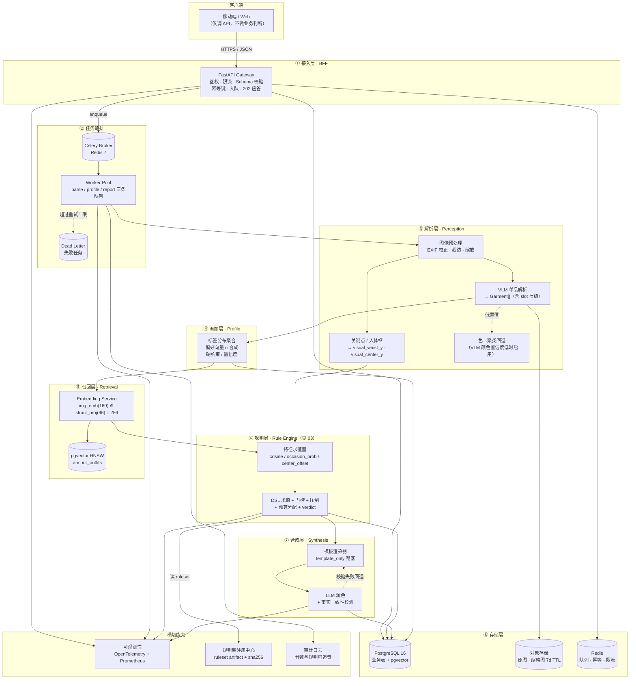
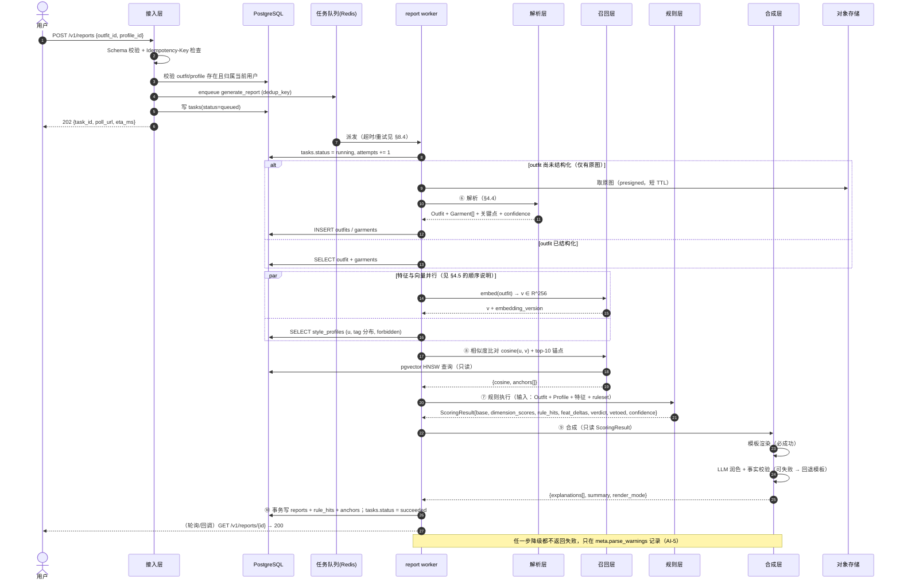
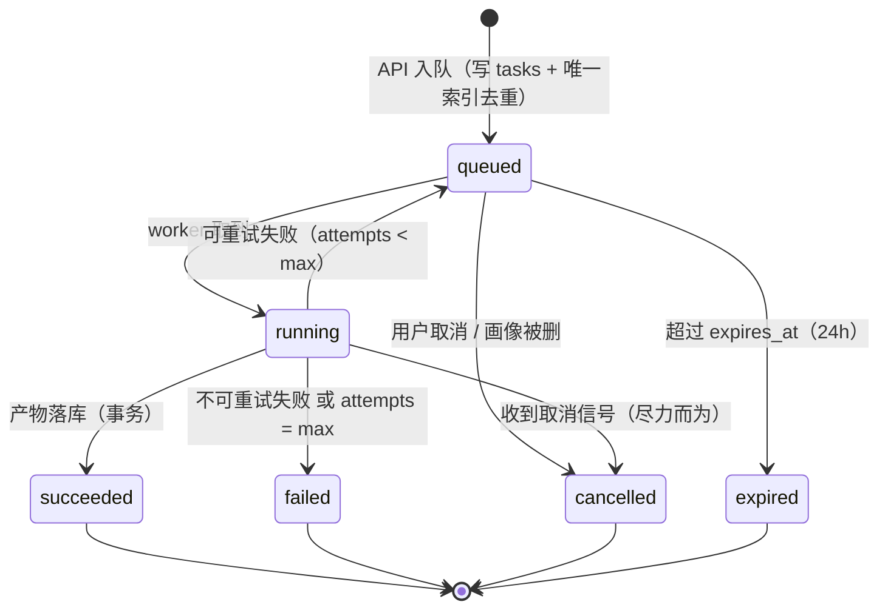

# 02 · 系统架构（System Architecture）

> 文档编号：02 ｜ 版本：v0.2 ｜ 日期：2026-10-31 ｜ 状态：待评审
> 上游事实源：[`00-baseline.md`](./00-baseline.md)（下称 baseline）。冲突以 baseline 为准；本文对 baseline 的补充与修订建议见 §12。
> 关联文档：03（规则引擎与评分，本文引用的 `base_score`、D1–D5 公式、规则执行语义均以它为准）、04（API 与数据契约，本文引用的请求/响应/错误码/任务状态机均以它为准）。

---

## 1. 本文档回答什么

1. **系统切成哪几层、每层能做什么、绝对不能做什么**（§3）——边界清晰是可解释性的第一道防线。
2. **一次报告的完整数据流长什么样、每步耗时多少、哪一步失败会怎样**（§4、§10）。
3. **双塔召回怎么在"不训练"的前提下真正落地**（§6）——含特征清单、固定投影、向量空间、三处用途的接线方式。
4. **数据存哪、怎么建表、向量库选谁**（§7）。
5. **异步任务、幂等、超时、重试、降级**（§8）。
6. **出问题时怎么发现、怎么归因**（§9）。

**本文不回答**：接口字段细节（→ 04）、评分公式与规则内容（→ 03）、产品需求与验收（→ 01）。

---

## 2. 架构不变量（Architecture Invariants）

这 6 条是"实现偏离即架构事故"的硬约束，code review 与上线评审逐条核对。

| 代号 | 不变量 | 违反示例（反例） |
|---|---|---|
| **AI-1 单向数据流** | 图像/文本等非结构化输入只能在**解析层**被转成结构化事实；结构化事实之后的所有层只读 JSON | 合成层（LLM）看到原图后"补充判断" |
| **AI-2 打分与解释分离** | 规则层产出 `ScoringResult`（纯数值 + 证据），合成层**只读不写**；任何"LLM 觉得应该再扣 2 分"都是事故 | LLM 输出里出现 `total_score` 的建议值并被采纳 |
| **AI-3 事实不可再生** | 合成层不得引入 `rule_hits` / `feature` 之外的新事实（baseline §8、本文 §9.7.7 的事实校验） | summary 里出现"这件衬衫是亚麻的"而解析结果里没有材质 |
| **AI-4 全链路可复现** | 同一 `(outfit, profile, ruleset_version, engine_version, embedding_version)` 必得同一 Report；每层产物必须带版本指纹 | 投影矩阵每次启动随机生成；规则从 `set` 迭代 |
| **AI-5 降级不失效** | 任一外部依赖（VLM / LLM / 向量库）不可用时，Report 仍必须完整产出（分数可算、文字可读），只降精度不降可用性 | VLM 超时直接返回 500 |
| **AI-6 用户数据最小化** | 原图只做短期存储；特征化后即删原图（可配置 TTL）；日志与 trace 中**永不**出现原图、原图 URL、base64（baseline R-06） | trace 里记了带签名的原图 URL |

---

## 3. 分层架构

### 3.1 总览图



### 3.2 各层职责与**禁止事项**

| 层 | 职责（做） | 禁止（不做） | 为什么这条边界重要 |
|---|---|---|---|
| **① 接入层 BFF** | 鉴权、限流、请求 Schema 校验、幂等键、同步接口（读）、异步入队、错误码翻译 | 禁止调用 VLM / LLM / 向量库；禁止任何业务打分逻辑；禁止长耗时操作 | 网关一旦能调模型，超时会吃掉连接池，P95 直接失控；把"判定"放进网关会让打分逻辑散落两处 |
| **② 任务编排** | 队列路由、优先级、重试、超时、死信、任务状态机 | 禁止承载业务逻辑（worker 里只做"取出→调下层→写库"） | 编排代码一旦有业务分支，就无法被规则/评分测试覆盖 |
| **③ 解析层** | 图 → 结构化事实（`Garment[]` / `Outfit` 结构 / 关键点）；置信度评估；色卡回退 | 禁止输出"好不好""适不适合"这类判断；禁止拿用户画像做条件解析 | 解析层一旦带主观判断，R-01（VLM 不准）与规则误触发就无法分离归因 |
| **④ 画像层** | 聚合参考穿搭为 `StyleProfile`：标签分布、偏好向量 `u`、禁忌、置信度 | 禁止读取**待评审**穿搭（只能用参考穿搭）；禁止在线学习 | 用待评审搭配反推画像 = 数据泄漏，会让 D2 永远高分（自证） |
| **⑤ 召回层** | 产出 `u` / `v` 向量、top-K 锚点、`cosine` | 禁止在召回时做规则判断；禁止把 occasion 编进搭配塔（见 §6.2.4） | 召回是"度量空间"，掺入场景会让同一件衣服在不同场合变成不同向量，锚点失去可比性 |
| **⑥ 规则层** | 特征求值、DSL 执行、门控、压制、预算分配、维度分与 verdict（全部按 03） | 禁止调用 LLM；禁止读图像；禁止访问网络；禁止写库（只返回结果对象） | 规则层必须是**纯函数**，否则 INV-1（确定性）无法保证，也无法做黄金快照回归 |
| **⑦ 合成层** | 模板渲染、LLM 润色、事实一致性校验、降级 | 禁止修改任何分数或 `delta`；禁止新增事实；禁止读原图 | 这是 baseline §4 红线：LLM 只解释不打分 |
| **⑧ 存储层** | 持久化、事务、索引、TTL、软删 | 禁止业务规则；禁止跨聚合的写事务（除任务状态机） | — |

### 3.3 线程 / 进程模型

| 组件 | 模型 | 并发上限 | 说明 |
|---|---|---|---|
| API 网关 | uvicorn，async，`--workers 2` | 500 连接 | 全部 sync 接口是"读 + 入队"，不阻塞 |
| report worker | Celery prefork，`--concurrency 4` | 4 并发任务 | 每任务内部用 `asyncio.run` + 单个 `httpx.AsyncClient`（连接池复用）；MVP QPS < 5，无事件循环饥饿风险 |
| profile / parse worker | 同上，独立队列 `--concurrency 2` | 2 | 与 report 队列隔离，避免画像构建把报告延迟拖垮 |
| Embedding Service | 独立进程（GPU 若有），gRPC/HTTP | batch 32 | 与 worker 解耦，便于单独扩缩容与版本升级 |

> **为什么 worker 里允许 `asyncio.run`**：任务量小（MVP 100 DAU ≈ 300 任务/天），用进程级事件循环换"代码简单 + 无 gevent monkey-patch 风险"是划算的。当 QPS > 30 时改为 `arq` 或原生 async worker（见 §8.1 的二期路径）。

---

## 4. 端到端数据流

### 4.1 baseline §4 的 ①–⑩ 分两个独立异步流程

baseline §4 把注册（①–④）与评审（⑤–⑩）画成一条链，但**产品上它们是两次独立的用户操作，可能相隔数周**。架构上必须拆成两个 task type，否则"用户今天只上传参考图、明天才来评审"这件事无法表达。

| 流程 | task_type | 对应 baseline 步骤 | 触发 |
|---|---|---|---|
| **Onboarding** | `build_profile` | ① 上传 → ② 单品解析 → ③ 画像构建 → ④ 锚点召回 | `POST /v1/profiles` |
| **Review** | `generate_report` | ⑤ 上传 → ⑥ 单品解析 + 结构还原 → ⑦ 规则执行 → ⑧ 向量比对 → ⑨ LLM 合成 → ⑩ Report 输出 | `POST /v1/reports` |
| （子流程） | `parse_outfit` | ⑥ 的独立暴露 | `POST /v1/outfits/parse` |

### 4.2 Review 流程时序图



### 4.3 时序上的一个**必须修正的 baseline 顺序问题**

baseline §4 把 ⑦（规则执行）放在 ⑧（向量比对）之前。但按 03 号文档 §4.4，**D2 的一个输入特征 `feat.style_cosine` 正是 ⑧ 的产物 `cosine(u,v)`**——若严格按 ⑦→⑧ 执行，规则层拿不到 `cosine`，D2 就无法计算。

**本文的实际执行顺序**：

```
⑥ 解析 → ⑥.5 特征求值（含 cosine + 锚点召回） → ⑦ 规则执行 → ⑨ 合成 → ⑩ 输出
```

即把 ⑧ 拆成两半：
- **⑧-a 向量比对**（产出 `cosine` / `anchors`）提前到 ⑦ 之前，因为它提供特征；
- **⑧-b 报告级 style_match 组装**（`matched` / `drifted` 等人类可读块）仍在 ⑦ 之后，因为它要用到规则层的命中结果来解释"漂移"。

这是对 baseline 的**顺序澄清**而非语义变更，已记入 §12 的 B-14。

### 4.4 各步耗时预算（P50 / P95，单位 ms）

> 口径：单机、5 并发任务、外部 VLM/LLM P95 按"供应商 SLA 的 1.5 倍"估。baseline §10 的「端到端 P95 ≤ 20 s」按 03 号文档 B-07 的口径限定为**单次 report 生成**（不含图片上传与首次画像构建）。

| # | 步骤 | P50 | P95 | 超时 | 重试 | 失败后 |
|---|---|---|---|---|---|---|
| 0 | 队列等待 | 300 | 1 500 | — | — | 积压告警（§9.3） |
| 1 | 图片下载（presigned） | 250 | 900 | 5 000 | 2（200/600ms） | `ERR_IMAGE_FETCH_FAILED`，任务失败 |
| 2 | 预处理 + 关键点 | 300 | 800 | 2 000 | 0 | 关键点置 null → 规则门控跳过 `visual_*` |
| 3 | VLM 解析（≤5 图，并发） | 2 400 | 4 500 | 8 000/图（整套 20 000） | 2（500/1 500ms） | 见 §10 F-01 |
| 4 | 色卡聚类回退 | 120 | 300 | 800 | 1 | 颜色置 null → 该维度规则门控 |
| 5 | 结构化校验 + 落库 | 40 | 120 | 500 | 1 | 任务失败（数据不一致） |
| 6 | 特征求值 + embedding | 180 | 600 | 3 000 | 2（200/500ms） | 见 §10 F-08 |
| 7 | 向量检索 top-10 | 12 | 150 | 300 | 1（100ms） | `anchors=[]`，D2 仍可用 `cosine`（若向量在） |
| 8 | 规则执行（50 条） | 8 | 50 | 200 | 0 | `ERR_RULE_EVAL_FAILED`，硬失败（属 bug） |
| 9 | LLM 合成（逐条 + summary） | 3 200 | 6 000 | 4 000/条、6 000/summary | 见 §8.4 | 回退 `template_only`（§10 F-06） |
| 10 | 事务写报告 | 60 | 300 | 500 | 1（100ms） | 硬失败，幂等可安全重试 |
| | **合计（关键路径）** | **≈ 7.0 s** | **≈ 15.5 s** | — | — | **P95 < 20 s ✅** |

**Onboarding（`build_profile`，5 张参考图）**：队列 300 → 下载 900 → 预处理 1 000 → VLM 4 500（并发）→ 画像构建 400 → embedding 600 → 召回 150 ≈ **P95 7.9 s**。

### 4.5 重试点设计（哪些步可重试、哪些不能）

| 可重试（幂等安全） | 不可重试（必须换路或失败） |
|---|---|
| 下载、VLM 解析、embedding、检索、报告落库 | 规则执行（确定性纯函数，重试无意义，失败即 bug） |
| 判据：**操作是幂等的**（同输入同输出）且**外部依赖** | 判据：**内部确定性计算**。重试会掩盖 bug |

**任务级重试上限 2 次**（即最多 3 次执行），退避 `500ms → 2s`，第三次失败进 DLQ 并返回 `ERR_TASK_FAILED_RETRY_EXHAUSTED`（04 号文档 §3）。

---

## 5. 组件清单与外部依赖

| 组件 | 选型 | 版本 | 关键配置 | 替换成本 |
|---|---|---|---|---|
| 语言 / 框架 | Python 3.12 + FastAPI | ≥ 0.115 | Pydantic v2 | 低 |
| 数据库 | PostgreSQL 16 | 16.x | `shared_buffers=2GB` | 高（DDL 与查询深度绑定） |
| 向量扩展 | pgvector | ≥ 0.8 | HNSW `m=16, ef_construction=64`，`ef_search=40` | 中（有 `VectorStore` 抽象） |
| 队列 | Celery + Redis | Celery ≥ 5.4，Redis 7 | `visibility_timeout=120s` | 低（`TaskQueue` 抽象） |
| 对象存储 | S3 兼容（MinIO / OSS） | — | presigned URL 5min，原图 TTL 7d | 低 |
| VLM | 供应商 A（中文能力优先） | 固定版本号 | 结构化输出（JSON Schema 约束）、`temperature=0` | 中（`VisionParser` 抽象） |
| Embedding | CLIP/SigLIP 系（中文 CLIP 优先） | 固定权重 + sha256 | batch 32，L2 归一化 | 中（换模型 → `embedding_version` 升级 + 全量重算向量） |
| LLM | 供应商 B | 固定版本号 | `temperature=0.3`，`max_tokens=800` | 低（AI-5 兜底） |
| 可观测性 | OpenTelemetry + Prometheus + Loki | — | trace 全采样（MVP） | 低 |

> **模型版本必须"钉死"**：所有模型调用都带 `model_versions` 写入 Report 的 `meta`（baseline §8）。供应商静默升级会让同一输入产出不同 Report，直接破坏 AI-4。上线前必须验证供应商是否支持**版本钉死**；不支持则退回自托管。

---

## 6. 双塔召回详设（baseline §7 的工程化）

### 6.1 目标与"不做"的边界

**做**：把"个人风格"映射到一个 256 维可比较空间，为 ①锚点 ②候选方向 ③D2 特征 三件事服务（baseline §7.3）。

**不做**：
- ❌ 不做商品召回（没有商品库）
- ❌ 不训练网络（baseline §2.2）——预训练嵌入 + 固定投影拼装
- ❌ 不做在线学习（MVP）；反馈数据只落库，供二期对比学习

### 6.2 Outfit Tower：输入特征清单

**总维度 256 = 图像块 160 + 结构块 96**，两块分别 L2 归一化后按 `α/β` 加权拼接，再整体 L2 归一化。

> **可归因要求**：`α`、`β`、`img_dim`、`struct_dim`、投影矩阵 `sha256`、`embedding_version` **必须**随每份 Report 写入 `meta.embedding_config`（04 号文档 §5.8）。理由见 05 号文档 §5.3：`α/β` 是可在线调的产品参数，不记录就无法归因 P0-3 的"两次运行差异 < 5%"。

#### 6.2.1 图像块 `e_img ∈ R^160`

| 项 | 取值 | 说明 |
|---|---|---|
| 来源模型 | CLIP/SigLIP 系，输出 `d_img`（512 或 768） | 必须记录 `embedding_version` |
| 单品图嵌入 | 每件 garment 的裁切图 → `L2norm(model(x_i))` | 最多取 8 件，按 `area_ratio` 降序 |
| 整图嵌入 | 原图整图 → `L2norm(model(X))` | 捕捉版面/配比信息 |
| 聚合 | `e_raw = normalize( 0.5·normalize(model(X)) + 0.5·normalize( mean_i(model(x_i)) ) )` | 整图与单品各占一半，避免大面积背景主导 |
| 降维 | `e_img = L2norm( W_img · e_raw )`，`W_img ∈ R^{160×d_img}` | `W_img` 为**固定矩阵**，见 §6.5 |

> 为什么必须降维：`d_img = 768` 时直接拼接会让结构块权重被稀释到 12.5%，`α/β` 调参失效。降维到 160 后才让 `α=0.6` 真正代表"六成看图像"。

#### 6.2.2 结构块原始特征 `x_struct ∈ R^170`

| 分组 | 维度 | 编码 | 来源字段（03 号文档 §7） |
|---|---|---|---|
| `StyleTag` 多热 | 48 | 受控词表 48 个标签，命中 = 1（不归一，保留多标签信息） | `outfit.style_tags` |
| 颜色家族 × 4 slot | 60 | top/bottom/outer/shoes 各 15 类 one-hot（12 色相桶 + neutral_black/mid/white） | `garment.{slot}.color.family` |
| 版型 × 2 slot | 10 | top/bottom 各 5 类 one-hot（tight/slim/regular/loose/oversized） | `garment.{slot}.fit` |
| 材质家族 | 12 | `cotton/wool/silk/linen/denim/leather/knit/synthetic/metal/other/…` one-hot（多热限 2） | `outfit.materials.families` |
| 长度 | 5 | crop/short/regular/long/maxi one-hot（取主下装或连衣裙） | `garment.bottom.length` |
| 图案 | 5 | solid/stripe/check/floral/graphic one-hot（多热限 2） | `outfit.colors.pattern_types` |
| 配饰类型 | 6 | 耳饰/项链/手表/腰带/帽/无 one-hot | `garment.accessory.*` |
| 连续量 | 10 | `hue_span/180`、`mean_saturation`、`lightness_range`、`warm_area_ratio`、`cool_area_ratio`、`n_main_colors/8`、`formality`、`formality_span`、`layer_depth/3`、`accessory_count/5` | 各派生字段 |
| slot 存在性 | 7 | top/bottom/outer/dress/shoes/bag/accessory 是否存在 | `outfit.slot_mask` |
| 季节 | 4 | spring/summer/autumn/winter one-hot | `outfit.season` |
| 金属性 / 结构感 | 2 | 是否存在金属单品、是否存在硬挺结构单品 | `garment.*.metal` / `.is_structured` |
| 图案复杂度 | 1 | `n_patterns/3` | `outfit.colors.n_patterns` |
| **合计** | **170** | | |

#### 6.2.3 结构块投影 `e_struct ∈ R^96`

```
e_struct = L2norm( W_struct · x_struct_normalized )      W_struct ∈ R^{96×170}
```

- `x_struct_normalized`：连续量已归一到 [0,1]；多热分组内不归一（保留"多标签"信息）。
- `W_struct` 元素独立同分布 `N(0, 1/170)`，`seed = 20261031`，**作为不可变制品发布**（`sha256` 写进 `embedding_manifest`），见 §12 B-06。
- 用固定随机投影（而非 PCA）：① 无需训练、② 无需数据依赖、③ Johnson–Lindenstrauss 保证近邻结构的期望保持、④ 制品可哈希。

#### 6.2.4 明确**不进入**搭配塔的特征（重要设计决策）

| 排除项 | 理由 |
|---|---|
| `outfit.occasion` | 场合是**上下文**不是**风格**。同一套衣服在通勤和周末应属于同一个风格点；把 occasion 编进塔会让"锚点"跨场合不可比，并与 D4 规则重复计数 |
| `profile.*`（用户信息） | 搭配塔必须与用户无关（baseline §7.1 双塔语义），否则无法复用锚点库 |
| `parse_confidence` | 置信度是质量标签，不是风格信号；编进去会让"解析差的搭配"聚成一类 |
| 待评审 vs 参考的身份 | 同一条搭配作为参考图与待评审图必须得到**同一向量**（否则 D2 的 cosine 无意义） |

### 6.3 User Tower

```
u = L2norm( Σ_{i=1..n_ref}  w_i · v_i  /  Σ_i w_i )
w_i = completeness_i = slot_coverage_i × mean(garment.confidence_i)     ∈ (0, 1]
```

- `v_i` = 第 i 套**参考穿搭**的搭配塔向量（与 §6.2 完全同一条代码路径）。
- `slot_coverage_i`：该套覆盖的必需 slot 数 / 该搭配类型应有 slot 数；`n_ref < 3` 时 `w_i` 不额外惩罚，但 `profile.reference_count` 会通过 03 号文档 §4.4.1 的 `coverage` 缩放 `feat.style_cosine`（baseline R-05 的落地）。
- `u` 与 `v` 同一空间、同一 `embedding_version`，否则 cosine 无意义（**版本不匹配必须拒绝计算并告警**）。

### 6.4 向量空间与 cosine 的正确用法

#### 6.4.1 拼接与归一化

```
ŷ_img    = L2norm(e_img)          ∈ R^160
ŷ_struct = L2norm(e_struct)       ∈ R^96
v = L2norm( [ α·ŷ_img ; β·ŷ_struct ] )       α = 0.6, β = 0.4（初值）
```

#### 6.4.2 一个必须写进文档的数学事实

设 `|ŷ_img| = |ŷ_struct| = 1`，则对两个向量 `u, v`：

```
cos(u, v) = ( α²·cos(e_img_u, e_img_v) + β²·cos(e_struct_u, e_struct_v) ) / (α² + β²)
```

代入 `α = 0.6, β = 0.4`：`α² = 0.36, β² = 0.16, α²+β² = 0.52`

```
cos(u, v) = 0.6923 · cos_img + 0.3077 · cos_struct
```

**结论**：baseline §7.2 写的 "α+β 归一化；初值 0.6/0.4" 在实现上等价于**图像占 69.2%、结构占 30.8%**（因为权重是按平方生效的）。这不是 bug，但必须在文档里写清楚——否则调参时会误以为改到 0.5/0.5 就能得到"对半"，实际是 50/50（`0.25/0.25` → 50%/50%，恰好相等，但 0.7/0.3 → 84.5%/15.5%，偏移比直觉大得多）。

调参建议：直接用**目标占比**反解 `α = sqrt(r), β = sqrt(1−r)`。若要"七成看图像"，取 `α = sqrt(0.7) = 0.8367, β = sqrt(0.3) = 0.5477`。

#### 6.4.3 检索

- 索引：pgvector HNSW，`vector_cosine_ops`。
- 查询：`ORDER BY embedding <=> :u LIMIT 10`（`<=>` 是 cosine 距离，`similarity = 1 − distance`）。
- 阈值：`similarity ≥ 0.60` 才进 `anchors`（与 03 号文档 `feat.style_cosine` 的中性点 0.60 对齐，避免"报告里说相似 0.4 还当锚点"的自相矛盾）。
- 过滤：`WHERE status = 'published' AND embedding_version = :v`（**必须**过滤版本，否则跨版本向量混算）。
- 目标：`recall@10 ≥ 0.96`（对 200k 规模用 flat 精确检索抽样 100 条对比）。

### 6.5 三处用途的具体接线（baseline §7.3）

| 用途 | 调用点 | 输入 | 输出 | 写进 Report 的字段 | 失败降级 |
|---|---|---|---|---|---|
| ① 风格锚点 | Review 流程 ⑧-a | `u`（来自 profile） | top-10 相似锚点 + 缩略图 | `anchors[]` | `[]` + `parse_warnings += ["ANCHOR_UNAVAILABLE"]` |
| ② 候选方向（"你可以试试"） | MVP 仅在 Report 的 `suggestions[].reference_anchor_id` 里引用锚点，**不生成新搭配** | 同上 | 锚点引用 | `suggestions[].reference_anchor_id` | 同 ① |
| ③ D2 特征 | Review 流程 ⑥.5（喂给规则层） | `u`, `v` | `cosine` 标量 | 规则层内部 `derived.cosine_uv` → `feat.style_cosine`（03 §4.4.1） | 特征缺失 → 该项不参与，D2 保持 `base_d`，`assessability.D2` 下降 |

> **用途 ② 的范围收紧**：MVP **不做**"画像 → 召回 → 生成候选搭配推荐"（baseline §7.3 用途 2 的完整形态），因为那需要搭配生成能力（属 01 号文档的非目标）。MVP 只把锚点作为**参照系与建议引用**。这是**对 baseline 的收窄**，见 §12 B-16。

### 6.6 冷启动与锚点库

| 问题 | MVP 方案 |
|---|---|
| 用户参考穿搭只有 1–2 套 | `u` 仍可算（加权平均），但 `profile.reference_count` 会压缩 D2 特征影响（03 §4.4.1）；Report 显式提示"画像样本不足" |
| 参考穿搭向量算不出（解析全失败） | `u` 退化为"仅结构块向量"（图像块置零后重新归一化），`profile.confidence` ≤ 0.4，D2 特征几乎不生效 |
| 锚点库从哪来 | **MVP 需要预置 800 套公共风格锚点图**（覆盖 8 场合 × 6 风格），由内容团队标注风格标签后批量入库；这是 baseline 未覆盖的架构缺口，见 §12 B-15 |
| 锚点库更新 | `status` 字段 + 批量导入 CLI；向量一旦写入**不可变**（换 embedding 版本则全量重建） |

---

## 7. 存储设计

### 7.1 PostgreSQL 表结构（MVP）

```sql
-- ============ 枚举 ============
CREATE TYPE task_status   AS ENUM ('queued','running','succeeded','failed','cancelled','expired');
CREATE TYPE outfit_role   AS ENUM ('reference','review','anchor');
CREATE TYPE slot_kind     AS ENUM ('top','bottom','outer','dress','shoes','bag','accessory');
CREATE TYPE severity_kind AS ENUM ('hard','soft','boost');
CREATE TYPE rule_status   AS ENUM ('draft','active','deprecated');
CREATE TYPE verdict_kind  AS ENUM ('strongly_recommended','suitable','neutral','unsuitable');
CREATE TYPE render_mode   AS ENUM ('template_only','hybrid','llm_polished');

-- ============ 用户与画像 ============
CREATE TABLE users (
  id            uuid PRIMARY KEY DEFAULT gen_random_uuid(),
  external_uid  text UNIQUE NOT NULL,              -- 第三方登录 ID
  status        text NOT NULL DEFAULT 'active',
  created_at    timestamptz NOT NULL DEFAULT now(),
  deleted_at    timestamptz
);

CREATE TABLE style_profiles (
  id                  uuid PRIMARY KEY DEFAULT gen_random_uuid(),
  user_id             uuid NOT NULL REFERENCES users(id),
  version             int  NOT NULL DEFAULT 1,     -- 同一用户可有多个版本，取 latest active
  status              text NOT NULL DEFAULT 'active',
  tag_distribution    jsonb NOT NULL,              -- {"极简":0.42,"通勤知性":0.31,...}
  top_styles          text[] NOT NULL,             -- 长度 3
  forbidden_styles    text[] NOT NULL DEFAULT '{}',
  explore_tags        text[] NOT NULL DEFAULT '{}',
  style_vector        vector(256),                 -- u
  embedding_version   text NOT NULL,
  reference_count     int  NOT NULL,
  reference_outfit_ids uuid[] NOT NULL,
  confidence          numeric(4,3) NOT NULL,
  ruleset_version     text NOT NULL,
  created_at          timestamptz NOT NULL DEFAULT now(),
  deleted_at          timestamptz,
  UNIQUE (user_id, version)
);
CREATE INDEX idx_profiles_user ON style_profiles(user_id, status);

-- ============ 搭配与单品 ============
CREATE TABLE outfits (
  id                 uuid PRIMARY KEY DEFAULT gen_random_uuid(),
  user_id            uuid NOT NULL REFERENCES users(id),
  role               outfit_role NOT NULL,
  source             text NOT NULL,                -- upload | anchor_seed
  image_keys         text[] NOT NULL,              -- 对象存储 key（不含签名）
  image_sha256       text[] NOT NULL,
  slot_mask          int NOT NULL,
  structure          jsonb NOT NULL,               -- {has_outer, layer_depth, visual_waist_y, ...}
  style_tags         text[] NOT NULL DEFAULT '{}',
  colors             jsonb NOT NULL,               -- 03 §7.1 的 outfit.colors.*
  materials          jsonb NOT NULL,
  formality          numeric(4,3),
  occasion           text NOT NULL DEFAULT 'unspecified',
  season             text NOT NULL DEFAULT 'unknown',
  parse_confidence   numeric(4,3) NOT NULL,
  parse_warnings     jsonb NOT NULL DEFAULT '[]',
  embedding          vector(256),                  -- v
  embedding_version  text,
  created_at         timestamptz NOT NULL DEFAULT now(),
  deleted_at         timestamptz
);
CREATE INDEX idx_outfits_user_role ON outfits(user_id, role);
CREATE INDEX idx_outfits_anchor ON outfits(role, created_at) WHERE role = 'anchor';
-- HNSW 索引（仅锚点库需要大规模检索）
CREATE INDEX idx_outfits_embedding ON outfits
  USING hnsw (embedding vector_cosine_ops) WITH (m = 16, ef_construction = 64)
  WHERE role = 'anchor';

CREATE TABLE garments (
  id                uuid PRIMARY KEY DEFAULT gen_random_uuid(),
  outfit_id         uuid NOT NULL REFERENCES outfits(id) ON DELETE CASCADE,
  slot              slot_kind NOT NULL,
  ord               int NOT NULL,                  -- 同 slot 多件时的序号
  bbox              jsonb,                         -- [x,y,w,h] 归一化
  area_ratio        numeric(4,3),
  category          text,                          -- "衬衫"/"工装裤"
  color_hsv         jsonb,                         -- {h,s,v}
  color_family      text,
  color_is_neutral  boolean,
  fit               text,
  length_class      text,
  length_ratio      numeric(4,3),
  waist             text,
  material          text,
  material_family   text,
  pattern           text,
  style_tags        text[] NOT NULL DEFAULT '{}',
  formality         numeric(4,3),
  is_sport_derived  boolean NOT NULL DEFAULT false,
  is_structured     boolean NOT NULL DEFAULT false,
  metal             boolean NOT NULL DEFAULT false,
  confidence        numeric(4,3) NOT NULL,
  vlm_raw           jsonb,                         -- 原始返回，便于审计与回放
  created_at        timestamptz NOT NULL DEFAULT now()
);
CREATE INDEX idx_garments_outfit ON garments(outfit_id, slot, ord);

-- ============ 规则资产 ============
CREATE TABLE ruleset_artifacts (
  version        text PRIMARY KEY,                 -- rs-2026.10.1
  dsl_version    text NOT NULL,
  sha256         text NOT NULL,                    -- 制品哈希（不可变）
  payload        jsonb NOT NULL,                   -- 冻结的规则集 + ρ 表 + 词表 + FORBIDDEN_PAIRS
  rho_table      jsonb NOT NULL,                   -- {"D1":0.78,...}
  status         text NOT NULL DEFAULT 'active',
  created_at     timestamptz NOT NULL DEFAULT now()
);

CREATE TABLE rules (
  rule_id       text NOT NULL,
  version       int  NOT NULL,
  ruleset_version text NOT NULL REFERENCES ruleset_artifacts(version),
  category      text NOT NULL,
  title         text NOT NULL,
  severity      severity_kind NOT NULL,
  scope         text NOT NULL,
  condition     jsonb NOT NULL,
  effect        jsonb NOT NULL,
  score_impact  jsonb NOT NULL,                    -- {dimension:"D1", delta:-7.8}
  explain_template     text NOT NULL,
  suggestion_template  text,                        -- boost 规则为 NULL
  reinforce_template   text,                        -- boost 规则必填
  evidence_fields      text[] NOT NULL,
  suppresses           text[] NOT NULL DEFAULT '{}',
  mutex_group          text,
  source        text NOT NULL,
  status        rule_status NOT NULL DEFAULT 'draft',
  test_cases    jsonb NOT NULL,
  introduced_in text NOT NULL,
  deprecated_in text,
  PRIMARY KEY (rule_id, version)
);
CREATE INDEX idx_rules_ruleset_active ON rules(ruleset_version, status);

-- ============ 报告 ============
CREATE TABLE reports (
  id                uuid PRIMARY KEY DEFAULT gen_random_uuid(),
  user_id           uuid NOT NULL REFERENCES users(id),
  outfit_id         uuid NOT NULL REFERENCES outfits(id),
  profile_id        uuid NOT NULL REFERENCES style_profiles(id),
  verdict           verdict_kind NOT NULL,
  vetoed            boolean NOT NULL DEFAULT false,
  veto_reasons      jsonb NOT NULL DEFAULT '[]',
  total_score       numeric(5,1) NOT NULL,         -- 1 位小数
  base_score        numeric(5,2) NOT NULL,         -- 02/03：恒为 70.00（本 ruleset）
  total_centi       int NOT NULL,                  -- 厘点整数，审计用（03 §2.4）
  confidence        numeric(4,3) NOT NULL,
  dimension_scores  jsonb NOT NULL,                -- [{code,name,score,max,weight,base,assessability}]
  style_match       jsonb NOT NULL,                -- {user_top_styles,outfit_styles,cosine,matched,drifted}
  suggestions       jsonb NOT NULL,
  summary           text NOT NULL,
  render_mode       render_mode NOT NULL,
  ruleset_version   text NOT NULL,
  engine_version    text NOT NULL,
  embedding_version text,
  model_versions    jsonb NOT NULL,                -- {vlm,llm,embedding}
  meta              jsonb NOT NULL,                -- {parse_warnings,degraded,anchor_count,...}
  created_at        timestamptz NOT NULL DEFAULT now(),
  deleted_at        timestamptz
);
CREATE INDEX idx_reports_user_created ON reports(user_id, created_at DESC);
CREATE UNIQUE INDEX uq_reports_outfit_profile_ruleset
  ON reports(outfit_id, profile_id, ruleset_version) WHERE deleted_at IS NULL;  -- 幂等结构性保障

CREATE TABLE rule_hits (
  id             bigserial PRIMARY KEY,
  report_id      uuid NOT NULL REFERENCES reports(id) ON DELETE CASCADE,
  order_index    int NOT NULL,                     -- 确定性顺序（03 §4.7）
  rule_id        text NOT NULL,
  rule_version   int  NOT NULL,
  category       text NOT NULL,
  severity       severity_kind NOT NULL,
  dimension      text NOT NULL,
  delta_schema   numeric(5,2) NOT NULL,            -- 原始值
  delta_applied  numeric(5,2) NOT NULL,            -- 生效值（可能被预算截断/压制为 0）
  clipped        boolean NOT NULL DEFAULT false,
  suppressed_by  text,
  triggered_value jsonb,
  evidence       jsonb NOT NULL,
  explanation    text NOT NULL,
  UNIQUE (report_id, order_index)
);
CREATE INDEX idx_rule_hits_rule ON rule_hits(rule_id, report_id);
CREATE INDEX idx_rule_hits_dim ON rule_hits(report_id, dimension);

CREATE TABLE report_anchors (
  report_id     uuid NOT NULL REFERENCES reports(id) ON DELETE CASCADE,
  rank          int  NOT NULL,
  anchor_outfit_id uuid NOT NULL REFERENCES outfits(id),
  similarity    numeric(5,4) NOT NULL,
  PRIMARY KEY (report_id, rank)
);

-- ============ 任务与幂等 ============
CREATE TABLE tasks (
  id              uuid PRIMARY KEY DEFAULT gen_random_uuid(),
  user_id         uuid NOT NULL REFERENCES users(id),
  task_type       text NOT NULL,                   -- build_profile | generate_report | parse_outfit
  status          task_status NOT NULL DEFAULT 'queued',
  dedup_key       text NOT NULL,                   -- 内部去重键
  payload         jsonb NOT NULL,
  result_ref      jsonb,                           -- {report_id} / {profile_id} / {outfit_id}
  attempts        int NOT NULL DEFAULT 0,
  max_attempts    int NOT NULL DEFAULT 3,
  error_code      text,
  error_detail    jsonb,
  created_at      timestamptz NOT NULL DEFAULT now(),
  started_at      timestamptz,
  finished_at     timestamptz,
  expires_at      timestamptz NOT NULL DEFAULT now() + interval '24 hours'
);
CREATE INDEX idx_tasks_user ON tasks(user_id, created_at DESC);
CREATE UNIQUE INDEX uq_tasks_dedup ON tasks(dedup_key) WHERE status IN ('queued','running');

CREATE TABLE idempotency_keys (
  key            text PRIMARY KEY,                 -- sha256(endpoint + client_key)
  endpoint       text NOT NULL,
  request_hash   text NOT NULL,
  response_status int,
  response_body  jsonb,
  task_id        uuid REFERENCES tasks(id),
  created_at     timestamptz NOT NULL DEFAULT now(),
  expires_at     timestamptz NOT NULL DEFAULT now() + interval '24 hours'
);

-- ============ 反馈与审计 ============
CREATE TABLE report_feedback (
  id          bigserial PRIMARY KEY,
  report_id   uuid NOT NULL REFERENCES reports(id),
  user_id     uuid NOT NULL,
  helpful     boolean,
  agree_score numeric(4,3),                        -- 用户认为应得分数（可选）
  tags        text[] NOT NULL DEFAULT '{}',        -- ["颜色判断错","建议不可执行"]
  comment     text,
  created_at  timestamptz NOT NULL DEFAULT now()
);

CREATE TABLE audit_log (
  id         bigserial PRIMARY KEY,
  actor      text NOT NULL,
  action     text NOT NULL,                        -- report.create / ruleset.activate / profile.delete
  target     text NOT NULL,
  payload    jsonb NOT NULL,
  trace_id   text,
  created_at timestamptz NOT NULL DEFAULT now()
);
CREATE INDEX idx_audit_created ON audit_log(created_at DESC);
CREATE INDEX idx_audit_target ON audit_log(target);
```

### 7.2 向量存储选型

| 方案 | 优点 | 缺点 | 适用 |
|---|---|---|---|
| **pgvector（选 MVP）** | ① 与业务表同库，`outfits` 与向量**一个事务**，天然一致；② 无第二套服务，运维/备份/权限统一；③ HNSW + `WHERE` 过滤可用；④ 200k 级 256 维性能足够（`ef_search=40` 下 P95 < 15 ms） | ① 百万级以上 HNSW 构建吃内存（`m=16` ≈ 每百万向量 ~1.2 GB）；② 过滤 + ANN 的组合可能退化为 post-filter，召回掉点；③ 水平分片能力弱 | ✅ **MVP + 二期早期**（≤ 500k 向量） |
| Qdrant | ① payload 过滤与 ANN 一体化（不会 post-filter 掉点）；② 分布式/分片/副本成熟；③ 量化（scalar/binary）省内存 | ① 多一套服务与备份；② 双写一致性需要 outbox；③ 与 Postgres 的查询无法 join | **备选**：若二期更看重"强标量过滤 + 多路召回"，在 Milvus 之外优先评估它 |
| Milvus（**二期选型**） | ① 亿级规模成熟；② GPU 索引；③ 多路召回与分区能力 | ① 组件多（etcd/MinIO/多个 service），运维成本高；② 与业务库分离，需 outbox 双写 | ✅ **二期**（按 [`05-tech-stack-and-model-selection.md`](./05-tech-stack-and-model-selection.md) 的选型结论：> 100 万向量 / 需多路召回或强标量过滤 / 需 GPU 索引时切换） |
| sqlite-vec | ① 零依赖、单文件，适合本地与 CI；② 便于评测脚本离线复现 | ① 无 HNSW（flat 扫描），10k 以上就慢；② 无并发写；③ 无生产高可用 | 仅**本地开发 / 评测 / 单机 Demo** |

**MVP 决策**：pgvector。理由一句话——**MVP 的真实瓶颈是 VLM/LLM 的延迟与成本，不是向量检索**；此时引入第二套存储只会增加一致性问题，不增加体验。该结论与 05 号文档一致（05 号文档同时给出"一年 < 3 万向量"的体量估算）。

**二期迁移路径**（目标库 = Milvus，按 05 号文档；提前写清避免返工）：

```
1. 代码只通过 VectorStore 接口访问向量（search / upsert / delete），不直接写 SQL
2. 迁移时用 transactional outbox：outfits 写入 → outbox 表 → 消费者 upsert 到 Milvus
3. 双读校验期（2 周）：两路检索结果 top-10 重叠率 ≥ 0.95 后切主
4. embedding_version 变更时，两套存储都必须全量重建（版本过滤见 §6.4.3）
5. Milvus 为多组件部署（etcd + 对象存储 + 多个 service），必须先在 staging 跑通
   "单机 pgvector → Milvus 一致性对齐"，再上生产
```

### 7.3 数据保留与隐私（baseline R-06 的落地）

| 数据 | 保留期 | 删除方式 | 说明 |
|---|---|---|---|
| 原图（对象存储） | **7 天** | 定时任务硬删；用户主动删除立即删 | 解析完成后只保留特征；7 天是为了支持"重新解析"与用户申诉 |
| 缩略图（报告/锚点展示） | 与原图同 TTL，锚点库除外 | — | 锚点库是公共素材，需授权 |
| `garments.vlm_raw` | 90 天 | 定时清空为 `null` | 仅审计/回放用 |
| `outfits` / `reports` / `rule_hits` | 永久（软删） | `deleted_at` 置位；30 天后硬删 | 审计需要；用户可要求硬删 |
| `audit_log` | 3 年 | 不删 | 合规 |
| trace / 日志 | 14 天 | 自动滚动 | **禁止**含原图、原图 URL、base64（AI-6） |

**两阶段删除**：`DELETE /v1/profiles/{id}` → 立即软删（不可见于任何接口）→ 30 天内硬删（含对象存储、向量）。用户可调 `POST /v1/privacy/purge` 立即硬删（04 号文档 §5.8）。

---

## 8. 异步任务架构

### 8.1 队列选型

| 方案 | 重试/退避 | 优先级队列 | 可观测 | 运维成本 | 结论 |
|---|---|---|---|---|---|
| **Celery 5 + Redis** | 内置 `autoretry_for` + `retry_backoff` + `max_retries` | ✅ 三条命名队列 + `priority` | Flower / Prometheus exporter | 中（生态最成熟） | ✅ **选它** |
| arq（async 原生） | 需手写 retry | ❌ 需自己实现 | 弱（无成熟 UI） | 低 | 二期若改全 async 栈时再评估 |
| AWS SQS + Lambda | 内置 DLQ / 可见性超时 | 有限（仅 FIFO group） | CloudWatch | 低（托管） | 若上云且不想运维 Redis 可选 |
| 自己用 Redis List | 全部手写 | 手写 | 无 | 低起步、高维护 | ❌ |

**为什么 Celery 而不是更轻的 arq**：本 MVP 有两个刚需——① VLM/LLM 是**不稳定**依赖，必须有成熟的重试/退避/死信；② report 与 profile 必须有**优先级隔离**（画像构建可以慢，报告不能）。Celery 这两件事开箱即用，arq 需要自己写并自己保证正确性。代价是 Celery 的同步 worker 模型，用 §3.3 的 `asyncio.run` 桥接（MVP QPS 下可接受）。

**队列划分**：

| 队列 | 任务 | concurrency | 优先级 | 说明 |
|---|---|---|---|---|
| `q.report` | `generate_report` | 4 | 9（高） | 用户等待中，必须低延迟 |
| `q.parse` | `parse_outfit` | 2 | 5 | 解析可稍慢 |
| `q.profile` | `build_profile` | 2 | 3（低） | 可容忍数分钟 |
| `q.maintenance` | 图片清理、审计归档、向量重建 | 1 | 1 | 只跑低峰 |

### 8.2 幂等键设计（与 04 号文档 §10 对齐）

**两层幂等**：

1. **接口层（客户端可控）**：`Idempotency-Key` header。
   ```
   key = sha256( endpoint || client_idempotency_key )
   ```
   - 同 key + 同 `request_hash` → 返回**首次响应**（200/202），响应头 `Idempotent-Replayed: true`。
   - 同 key + **不同** `request_hash` → `409 ERR_IDEMPOTENCY_CONFLICT`（不允许同键不同体）。
   - TTL 24 h；过期后同 key 视为新请求。
   - **客户端未传时**服务端不回退到"自动去重"（避免误合并两台设备的合法重复提交），而是仅靠第 2 层。

2. **任务层（服务端保证）**：
   ```
   dedup_key = sha256( task_type || user_id || canonical_json(payload) )
   canonical_json: 键排序、去除易变字段（如 timestamp）、浮点转字符串
   ```
   - 唯一索引 `uq_tasks_dedup WHERE status IN ('queued','running')`：**同一份工作不会并行跑两遍**。
   - 已完成的任务不阻止新任务（用户可能重跑）；`reports` 表上的 `uq_reports_outfit_profile_ruleset` 保证同一 `(outfit, profile, ruleset)` 只产出一份报告——重复提交直接返回既有 `report_id`。

**为什么需要两层**：接口层保证"网络重试不重复计费/不重复建任务"；任务层保证"多入口（API / 批处理 / 重放工具）不会把同一份工作并行跑两遍"。只有一层都有漏洞。

### 8.3 任务状态机（图与 04 号文档 §4 一致）



- **终态**：`succeeded` / `failed` / `cancelled` / `expired`。终态不可逆。
- `failed` 的 `error_code` 必须来自 04 号文档 §3 的枚举（可归因）。
- 取消：`running` 状态下为"尽力而为"（当前外部调用不可中断，取消只阻止后续步骤与落库）。

### 8.4 超时 / 重试矩阵

| 步骤 | 单次超时 | 重试次数 | 退避 | 熔断 | 最终失败语义 |
|---|---|---|---|---|---|
| 对象存储取图 | 5 s | 2 | 200 / 600 ms | — | `ERR_IMAGE_FETCH_FAILED`（任务失败） |
| 图像预处理 + 关键点 | 2 s | 0 | — | — | 降级：`visual_*` 置 null，规则门控跳过；**不失败** |
| VLM 解析（单图） | 8 s | 2 | 500 / 1500 ms | 连续 5 次失败 → 熔断 60 s | 该图 `garments = []`，`parse_warnings += VLM_IMAGE_SKIPPED`；若全部图失败 → `ERR_VLM_UNAVAILABLE`（任务失败） |
| 色卡聚类回退 | 0.8 s | 1 | 100 ms | — | 颜色置 null |
| Embedding | 3 s | 2 | 200 / 500 ms | 连续 10 次 → 熔断 30 s | 返回 struct-only 向量（图像块置零重新归一化），`embedding_degraded = true` |
| 向量检索 | 0.3 s | 1 | 100 ms | — | `anchors = []`；若 `cosine` 也拿不到则 `assessability.D2` 下降 |
| 规则执行 | 0.2 s | **0** | — | — | `ERR_RULE_EVAL_FAILED`（纯函数失败 = bug，硬失败并告警） |
| LLM 单条改写 | 4 s | 0 | — | 连续 20 次 → 熔断 120 s | 该条回退 `template_only` |
| LLM summary | 6 s | 1 | 500 ms | 同上 | 回退拼接式 summary |
| 报告事务落库 | 0.5 s | 1 | 100 ms | — | `ERR_PERSIST_FAILED`（任务可重试） |
| 任务整体 | **20 s**（软）/ 25 s（硬） | 任务级 ≤ 2 | 500 ms / 2 s | — | `ERR_TASK_TIMEOUT` / `ERR_TASK_RETRY_EXHAUSTED` |

**软超时 vs 硬超时**：软超时（20 s）触发时**停止继续等待 LLM**，直接用模板产出并落库——保证"用户 20 秒内一定能拿到结果"（AI-5）。硬超时（25 s）由 Celery 的 `SoftTimeLimitExceeded`/`TimeLimitExceeded` 兜底，只用于回收卡死任务。

### 8.5 失败降级总表（AI-5 的可执行清单）

| 外部依赖 | 不可用时的 Report 形态 | 分数是否仍可信 |
|---|---|---|
| VLM | **无法产出**（解析是分数的基础）→ 任务失败 + 明确错误码 | — |
| 关键点模型 | `visual_waist_y` / `visual_center_y` 为 null → D3 的 `feat` 跳过、依赖它的 3 条规则门控跳过 | 部分（D3 精度下降，`assessability.D3` 下降） |
| Embedding | 按 05 号文档降级为**结构化单塔（`β=1, α=0`）**：`v` 只由结构块构成，同空间重归一化后仍可检索；`cosine` 可用但语义变弱 → `feat.style_cosine` 仍算，`parse_warnings += ["EMBEDDING_DEGRADED_SINGLE_TOWER"]`；若连结构化单塔也不可用才 `anchors = []` | 部分（D2 少图像信号） |
| 向量库 | 同上但 `cosine` 仍可用（本地算） | 基本可信（只少锚点） |
| LLM | `render_mode = template_only` | **完全可信**（分数从不依赖 LLM） |
| 规则集制品 | 从本地缓存的最新 `sha256` 校验过的副本加载；无缓存 → `ERR_RULESET_UNAVAILABLE`（任务失败，不允许用"空规则集"产出 70 分的假报告） | — |

> **最后一条特别重要**：宁可不给报告，也不能给一份"零规则命中、恰好 70 分"的报告。那会让用户以为"这套很棒"，是最坏的失败模式。

---

## 9. 可观测性

### 9.1 Trace 字段规范

所有 span 必须带：

| 字段 | 类型 | 说明 |
|---|---|---|
| `trace_id` | string | W3C `traceparent`，从 API 入口透传到 worker（经 task payload 的 `_trace` 字段） |
| `task_id` / `report_id` / `profile_id` / `outfit_id` | uuid | 可空但**尽量填**；是排障的主键 |
| `stage` | enum | `ingress / queue / fetch / preprocess / vlm / color_cluster / embed / retrieve / rules / synth / persist` |
| `ruleset_version` / `engine_version` / `embedding_version` | string | 复现问题的必要信息 |
| `model_name` + `model_version` | string | 外部调用必填 |
| `degraded` | bool + `degraded_reasons[]` | 本次是否降级、降级原因 |
| `attempt` | int | 第几次执行（重试可见性） |

**禁止**进入 trace/日志的字段（AI-6 强校验，CI 用正则扫代码）：`image_url`、`presigned`、`base64`、`user_phone`、`user_email`、原图 bytes。

### 9.2 关键指标（Prometheus）

**延迟与可用性**

| 指标 | 类型 | 标签 | 用途 |
|---|---|---|---|
| `report_pipeline_duration_seconds` | histogram | `stage`, `outcome` | 定位慢在哪一步（对齐 §4.4 预算） |
| `report_e2e_duration_seconds` | histogram | `verdict`, `render_mode` | 对 baseline §10 门槛 |
| `task_total` | counter | `task_type`, `status`, `error_code` | 失败归因 |
| `task_queue_depth` | gauge | `queue` | 积压告警 |
| `task_age_seconds` | histogram | `queue` | 排队时长 |

**规则质量（这是本产品的核心监控）**

| 指标 | 类型 | 标签 | 用途与阈值 |
|---|---|---|---|
| `rule_hit_rate` | gauge | `rule_id` | 命中率 = 命中份数 / 可执行份数。**< 0.5% 连续 7 天 → 该规则可能永不触发（失效/条件写错）；> 25% → 该规则可能过严** |
| `rule_skip_rate` | gauge | `rule_id`, `reason` | 门控跳过率；`reason=LOW_CONFIDENCE` 高说明解析质量差（R-01 早期预警） |
| `rule_clip_rate` | gauge | `dimension` | 预算截断率；> 10% 说明该维度预算不足（03 §12.4 的扩容信号） |
| `score_histogram` | histogram | `verdict` | 分数分布；若集中在 70 附近说明规则辨识度不足 |
| `veto_rate` | gauge | `rule_id` | veto 率；> 15% 说明 hard 规则过严（用户会觉得"什么都不行"） |
| `dimension_score_mean` | gauge | `dimension` | 各维度均值；长期 > 0.92×max 说明该维度规则太宽松 |

**解析与合成质量**

| 指标 | 类型 | 标签 | 阈值 |
|---|---|---|---|
| `vlm_parse_confidence` | histogram | `vlm_version` | P50 < 0.75 需排查 prompt/模型 |
| `garment_slot_missing_rate` | gauge | `slot` | 某 slot 缺失率 > 20% → 解析 prompt 需针对该 slot 优化 |
| `render_mode_total` | counter | `render_mode` | `template_only` 占比 > 5% → LLM 稳定性问题 |
| `llm_fact_check_reject_rate` | gauge | — | > 10% → prompt 回归（03 §9.7.7） |
| `anchor_recall_similarity` | histogram | — | P50 < 0.65 → 锚点库与用户风格分布不匹配 |

### 9.3 告警规则（MVP 最小集）

| 告警 | 条件 | 级别 | 处置 |
|---|---|---|---|
| 报告 P95 超预算 | `report_e2e_duration_seconds{p95} > 20s` 持续 10 min | P1 | 查 §4.4 哪一步回归 |
| 报告失败率 | `rate(task_total{status="failed"}) > 3%` 持续 10 min | P1 | 查 `error_code` top 1 |
| 队列积压 | `task_queue_depth > 100` 持续 5 min | P1 | 扩容 worker / 查下游 |
| 规则零命中 | 任一 `rule_hit_rate < 0.005` 且 7 天 | P3（周报） | 规则失效排查 |
| 模板降级率 | `template_only` 占比 > 5% 持续 1 h | P2 | 查 LLM 供应商状态 |
| 事实校验拒绝率 | > 10% 持续 1 h | P2 | prompt 回归 |
| 规则集校验失败 | 制品 `sha256` 不匹配 | P0 | **立即停止接单**（不允许用错误规则集打分） |
| 截断率异常 | 任一维度 `rule_clip_rate > 10%` 持续 1 天 | P3 | 触发预算/规则扩容评审 |

### 9.4 采样策略

- **trace**：MVP 全采样（QPS < 5）。QPS > 20 后改为 `head-based 20% + 错误全采样`。
- **日志**：INFO 10% 采样；WARN/ERROR 100%。
- **Report 快照**：每次生成都完整落库（这本身就是最好的可观测数据，且审计必需）。
- **黄金回归样本**：每天从线上抽 50 份 Report（按 verdict 分层），用**当天的 ruleset + 重放输入**重跑，断言 `total_score` 逐位相等——这是 AI-4 在**生产环境**的持续验证，而不只是 CI。

---

## 10. 失败模式表

| ID | 失败 | 具体表现 | 检测方式 | 处理策略 | 用户可见结果 |
|---|---|---|---|---|---|
| **F-01** | VLM 超时/不可用 | 单图 > 8 s 无返回；或 5xx | `stage=vlm` span 超时；`vlm_error_total` | 单图重试 2 次；全图失败则任务失败；熔断 60 s | `503 ERR_VLM_UNAVAILABLE`，前端提示"稍后重试"，不产生报告 |
| **F-02** | 颜色识别失败 | `color.hsv = null` 或 `confidence < 0.60` | `COLOR_UNKNOWN` 进 `parse_warnings` | ① 触发色卡聚类回退；② 仍失败 → 颜色置 null，D1 全组规则门控跳过，`score_D1 = base_1 = 15.60`，`assessability.D1` 下降 | 报告正常；D1 显示"色彩信息不足，按中性计"；`confidence` 降低 |
| **F-03** | 单品漏检（slot 缺失） | `slot_mask` 少 bit（如无 `bottom`） | `slot_missing_rate{slot}`；结构校验 | ① VLM 重试时提高召回 prompt；② 仍缺 → 用 `top+bottom` 的最小结构判定；③ 影响 D3/D4 的规则门控 | 报告正常，`parse_warnings += ["SLOT_MISSING:bottom"]`，D3 置信度下降 |
| **F-04** | 关键点失败 | `visual_waist_y = null` | `KP_FAILED` | D3 的 `feat` 跳过 + `R-PROP-004/005/009` 门控跳过；D3 保持 base 13.20 | 报告正常；D3 提示"比例信息不足" |
| **F-05** | 规则冲突/预算异常 | 同维度 `Σ|δ| > 预算` 且截断逻辑抛出；或 T1 逻辑互斥对同时命中 | `assert` 失败 → `ERR_RULE_EVAL_FAILED`；`rule_clip_rate` 异常 | ① 生产环境**不静默**：任务失败并告警（这是 bug，不能吞）；② 同时用上一版 `ruleset` 的只读副本重算做对照，便于定位 | `500 ERR_RULE_EVAL_FAILED`（宁可失败也不给错分） |
| **F-06** | LLM 跑偏（编造事实） | 事实校验 REJECT（03 §9.7.7） | `llm_fact_check_reject_rate` | 该条回退 `template_only`；拒绝率 > 30% 整篇回退；样本进 prompt 回归集 | 报告正常，文采下降 |
| **F-07** | LLM 超时 | 单条 > 4 s / summary > 6 s | `stage=synth` span | 软超时 20 s 到点直接用模板落库 | 报告正常，`render_mode=template_only` |
| **F-08** | 向量缺失 | `embedding = null` | `embedding_degraded=true` | 用 struct-only 向量（图像块置零后重归一化）；`feat.style_cosine` 仍可算但可信度低；`anchors=[]` | 报告正常；`style_match.cosine` 标注"降级" |
| **F-09** | 锚点库为空/检索失败 | top-10 = 0 条 | `anchor_count=0` | `anchors=[]`；`suggestions` 只用规则证据，不引用锚点 | 报告正常，少"参照系"模块（前端隐藏该区块） |
| **F-10** | 队列积压 | `task_queue_depth > 100`，任务 P95 排队 > 30 s | 告警 | ① 扩容 report worker；② 拒绝新任务（`429 ERR_RATE_LIMITED` + `Retry-After`）；③ **不降级跑到一半就返回** | 202 变 429，用户在提交阶段就被挡（好过转圈 30 秒） |
| **F-11** | 幂等冲突 | 同 key 不同 body | `409` | 返回冲突并提示"请更换 Idempotency-Key" | 前端提示重试并生成新 key |
| **F-12** | 数据库写失败/死锁 | 事务回滚 | `ERR_PERSIST_FAILED` | 任务级重试（幂等安全）；3 次后失败 | `503`，可安全重试 |
| **F-13** | 规则集制品损坏 | `sha256` 不匹配 | 启动时校验 + 每任务加载时校验 | **拒绝接单**（P0）；用上一版已校验副本 | `503 ERR_RULESET_UNAVAILABLE` |
| **F-14** | 用户删除画像后仍有 in-flight 任务 | profile 不存在但任务在跑 | 任务开始与落库前各查一次 | 落库前校验失败 → `cancelled`；已落库的报告随 profile 软删而不可见 | 报告不可访问 |

---

## 11. 部署拓扑与容量

### 11.1 MVP 单区部署

| 节点 | 规格 | 数量 | 说明 |
|---|---|---|---|
| `api` | 2 vCPU / 4 GB | 2（滚动） | uvicorn + gunicorn |
| `worker.report` | 2 vCPU / 4 GB | 2 | Celery，concurrency 2/进程 |
| `worker.parse` | 2 vCPU / 4 GB | 1 | 可与 report 共用节点（MVP） |
| `worker.maintenance` | 1 vCPU / 2 GB | 1 | 定时任务 |
| `embedding` | 4 vCPU / 8 GB（或 1× GPU T4） | 1 | 独立，便于升级模型 |
| `postgres` | 4 vCPU / 16 GB / 200 GB SSD | 1（主）+ 1（只读/备份） | pgvector 0.8 |
| `redis` | 2 vCPU / 4 GB | 1 | 队列 + 幂等 + 限流 |
| 对象存储 | 托管 | — | 生命周期规则自动删 7 天前原图 |

### 11.2 容量与成本估算（MVP，100 DAU）

| 量 | 估算 | 说明 |
|---|---|---|
| 日报告数 | ~300 | 100 DAU × 3 次 |
| 日 VLM 调用 | ~1 500 次 | 报告 300 × 1 套 + 上传图 3/套 + 重试 20% |
| 日 LLM 调用 | ~3 000 次 | 每报告 8 条改写 + 1 summary + 重试 |
| 每报告 VLM token | ~1.2k in / 0.4k out | 5 图 + 结构化输出 |
| 存储/日 | 原图 ~1.5 GB（7 天滚动 → ~10 GB 常驻）+ 结构化 ~20 MB | 特征化后原图即删 |
| 向量库规模 | 锚点 800 + 用户搭配 ~2k，年末 ~10k | 远低于 pgvector 舒适区 |

**扩容触发条件**（写进容量手册）：

1. `report_e2e_duration_seconds{P95} > 12 s`（离 20 s 门槛留 8 s 余量）→ 加 worker。
2. `task_queue_depth` 日均峰值 > 50 → 加 worker 或提高并发。
3. 向量数 > 300k → 评估 Qdrant（§7.2）。
4. 写入 QPS > 200 → Postgres 读写分离或分区（`reports` 按 `created_at` 月分区）。

---

## 12. 对 baseline 的修订建议（本文部分）

> 编号接续 03 号文档的 B-01…B-10。以下均**不修改** baseline，仅提交评审。

| ID | 涉及 baseline 章节 | 建议 | 理由 / 影响 |
|---|---|---|---|
| **B-11** | §7.2 拼接公式 | 把 `concat(α·img_emb, β·struct_proj)` 明确为「两块各自 L2 归一化后按 α/β 加权拼接，再整体 L2 归一化」，并写明 `cos(u,v) = α²/(α²+β²)·cos_img + β²/(α²+β²)·cos_struct`；同时钉死 `img_dim=160, struct_dim=96` 与投影矩阵的生成种子 | 现表述下 `α=0.6/β=0.4` 的真实含义（图像 69.2% / 结构 30.8%）与直觉不符，调参会一直调不准；不钉维度则不同实现产出的向量不可比（违反 AI-4） |
| **B-12** | §4 主流程 | 把 ⑦（规则执行）与 ⑧（向量比对）的顺序改为「⑥ 解析 → ⑥.5 特征求值（含 cosine/锚点）→ ⑦ 规则执行 → ⑧-b style_match 组装 → ⑨ 合成」 | 03 号文档的 `feat.style_cosine` 来自 ⑧，若严格按 ⑦→⑧ 执行则 D2 无法计算；这是纸面顺序与数据依赖的真实冲突（本文 §4.3） |
| **B-13** | §7.3 用途 2「候选生成」 | MVP 明确**不做**"画像 → 召回 → 生成候选搭配"，只把锚点作为「参照系 + 建议引用」（`suggestions[].reference_anchor_id`）；完整形态留二期 | 候选生成需要搭配生成能力（baseline §2.2 未列但实际是"生成新搭配"），与"不训练双塔"的边界冲突；写清可避免团队按电商推荐惯性做错方向（baseline §7.3 尾注正是这个担忧） |
| **B-14** | §10 评测 | 除「端到端 P95 ≤ 20 s」外，**增加**「队列等待 P95 ≤ 2 s」与「单步 P95 预算表」（本文 §4.4）作为独立指标 | 20 s 是复合指标，超了无法归因到"是排队慢了"还是"模型慢了"；拆开后告警可定位（§9.3） |
| **B-15** | §7.1 / §2.1 P0-4 | 明确锚点库的**来源与规模**：MVP 需预置 800 套公共风格锚点（8 场合 × 6 风格，人工标注）；锚点向量一旦写入不可变，换 embedding 版本必须全量重建 | baseline 只说"召回 top-10 风格锚点搭配"，未说锚点从哪来；这是 P0-4 的**阻塞性前置条件**，没有锚点库就没有召回（本文 §6.6） |
| **B-16** | §11 风险表 | 新增风险 **R-07：模型静默升级**（影响：高；降级：钉死模型版本 + 每次 Report 记录 `model_versions` + 每日黄金样本重放断言） | baseline 未覆盖"同一输入因供应商升级而产出不同 Report"这一破坏 AI-4 的风险路径，且它在真实项目里比 R-04 更常发生 |
| **B-17** | §8 Report 契约 | `meta` 增加 `render_mode`（`template_only｜hybrid｜llm_polished`）、`degraded`（bool）、`degraded_reasons[]`、`anchor_count`；顶层增加 `total_centi`（厘点整数，审计用） | 降级是常态不是异常（AI-5），必须可观测；`total_centi` 让"分数精确可复现"能被脚本逐位校验（03 §2.4） |

---

## 13. 变更记录

| 版本 | 日期 | 变更 | 作者 |
|---|---|---|---|
| v0.1 | 2026-10-31 | 初稿：6 条架构不变量、8 层职责与禁止事项、端到端双流程时序与耗时预算、双塔工程化（含 α/β 权重真相与固定投影）、存储 DDL 与向量库选型、异步幂等/重试/降级、可观测性指标与告警、14 条失败模式、部署与容量、7 条 baseline 修订建议 | tech-arch |
| v0.2 | 2026-10-31 | 与 05 号文档对齐：二期向量库选型由 Qdrant 改为 **Milvus**（Qdrant 降为备选评估项）、embedding 降级改为 `β=1, α=0` 的结构化单塔、新增"`α/β` 与投影 `sha256` 必须写入 `Report.meta.embedding_config`"的可归因要求 | tech-arch |
