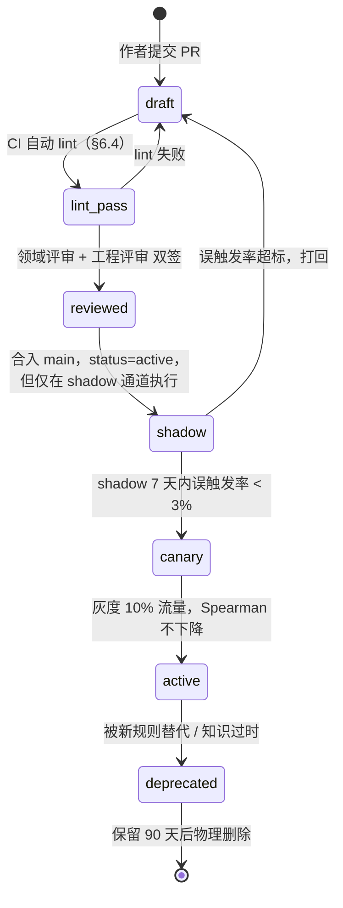

# 03 · 规则引擎与评分（Rule Engine & Scoring）

> 文档编号：03 ｜ 版本：v0.2 ｜ 日期：2026-10-31 ｜ 状态：待评审
> 上游事实源：[`00-baseline.md`](./00-baseline.md)（下称 baseline）。本文**任何**与 baseline 冲突之处，一律以 baseline 为准，冲突裁决见 §1.4 与 §14。
> 关联文档：02（系统架构，描述规则引擎在管线中的位置）、04（API 与数据契约，描述本文全部输出对象的序列化形态）。

---

## 1. 本文档的定位与不变量

### 1.1 只解决三件事

1. **把「一套搭配好不好」变成可复现的算术**：给出 `base_score` 确定性算法（解决 baseline 风险 R-04）与 D1–D5 五个维度的落地公式。
2. **定义规则的机器可执行形态**：DSL 语法、字段字典、执行算法、冲突消解、测试框架、治理流程。
3. **给出首批 50 条真实规则**：可被工程师直接翻译成 JSON 装载进引擎，无需脑补。

### 1.2 产品红线（继承 baseline §4 关键设计约束）

> LLM **不参与打分**，只做解释与润色。所有分数由本文定义的确定性算法产出。

因此本文所有公式必须满足 §1.3 的四条不变量，任何一条被违反即视为实现 bug（不是"效果问题"）。

### 1.3 四条硬不变量（实现验收口径）

| 代号 | 不变量 | 校验方式 |
|---|---|---|
| **INV-1 确定性** | 同一 `(Outfit, StyleProfile, ruleset_version, engine_version)` 必得同一 Report，`total_score` 逐位相等 | 黄金用例回归，两次运行 diff = ∅ |
| **INV-2 加法性** | `total_score = base_score + Σ delta_applied`（含 boost 正值），误差为 0（用整数"厘点"运算，见 §2.4） | 逐条 sum 校验脚本 |
| **INV-3 可追溯** | 每一笔 `|delta| > 0` 都必须有 `rule_id` 或 `feature_key`，且带 `evidence` 与 `suggestion` | baseline §10「扣分可追溯率 100%」 |
| **INV-4 有界性** | `0 ≤ score_d ≤ max_d`，且 `base_d ≤ score_d ≤ max_d` 不可能被单方向突破（见 §2.3 预算机制） | 边界用例：全命中 / 全 boost |
| **INV-5 模板自足性** | 每笔 `delta` 的 `explain_template` 必须在不依赖 LLM、不依赖上下文的条件下**独立成句、可直接出到 UI**（见 §9.7） | 关闭 LLM 通道跑全量回归；39 条 penalty 模板人工盲评可读性 ≥ 4/5 |

### 1.4 与 baseline 的裁决规则

- baseline 未定义的参数（`base_score`、预算、`expected_gain` 算法）→ 本文定稿，写入 §14 供 baseline 回填。
- baseline 已定义的常量（维度权重 20/25/20/20/15、四档 verdict 阈值、三类 severity 语义、`rule_id` 格式 `R-{CATEGORY}-{NNN}`）→ 本文**不改**。
- 本文**收紧**了 baseline §6.3 的"单维度扣分上限为该维度权重"，理由见 §2.3，属"更严格的参数化"，非语义冲突，仍在 §14 记录。

---

## 2. 评分总式

### 2.1 三层结构

```
Layer 1  基准分      base_score      ← 只与「规则集版本」有关，与具体穿搭无关（§3）
Layer 2  规则增量    Σ delta_applied ← 50 条规则的确定性输出（§9）
Layer 3  特征增量    Σ feature_delta ← 3 个连续模型特征的确定性输出（§4.6）
---------------------------------------------------------------------
          total_score = base_score + Σ delta_applied + Σ feature_delta
```

`feature_delta` 在 Report 里**与 rule delta 同级呈现**（用 `feature_key` 而非 `rule_id` 标识），以满足 baseline §5.3 第 1 条"指向一条具名规则**或**一个具名模型特征"。

### 2.2 分维度记法

对每个维度 `d ∈ {D1..D5}`：

```
score_d = base_d + Σ_{hit ∈ hits_d} delta_applied_hit + Σ_{f ∈ feats_d} feature_delta_f
total_score = Σ_d score_d
```

其中 `base_d` 与 `max_d` 的关系为本文核心设计：

| 维度 | max_d | base_d | ρ_d = base_d / max_d | 扣分预算 <br> `budget_pen_d` = base_d | 加分预算 <br> `budget_boost_d` = max_d − base_d |
|---|---|---|---|---|---|
| D1 色彩和谐度 | 20 | **15.60** | 0.78 | 15.60 | 4.40 |
| D2 风格一致性 | 25 | **18.00** | 0.72 | 18.00 | 7.00 |
| D3 身形与比例 | 20 | **13.20** | 0.66 | 13.20 | 6.80 |
| D4 场合适配 | 20 | **13.60** | 0.68 | 13.60 | 6.40 |
| D5 细节完成度 | 15 | **9.60** | 0.64 | 9.60 | 5.40 |
| **合计** | **100** | **70.00** | 0.70 | 70.00 | **30.00** |

**关键恒等式（本文的"预算守恒"）**：

```
base_d + budget_boost_d = max_d          （每维度都成立）
Σ_d base_d               = 70.00         （base_score）
Σ_d budget_boost_d       = 30.00
⇒ 理论最高分 = 70.00 + 30.00 = 100.00     （恰好满分，不多不少）
⇒ 理论最低分 = 70.00 − 70.00 =   0.00     （恰好零分，不多不少）
```

这是选择 `base_d` 数值的**唯一约束**：它必须让"全 boost 无扣分"精确等于 100、"全扣分无 boost"精确等于 0。任何其他取法都会导致满分不可达（区分度丢失）或最低分不可达（严重搭配被系统性高估）。

### 2.3 预算机制（为什么不直接 clamp 到 [0, max_d]）

baseline §6.3 第 3 条写的是"单维度扣分上限为该维度权重"。若照此实现，D1 的扣分上限是 20，但 `base_1 = 15.60`，于是 `15.60 − 20 = −4.40` 会被 clamp 到 0，**加法性 INV-2 被破坏**（`total ≠ base + Σdelta`），baseline §8 的硬约束"`delta` 之和必须等于 `total_score` 的扣减可解释部分"就无法通过脚本校验。

**本文收紧为：单维度扣分预算 = `base_d`，加分预算 = `max_d − base_d`。** 效果：

- 维度最低恰好为 0，最高恰好为 `max_d`，**永不触发 clamp**；
- INV-2 恒成立，无需任何"补偿项"；
- baseline §6.3 想防的"规则叠加把维度打成负数"依然被防住（更强）。

预算不够时的确定性截断算法见 §4.7。

### 2.4 数值表示（可复现的浮点策略）

**所有分值以整数"厘点"（centi-point）为单位存储与计算**，1 分 = 100 厘点。

- 规则 `delta` 在 schema 中写作小数（如 `-8`、`-2.5`），装载时**必须**转成整数厘点（`-800`、`-250`）；转换失败（小数位 > 2）在 lint 阶段直接报错。
- `feature_delta` 由公式产出浮点后，**在写入账本前一次 `round_half_up(·, 2)` 并转厘点**，之后不再引入浮点。
- 所有求和是整数加法，故 `total` 精确可复现，不受求和顺序影响。
- 最终 `total_score` 由厘点整数 `round_half_up(total_centi / 100, 1)` 得到 1 位小数；`score_d` 同样输出 2 位小数。舍入只在**输出边界**发生一次。

> 直接反例（说明为什么必须这样）：若用 float 累加，`18.0 + 4.0 + 2.7 = 24.700000000000003`，两次运行受规则装载顺序影响可能产生不同字符串，违反 INV-1 且让黄金用例无法 diff。

### 2.5 `total_score` 的语义（一句话）

`total_score` 是**"这套搭配对你而言的适配度"**，不是"这套搭配的绝对审美水平"。它服从 `base_score` 的中性先验（70），由规则扣掉具体缺陷、由 boost 奖励具体亮点。所以：

- **0 分** = 规则集能识别的缺陷全部踩满，且无任何亮点；
- **100 分** = 全部 boost 命中且无任何缺陷，这是"完全贴合你的高分搭配"；
- **70 分** = 一套干净、体面、和你风格不冲突、但没有任何亮点的普通搭配（这正是"普通"该得的分，见 §3.2）。

---

## 3. `base_score` 确定性算法（解决 baseline 风险 R-04）

### 3.1 结论先行

```
base_score := 70.00                     （常量，随 ruleset_version 冻结）
base_d     := max_d × ρ_d               （常量表，见 §2.2）
```

**`base_score` 不依赖输入。** 它只依赖 `ruleset_version`。同一 ruleset 下，任何穿搭、任何用户、任何时间的 `base_score` 都是 `70.00`。

> 这是本文对 lead 提问「每种搭配类型/完整度的基准分怎么算」的**明确回答**：不按类型算，因为它**不允许**按类型算。理由见 §3.3；若评审坚持要输入相关基准分，正确的落点是 §3.4 列出的三个替代机制（且其中两个已被本文采用），不是改 `base_score`。

### 3.2 为什么普通搭配的基准分是 70，而不是 0 或 100

**不是 0：**

1. **规则集只做"缺陷检测"，不做"品质证明"。** 一条规则命中 = 发现一个可命名的缺陷。没命中 ≠ 好，只 = "在 50 条规则的探测面上没发现缺陷"。把这种"未发现缺陷"记为 0，等价于"未经举证即判有罪"，与 baseline §1「分数能被解释、能被追溯、能被反驳」直接矛盾——0 分无法指向任何一条具名规则。
2. **有界性要求能踩到 0。** 由 §2.2 的预算守恒，`70 − 70 = 0` 恰好可达。若 `base = 0`，则任何搭配都在 0 附近，verdict 四档失去区分度。
3. **0 分必须留给真正的极端。** 一个大量 hard 规则触发 + 多个 soft 叠加的搭配才是 0 分候选；把"普通"定到 0 会让极端失效。

**不是 100：**

1. **满分必须是荣誉。** `base = 70` 意味着要到 `≥80`（强烈推荐）必须先赚到 `net +10`，即"扣分 ≤ 加分 − 10"。这强制"强烈推荐"只在有**具体亮点**时给出，符合产品定位（baseline §1 差异化是"给建议"，不是"给高分"）。
2. **规则集的 boost 数量有限（本文 50 条中含 **11** 条 boost，`delta` 合计 38 分，而加分容量只有 30 分）。** 若 `base = 100`，boost 无处可加，且任何 soft 扣分都直接把普通搭配踢出"强烈推荐"，区分度反向崩塌。
3. **有界性要求能踩到 100。** 由预算守恒，全 boost = 100 精确可达（算例 C 展示了 99.0，差 1 分的部分被截断，见 §5.3）。

**为什么是 70 这个具体数字：**

- 输出侧：70 落在 baseline §5.2 `适合` 区间 `[65, 79]` 内，且接近区间下沿。语义是"一套无可指摘但无亮点的搭配 = 适合，但不值得强烈推荐"，这正是产品想传达的判断。
- 结构侧：`70 = 100 × 0.70`，而 0.70 是 5 个维度的中性通过率先验的加权平均（§2.2 的 ρ 表）。ρ 表本身有领域含义（见下），不是凑出来的。

**ρ_d 的领域含义（先验的方向性必须先讲得通，再用数据校准）：**

| 维度 | ρ_d | 领域理由 |
|---|---|---|
| D1 色彩 | 0.78（最高） | 日常穿搭最常见的做法就是"黑白灰 + 一个彩色"或同色系，色彩和谐是普通人**最容易无意中达成**的维度；且色彩是最容易判定的（HSV 可测），先验可以给高。 |
| D2 风格 | 0.72 | 大多数人有稳定但未成体系的口味，命中 top-1 风格的概率较高；但"和**你**像"比"整体不难看"更难达成，故低于 D1。 |
| D4 场合 | 0.68 | 人通常按场合穿衣（否则不会出门），但规则集对"正式度精确匹配"较严格，故略低于 D2。 |
| D3 比例 | 0.66 | 比例是日常穿搭**最高频**的失分点（上长下长、五五分、全身宽松）。 |
| D5 细节 | 0.64（最低） | 配饰/材质呼应/收口是绝大多数人**不做**的事，且 VLM 对该维度识别置信度最低（baseline §5.1「为什么 D5 最低」）。低先验 + 低权重共同抑制高噪声维度的误差放大。 |

> **校准纪律**：ρ 表是 ruleset 的冻结常量，**不是**在线学习参数。每次调整必须走 §12 治理流程、升 `ruleset_version`、并用 baseline P0-8 的 20 套人工标注重跑 Spearman。禁止按用户反馈在线更新 ρ——那会立刻破坏 INV-1。

### 3.3 为什么 `base_score` 绝不能依赖穿搭类型或完整度（这是关键论证）

设 `base(outfit)` 是输入相关函数，则 `total = base(o) + Σδ`。考虑两套搭配 `o₁`（2 件：连衣裙 + 鞋）与 `o₂`（6 件：上装 + 下装 + 外套 + 鞋 + 包 + 配饰），二者命中**完全相同**的两条 soft 规则（各 −4）。若 `base(o₁) = 66`、`base(o₂) = 72`：

1. **同一缺陷的价格不同。** 用户会看到"同样两个问题，我这套少扣 6 分"，无法解释，直接摧毁可信度。
2. **跨套排序失效。** 报告的核心用途之一是"我今天穿 A 还是 B"的比较。输入相关 base 会让比较不再可比——这恰恰是 baseline §7.3 用双塔建立"度量空间"要解决的问题，不能在这里被打破。
3. **`expected_gain` 不可加。** baseline §8 要求 `suggestions.expected_gain` 能与 `dimension_scores` 对齐。输入相关 base 下，改动一件衣服会同时改变 base，`expected_gain` 不再等于被清除 delta 的相反数，建议的可信度崩掉。
4. **可审计性失效。** 审计员需要能独立手算复核。常量 base 让"手算 = 引擎输出"成为可能（§5 三个算例）；输入相关 base 会引入一张必须同步维护的 `base × archetype` 表，任何漂移都不可见。

### 3.4 那"完整度/不确定性"去哪了？（三个正确落点）

| 需求 | 本文的落点 | 是否已在 50 条规则 / 公式中生效 |
|---|---|---|
| 输入缺件（如正式场合无外套） | **规则**（如 `R-OCC-007` 正式场合缺外套层次 −2）。缺件是**缺陷**，不是"基准不同"。 | ✅ |
| VLM 解析不出（如颜色 unknown） | **规则门控 + `assessability`**：字段不可用的规则不执行（不误罚），维度保持中性分，`confidence` 下降，`parse_warnings` 记录。baseline R-01 的降级要求。 | ✅（§4.8） |
| 画像样本不足（n_ref < 3） | **D2 特征增量按 `profile_coverage = min(1, n_ref/3)` 缩放**，即"我们没把握，就不敢把 D2 拉离中性太远"。这就是 baseline R-05 想要的"降低 D2 影响"，且不破坏固定权重（§4.6.1）。 | ✅ |

三者的共同点：**它们改变的是"证据强度"，不是"起评分"。** 证据强度用规则的执行门控与特征的缩放表达；起评分保持常量，评分体系才可审计。

### 3.5 算例：一套零命中的搭配得多少分

| 维度 | base_d | 规则命中 | feature delta | score_d |
|---|---|---|---|---|
| D1 | 15.60 | — | — | 15.60 |
| D2 | 18.00 | — | 0.00（cosine 0.60 恰在阈值） | 18.00 |
| D3 | 13.20 | — | 0.00（visual_center_offset = 0.10 恰在阈值） | 13.20 |
| D4 | 13.60 | — | 0.00（occasion_fit_prob 0.55 恰在阈值） | 13.60 |
| D5 | 9.60 | — | — | 9.60 |
| **Σ** | **70.00** | 0 | 0.00 | **70.00** |

`total_score = 70.0` → verdict `适合`。语义："干净、体面、无亮点"。这就是基准分的可手算定义。

---

## 4. 维度得分公式（D1–D5）

### 4.1 总则

`score_d = base_d + Σ delta_applied（本维度规则） + Σ feature_delta（本维度特征）`，结果**天然**落在 `[0, max_d]`（由 §2.3 预算保证，不需要 clamp）。

### 4.2 哪些维度引入 feature delta（设计原则）

**原则：只有在存在"真正连续、无法被离散规则枚举"的模型输出时，才引入 feature delta；能用离散规则表达的，一律全规则化。** 理由：连续特征一旦与规则覆盖同一现象，就会双重计数，且带来不可解释的模糊扣分（违反 INV-3）。

| 维度 | 是否用 feature delta | 理由 |
|---|---|---|
| D1 色彩 | ❌ 纯规则 | 色彩和谐知识是可枚举的离散知识（撞色/色不过三/冷暖/呼应），已由 12 条规则覆盖。连续色彩特征会与规则重叠。 |
| D2 风格 | ✅ `feat.style_cosine` | 双塔 cosine 是 baseline §7.3 明确要求的 D2 输入特征，且它是 256 维空间的连续距离，无法离散化。 |
| D3 比例 | ✅ `feat.visual_center_offset` | 视觉重心高度由图像关键点回归得出，是连续量；规则只能覆盖"五五分""上长下长"等离散条件。 |
| D4 场合 | ✅ `feat.occasion_fit_prob` | 场合分类器输出的概率是连续量，50 条规则只能覆盖离散的正式度边界。 |
| D5 细节 | ❌ 纯规则 | 细节是可枚举清单（配饰数量、材质家族、收口三点），适合规则化。 |

> `ruleset_version = rs-2026.10.1` 激活的特征项恰好 3 个，容量预算充足（D2 特征上限 6.00 ≤ 7.00，D3 上限 3.00 ≤ 6.80，D4 上限 4.00 ≤ 6.40），不会出现"特征挤占规则加分"的隐形耦合。

### 4.3 D1 色彩和谐度

```
score_D1 = 15.60 + Σ_{hit ∈ D1} delta_applied
```

- `delta_applied` 为该维度内 12 条规则（1 条 hard + 9 条 soft + 2 条 boost，见 §9.1）经 §4.7 预算截断后的实际生效值。
- 无 feature delta。
- 扣分预算 15.60，加分预算 4.40。

### 4.4 D2 风格一致性

```
score_D2 = 18.00 + Σ_{hit ∈ D2} delta_applied + feat_style_cosine
```

#### 4.4.1 `feat.style_cosine` 公式

输入：`c = derived.cosine_uv ∈ [-1, 1]`（`cosine(u, v)`，u = 用户画像向量，v = 搭配向量，均 L2 归一化，见 02 号文档 §6）。

```
coverage = min(1.0, profile.reference_count / 3)        # baseline R-05 的证据强度折减
if c >= 0.60:
    raw = 6.00 * (c - 0.60) / 0.40                       # c=1.00 → +6.00
else:
    raw = 6.00 * (c - 0.60) / 0.60                       # c=0.00 → -6.00，下限 -6.00
feat_style_cosine = round_half_up(raw * coverage, 2)
```

性质：
- `c = 0.60` 是**中性点**（得 0），对应"画像与搭配刚好达到可接受相似度"。
- 上下分支斜率不同（上行 15.00/单位，下行 10.00/单位），刻意让"低于中性"的惩罚比"高于中性"的奖励更陡——风格冲突比风格契合更值得扣分。
- `n_ref = 1` 时 `coverage = 0.333`，特征影响被压缩到 1/3，即 baseline R-05 要求的"画像不可靠时降低 D2 影响"，且**不动权重 25**。

#### 4.4.2 D2 的其余输入
- 10 条规则（§9.2）的 `delta_applied`。
- `profile_coverage` 只作用于 `feat_style_cosine`，**不作用**于规则 delta（规则命中是"这套搭配自身"的事实，与画像样本量无关，除 `R-STYLE-001/002/008` 等本就依赖 profile 的规则——它们由规则门控处理）。

### 4.5 D3 身形与比例

```
score_D3 = 13.20 + Σ_{hit ∈ D3} delta_applied + feat_visual_center_offset
```

#### 4.5.1 `feat.visual_center_offset` 公式

输入：`y = outfit.structure.visual_center_y ∈ [0,1]`（图像坐标系，0 = 画面顶端，1 = 画面底端，即人的头顶到脚底归一化后的视觉重心高度）。

```
off = abs(y - 0.50)
if off <= 0.10:
    raw = 3.00 * (0.10 - off) / 0.10                     # off=0 → +3.00；off=0.10 → 0.00
else:
    raw = -3.00 * (off - 0.10) / 0.20                    # off=0.30 → -3.00（下限）
feat_visual_center_offset = round_half_up(raw, 2)
```

- 中性点 `off = 0.10`：视觉重心与画面中线偏差 10% 以内视为正常。
- 重心过低（off 偏大，即 `y` 远离 0.50）通常是"上长下长"的可测量表现，与 D3 的离散规则互补（规则判"形态"，特征判"幅度"）。
- 该特征无 coverage 缩放（由图像关键点直接得出，与画像无关）。

### 4.6 D4 场合适配

```
score_D4 = 13.60 + Σ_{hit ∈ D4} delta_applied + feat_occasion_fit_prob
```

#### 4.6.1 `feat.occasion_fit_prob` 公式

输入：`p = derived.occasion_fit_prob ∈ [0,1]`（场合分类器对 `P(该搭配适合声明场合)` 的输出）。

```
if p >= 0.55:
    raw = 4.00 * (p - 0.55) / 0.45                       # p=1.00 → +4.00
else:
    raw = 4.00 * (p - 0.55) / 0.55                       # p=0.00 → -4.00
feat_occasion_fit_prob = round_half_up(raw, 2)
```

- 中性点 `p = 0.55`（略高于 0.5，因为分类器输出分布偏保守）。
- 若 `outfit.occasion == unspecified`：**该特征不计算，D4 所有规则不执行**，`score_D4 = 13.60`（保持中性），`dimension_scores[].assessability.D4 = 0.0`，`parse_warnings += ["OCCASION_UNSPECIFIED"]`，`confidence` 按 §4.9 下降。**不惩罚用户"没说场合"。**

### 4.7 预算截断算法（determinism 的关键）

同维度内多笔 delta 竞争有限预算时，按**固定优先级**消耗预算。优先级必须全局确定、不依赖装载顺序：

```
排序键 = ( -abs(delta_schema), rule_id )        # 绝对值大的先，同绝对值按 rule_id 字典序
```

- **penalty 与 boost 分开两个池**（`budget_pen_d` / `budget_boost_d`），互不挪用。
- 顺序消耗：`remaining = budget`；对每笔 `δ`：
  - 若 `abs(δ) <= remaining`：`delta_applied = δ`，`remaining -= abs(δ)`，`clipped = false`；
  - 否则：`delta_applied = sign(δ) * remaining`，`clipped = true`，`remaining = 0`（此后所有同类 delta 全部 `delta_applied = 0` 且 `clipped = true`）。
- `delta_applied` 保留 2 位小数（厘点整数运算，见 §2.4）。
- Report 中必须暴露 `delta_schema`（原始值）、`delta_applied`（生效值）、`clipped`（是否被截断）。**这是 INV-2 可校验的前提，也是诚实性要求**：用户看到的是"这条规则本应扣 8 分，但该维度扣分额度已用完，实际扣 1.6"。

> 为什么不按 `delta` 归一化缩放（proportional scaling）：缩放会让每一个 delta 都变成非整数（如 −8 × 0.2 = −1.6 恰好整数是巧合），破坏"手算"与"逐条可解释"。截断保证每一笔生效值要么等于原值、要么等于一个干净的余量，且只有**一笔**被部分截断。

### 4.8 规则执行门控（`assessability`）

规则执行前对每条规则做**证据可用性检查**：

```
can_evaluate(rule) := 该规则 condition + evidence_fields 引用的每个字段都满足：
    field.present == true
    且 field.confidence >= field.threshold           # 阈值见 §7 字段字典的 conf_thr 列
```

- `can_evaluate == false` → 该规则**不执行**，不计入 `rule_hits`，而计入 `skipped_rules`（含原因 `MISSING_FIELD` / `LOW_CONFIDENCE`）。
- 维度 `assessability_d = 可执行规则中被门控允许的数量 / 该维度应有规则数量`（`hard`+`soft`+`boost` 全计）。
- **不执行 ≠ 算通过**：维度分保持中性 `base_d`，不因缺证据而奖分，也不因缺证据而扣分；不确定性统一由 `confidence` 表达（§4.9）。

### 4.9 `confidence`（报告置信度）

```
C_parse   = mean(g.confidence for g in outfit.garments) × slot_coverage
slot_coverage = |已识别的必需 slot 数| / |该搭配类型应有的 slot 数|     # 见 04 号文档 §5.3
C_profile = min(1.0, profile.reference_count / 3)
C_rules   = 1 - (skipped_rules 数 / 可执行域规则总数)

confidence = round_half_up(0.50*C_parse + 0.30*C_profile + 0.20*C_rules, 2)
```

- 权重 0.50/0.30/0.20 体现"分数主要依赖解析质量"。
- `confidence < 0.55` 时 Report 必须额外输出 `meta.degraded = true` 与 `parse_warnings` 中的降级原因（baseline R-01 的降级要求）。
- `confidence` **不参与** `total_score` 计算（否则破坏 INV-2 的加法账本），只作为并列的独立信号输出。

### 4.10 维度公式一览（工程实现速查）

| 维度 | 公式 | 特征 | 扣分预算 | 加分预算 |
|---|---|---|---|---|
| D1 | `15.60 + Σδ` | — | 15.60 | 4.40 |
| D2 | `18.00 + Σδ + 6.00·f(c)·coverage` | `style_cosine` | 18.00 | 7.00 |
| D3 | `13.20 + Σδ + 3.00·g(off)` | `visual_center_offset` | 13.20 | 6.80 |
| D4 | `13.60 + Σδ + 4.00·h(p)` | `occasion_fit_prob` | 13.60 | 6.40 |
| D5 | `9.60 + Σδ` | — | 9.60 | 5.40 |

---

## 5. 算例（可手算验证）

> 三个算例的 ruleset 均为 `rs-2026.10.1`，`engine_version = re-1.0.0`。所有数字均以 0.01 为单位精确相加，无中间舍入。

### 5.1 算例 A：普通通勤搭配（无 veto，`total = 78.8` → `适合`）

**输入**

| 单品 | slot | 颜色 (hue/sat/L) | 版型 | 材质 | formality |
|---|---|---|---|---|---|
| 白棉质衬衫 | top | 中性白 (—/0.02/0.95) | regular | cotton | 0.65 |
| 藏青直筒西裤 | bottom | (220/0.55/0.25) | straight | wool_blend | 0.70 |
| 黑色乐福鞋 | shoes | 中性黑 (—/0.03/0.12) | regular | leather | 0.75 |
| 黑色托特包 | bag | 中性黑 (—/0.03/0.10) | — | leather | 0.70 |

- `occasion = business`；`is_tucked = false`；`visual_waist_y = 0.50`；`visual_center_y = 0.58`；`accessory_count = 1`；`has_outer = false`
- `profile = { top_styles: ["极简","通勤知性","法式"], reference_count: 4, forbidden_styles: [] }`
- `outfit.style_tags = ["极简","通勤知性"]`；`derived.cosine_uv = 0.70`；`derived.occasion_fit_prob = 0.74`

**规则命中**

| 维度 | rule_id | sev | delta_schema | delta_applied | 触发依据 |
|---|---|---|---|---|---|
| D2 | `R-STYLE-008` | boost | +4.00 | **+4.00** | `style_tags[0] = 极简` 等于 `profile.top_styles[0]` |
| D3 | `R-PROP-004` | soft | −3.00 | **−3.00** | `visual_waist_y = 0.50 ∈ [0.46, 0.54]`（五五分） |
| D4 | `R-OCC-009` | boost | +4.00 | **+4.00** | 4 件 formality ∈ [0.65, 0.75]，均在 `business` 目标 0.70 的 ±0.10 内 |

**特征增量**

| 维度 | feature_key | 计算过程 | 生效值 |
|---|---|---|---|
| D2 | `feat.style_cosine` | `c = 0.70 ≥ 0.60` → `6.00 × (0.70 − 0.60) / 0.40 × min(1, 4/3)` = `6.00 × 0.25 × 1.00` | **+1.50** |
| D3 | `feat.visual_center_offset` | `off = abs(0.58 − 0.50) = 0.08 ≤ 0.10` → `3.00 × (0.10 − 0.08) / 0.10` = `3.00 × 0.20` | **+0.60** |
| D4 | `feat.occasion_fit_prob` | `p = 0.74 ≥ 0.55` → `4.00 × (0.74 − 0.55) / 0.45` = `4.00 × 0.42222` = 1.68889 → round(·,2) | **+1.69** |

**预算核对**（无截断，全部 `clipped = false`）

| 维度 | 扣分预算 | 已用扣分 | 加分预算 | 规则加分 | 特征加分 | 加分余量 |
|---|---|---|---|---|---|---|
| D1 | 15.60 | 0.00 | 4.40 | 0.00 | — | 4.40 |
| D2 | 18.00 | 0.00 | 7.00 | 4.00 | 1.50 | 1.50 |
| D3 | 13.20 | 3.00 | 6.80 | 0.00 | 0.60 | 6.20 |
| D4 | 13.60 | 0.00 | 6.40 | 4.00 | 1.69 | 0.71 |
| D5 | 9.60 | 0.00 | 5.40 | 0.00 | — | 5.40 |

**维度分账本（厘点整数）**

| 维度 | base_d | 规则笔 | 特征笔 | score_d（厘点） | score_d（分） |
|---|---|---|---|---|---|
| D1 | 1560 | 0 | — | 1560 | 15.60 |
| D2 | 1800 | +400 | +150 | 2350 | 23.50 |
| D3 | 1320 | −300 | +60 | 1080 | 10.80 |
| D4 | 1360 | +400 | +169 | 1929 | 19.29 |
| D5 | 960 | 0 | — | 960 | 9.60 |
| **Σ** | **7000** | **+500** | **+379** | **7879** | **78.79** |

**INV-2 校验**：`7000 + 500 + 379 = 7879` ✅ 即 `70.00 + 5.00 + 3.79 = 78.79`。

**输出**

- `total_score = round_half_up(78.79, 1) = 78.8`
- `verdict = suitable`（65–79）；`vetoed = false`
- `confidence = 0.50 × 0.86 + 0.30 × 1.00 + 0.20 × 0.92 = 0.43 + 0.30 + 0.184 = 0.914`
- 建议：`priority 1`，`target = "上装"`，`action = "把衬衫塞入，并把下装换成高腰直筒款，把腰线提到 0.42 以上"`，`reason_rule_ids = ["R-PROP-004"]`，`expected_gain ≈ 7.00`（清掉 −3.00 并新增 `R-PROP-009` +4.00；未计特征项变化）

**读报告的人看到的故事**：风格与画像高度契合（+4.00 +1.50），场合正式度精准（+4.00 +1.69），但腰线落在 0.50 形成五五分（−3.00），把分数从 80 档拉到 78.8。

---

### 5.2 算例 B：撞色 + 场合错配（hard veto，`total = 43.0` → `不适合`）

**输入**

| 单品 | slot | 颜色 (hue/sat/L) | 版型 | 材质 | formality |
|---|---|---|---|---|---|
| 玫红短袖 | top | (330/0.90/0.50) | regular | cotton | 0.15 |
| 亮绿工装裤 | bottom | (128/0.88/0.45) | loose | cotton | 0.20 |
| 白色运动鞋 | shoes | 中性白 (—/0.02/0.94) | regular | synthetic | 0.10 |

- `occasion = date`；`accessory_count = 0`；`has_outer = false`；`visual_waist_y = 0.48`；`visual_center_y = 0.52`
- `profile = { top_styles: ["极简","通勤知性","法式"], reference_count: 5 }`
- `outfit.style_tags = ["甜美","运动休闲"]`；`derived.cosine_uv = 0.41`；`derived.occasion_fit_prob = 0.31`

**派生量**：`hue_span = min(|330 − 128|, 360 − 202) = 158°`；`max_saturation = 0.90`；`n_main_colors = 3`（玫红 / 亮绿 / 白，其中白为中性）；`has_neutral_anchor = true`（白鞋）。

**规则命中**

| 维度 | rule_id | sev | delta_schema | delta_applied | 触发依据 |
|---|---|---|---|---|---|
| D1 | `R-COLOR-001` | **hard** | −7.80 | **−7.80** | `hue_span 158 > 120` 且 `max_sat 0.90 > 0.85` → veto |
| D2 | `R-STYLE-002` | soft | −5.00 | **−5.00** | `{甜美, 运动休闲} ∩ {极简, 通勤知性, 法式} = ∅` |
| D2 | `R-STYLE-005` | soft | −3.00 | **−3.00** | `cosine 0.41 < 0.55` |
| D4 | `R-OCC-003` | soft | −4.00 | **−4.00** | `formality_gap = 0.15 − 0.45 = −0.30 < −0.20` |
| D4 | `R-OCC-006` | soft | −3.00 | **−3.00** | `occasion = date` 且命中运动鞋 |
| D5 | `R-DET-002` | soft | −3.00 | **−3.00** | `accessory_count = 0` 且场合为 `date` |

**特征增量**

| 维度 | 计算过程 | 生效值 |
|---|---|---|
| D2 | `c = 0.41 < 0.60` → `6.00 × (0.41 − 0.60) / 0.60 × min(1, 5/3)` = `6.00 × (−0.31667) × 1.00` | **−1.90** |
| D3 | `off = abs(0.52 − 0.50) = 0.02` → `3.00 × (0.10 − 0.02) / 0.10` | **+2.40** |
| D4 | `p = 0.31 < 0.55` → `4.00 × (0.31 − 0.55) / 0.55` = `4.00 × (−0.43636)` = −1.74545 → round(·,2) | **−1.75** |

**维度分账本（厘点整数）**

| 维度 | base_d | 规则笔 | 特征笔 | score_d（厘点） | score_d（分） |
|---|---|---|---|---|---|
| D1 | 1560 | −780 | — | 780 | 7.80 |
| D2 | 1800 | −500 −300 | −190 | 810 | 8.10 |
| D3 | 1320 | 0 | +240 | 1560 | 15.60 |
| D4 | 1360 | −400 −300 | −175 | 485 | 4.85 |
| D5 | 960 | −300 | — | 660 | 6.60 |
| **Σ** | **7000** | **−2580** | **−125** | **4295** | **42.95** |

**INV-2 校验**：`7000 − 2580 − 125 = 4295` ✅ 即 `70.00 − 25.80 − 1.25 = 42.95`。

**输出**

- `total_score = round_half_up(42.95, 1) = 43.0`
- `vetoed = true`；`veto_reasons = [{ rule_id: "R-COLOR-001", ... }]`；`verdict = unsuitable`（baseline §5.2：任一 hard 触发即降为「不适合」，`total_score` 仍照算）
- 建议：`priority 1`，`target = "上装/下装中面积较小者"`，`action = "把亮绿工装裤换成藏青直筒西裤，把色相跨度从 158° 收到 90° 以内"`

> **注意**：D3 因视觉重心良好而得 **15.60**（base 13.20 + 特征 2.40），是本文唯一高于 `base_d` 的维度。这说明正向特征可以与 veto 共存——报告必须允许"这套除了撞色，比例其实不错"这种表达，否则可解释性只剩单向的指责。

---

### 5.3 算例 C：高分通勤（演示预算截断，`total = 99.0` → `强烈推荐`）

**输入**

| 单品 | slot | 颜色 (hue/sat/L) | 版型 / 长度 | 材质家族 | style_tags | formality |
|---|---|---|---|---|---|---|
| 米白丝质衬衫 | top | 中性米白 (—/0.06/0.93) | regular / regular | silk | 通勤知性, 极简 | 0.62 |
| 燕麦高腰阔腿裤 | bottom | (35/0.18/0.72) | loose / long | wool | 通勤知性, 极简 | 0.66 |
| 驼色羊毛大衣 | outer | (32/0.42/0.58) | regular / long | wool | 通勤知性, 法式 | 0.72 |
| 棕色乐福鞋 | shoes | (28/0.50/0.32) | regular | leather | 通勤知性 | 0.70 |
| 焦糖色手袋 | bag | (30/0.45/0.42) | — | leather | 通勤知性 | 0.68 |
| 金色耳饰 | accessory | 金属 | — | metal | 极简 | 0.60 |

- `occasion = business`；`is_tucked = true`；`visual_waist_y = 0.40`；`visual_center_y = 0.46`；`accessory_count = 1`；`has_outer = true`
- `profile = { top_styles: ["通勤知性","极简","法式"], reference_count: 5 }`
- `outfit.style_tags = ["通勤知性","极简"]`；`derived.cosine_uv = 0.71`；`derived.occasion_fit_prob = 0.88`

**规则命中（含截断）**

| 维度 | rule_id | sev | delta_schema | delta_applied | clipped | 截断原因 |
|---|---|---|---|---|---|---|
| D1 | `R-COLOR-012` | boost | +4.00 | **+4.00** | 否 | 驼 / 棕 / 燕麦同属 warm-neutral 家族，L 0.93→0.72→0.58→0.32 单调递进；预算 4.40 余 0.40 |
| D1 | `R-COLOR-011` | boost | +3.00 | **+0.40** | **是** | `bottom.hue 35` 与 `bag.hue 30` 差 5° < 25°；预算仅余 0.40 |
| D2 | `R-STYLE-008` | boost | +4.00 | **+4.00** | 否 | `style_tags[0] = 通勤知性` 等于 `top_styles[0]`；预算 7.00 余 3.00 |
| D2 | `R-STYLE-010` | boost | +3.00 | **+3.00** | 否 | 5 件单品同属「通勤知性」且与 top3 有交集；预算耗尽 |
| D3 | `R-PROP-009` | boost | +4.00 | **+4.00** | 否 | 衬衫塞入 + 高腰 + `visual_waist_y 0.40 ≤ 0.42`；预算 6.80 余 2.80 |
| D4 | `R-OCC-009` | boost | +4.00 | **+4.00** | 否 | 6 件 formality ∈ [0.60, 0.72]，均在 business 0.70 ± 0.10 内；预算 6.40 余 2.40 |
| D5 | `R-DET-008` | boost | +4.00 | **+4.00** | 否 | 鞋 + 包 + 金属配饰齐备且同为暖棕系；预算 5.40 余 1.40 |
| D5 | `R-DET-007` | boost | +3.00 | **+1.40** | **是** | 大衣与阔腿裤同 `material_family = wool`；预算仅余 1.40 |

排序依据 §4.7：先按 `abs(delta)` 降序（所有 +4.00 先于 +3.00），同绝对值内按 `rule_id` 字典序（`R-COLOR-012` 先于 `R-COLOR-011`，`R-DET-008` 先于 `R-DET-007`）。

**特征增量（2 项被预算截断）**

| 维度 | 计算过程 | 原始值 | 生效值 | clipped |
|---|---|---|---|---|
| D2 | `6.00 × (0.71 − 0.60) / 0.40 × 1.0` = 1.65 | +1.65 | **0.00** | 是（7.00 已被规则加分用尽） |
| D3 | `off = abs(0.46 − 0.50) = 0.04` → `3.00 × (0.10 − 0.04) / 0.10` = 1.80 | +1.80 | **+1.80** | 否（余 2.80） |
| D4 | `4.00 × (0.88 − 0.55) / 0.45` = 2.93333 → round(·,2) = 2.93 | +2.93 | **+2.40** | 是（余 2.40） |

**维度分账本（厘点整数）**

| 维度 | base_d | 规则笔 | 特征笔 | score_d（厘点） | score_d（分） | 是否触顶 |
|---|---|---|---|---|---|---|
| D1 | 1560 | +400 +40 = +440 | — | 2000 | 20.00 | ✅ max 20.00 |
| D2 | 1800 | +400 +300 = +700 | +0 | 2500 | 25.00 | ✅ max 25.00 |
| D3 | 1320 | +400 | +180 | 1900 | 19.00 | 否（离上限差 1.00） |
| D4 | 1360 | +400 | +240 | 2000 | 20.00 | ✅ max 20.00 |
| D5 | 960 | +400 +140 = +540 | — | 1500 | 15.00 | ✅ max 15.00 |
| **Σ** | **7000** | **+2480** | **+420** | **9900** | **99.00** | — |

**INV-2 校验**：`7000 + 2480 + 420 = 9900` ✅ 即 `70.00 + 24.80 + 4.20 = 99.00`。

**被丢弃的分数（诚实性指标）**

| 项 | 原始 | 生效 | 丢弃 |
|---|---|---|---|
| `R-COLOR-011` | +3.00 | +0.40 | 2.60 |
| `feat.style_cosine` | +1.65 | 0.00 | 1.65 |
| `feat.occasion_fit_prob` | +2.93 | +2.40 | 0.53 |
| `R-DET-007` | +3.00 | +1.40 | 1.60 |
| **合计丢弃** | | | **6.38** |

若无截断，本套理论得分应为 `99.00 + 6.38 = 105.38`，超过满分。这是**有价值的负结论**：`rs-2026.10.1` 的 **11 条 boost 的 `delta` 合计 38 分，而加分总容量只有 30 分**，意味着一件优秀的通勤搭配必然触发截断——即"规则集在高端区分度不足"。该问题已量化并列入 §12.4 的 S2 扩容计划（推荐解法：`base_score` 从 70 下调至 62，把加分容量从 30 提到 38，代价是必须重跑标注集校准）。

**输出**：`total_score = 99.0`；`verdict = strongly_recommended`；`vetoed = false`；`confidence = 0.50 × 0.91 + 0.30 × 1.00 + 0.20 × 0.96 = 0.455 + 0.30 + 0.192 = 0.947 → 0.95`。

---


## 6. 规则 DSL 完整语法

### 6.1 顶层结构

```jsonc
{
  "rule_id": "R-COLOR-001",           // 必填，正则 ^R-(COLOR|STYLE|PROP|OCC|DET)-\d{3}$，全局唯一且不可复用
                                   // 分类段用短码（PROP/OCC/DET），与 category 全称经 CATEGORY_SHORT 绑定（见 04 号文档 B-26）
  "version": 1,                        // 必填，整数 ≥ 1，规则内容任一字段变更即 +1
  "category": "COLOR",                 // 必填，枚举（全称）；须与 rule_id 分类段短码经 CATEGORY_SHORT 映射后一致
  "title": "高饱和互补撞色",            // 必填，≤ 20 汉字
  "severity": "hard",                  // 必填，hard | soft | boost
  "scope": "cross_garment",            // 必填，outfit | garment | cross_garment
  "condition": { ... },                // 必填，见 §6.2
  "effect": { "type": "veto" },        // 必填，veto | penalty | bonus；须与 severity 一致（§6.5）
  "score_impact": { "dimension": "D1", "delta": -7.8 },  // 必填，delta 为 0.01 的整数倍，见 §6.6
  "explain_template": "上装与下装色相跨度达 {hue_span}°，且含饱和度 {max_saturation} 的高饱和色，视觉冲突明显。",
  "evidence_fields": ["outfit.colors.hue_span", "outfit.colors.max_saturation"],
  "suggestion_template": "将其中一件单品换成中性色（米白 / 藏青 / 燕麦），把色相跨度压到 90° 以内。",
  "suppresses": [],                    // 可选，本规则命中时压制哪些 rule_id（§10）
  "mutex_group": null,                 // 可选，互斥组名，同组内最多一条生效（§10）
  "source": "domain_expert",           // 必填，domain_expert | paper | reverse_engineered | learned
  "status": "active",                  // 必填，draft | active | deprecated
  "status_changed_at": "2026-10-31T00:00:00+08:00",
  "introduced_in": "rs-2026.10.1",     // 首次生效的 ruleset_version
  "deprecated_in": null,
  "test_cases": [ ... ]                // 必填，至少 1 正 1 负，见 §11
}
```

### 6.2 条件（condition）语法

条件是一棵递归结构，节点类型三类：**谓词（predicate）**、**逻辑（logical）**、**量词（quantifier）**。

#### 6.2.1 谓词节点

```jsonc
// 形式 1：字段 vs 字面量
{ "field": "outfit.colors.hue_span", "op": "gt", "value": 120 }

// 形式 2：字段 vs 字段（用于"两件单品之间"的比较）
{ "field": "garment.top.color.hue", "op": "hue_dist_gt",
  "value_field": "garment.bottom.color.hue", "value": 120 }

// 形式 3：字段集合运算
{ "field": "outfit.style_tags", "op": "intersects", "value": ["运动休闲"] }

// 形式 4：存在性
{ "field": "garment.outer", "op": "is_absent" }
{ "field": "garment.shoes.color.hue", "op": "exists" }
```

#### 6.2.2 op 全集（**封闭集合**，新增 op 必须升 DSL 次版本）

| op | 适用类型 | 语义 |
|---|---|---|
| `eq` / `neq` | 任意标量 | 相等 / 不等（字符串精确匹配，大小写敏感） |
| `gt` / `gte` / `lt` / `lte` | number | 数值比较 |
| `between` | number | 闭区间，`value: [min, max]` |
| `abs_gte` | number | `abs(field − value) ≥ 阈值` |
| `abs_diff_gt` / `abs_diff_lt` | number（双字段） | `abs(field − value_field) > / < 阈值`；用于"两件单品之间的差值" |
| `hue_dist_gt` | number(deg) | 环形色相差 `≥` 阈值：`min(|a−b|, 360−|a−b|) > 阈值` |
| `hue_dist_lt` | number(deg) | 环形色相差 `<` 阈值 |
| `in` / `not_in` | 标量 | 枚举成员判断 |
| `intersects` / `disjoint` | set | 列表字段与给定集合有交集 / 无交集 |
| `contains_all` / `contains_any` | set | 子集 / 非空交集（语义等价声明，便于审查） |
| `count_gte` / `count_lte` / `count_eq` | set | 列表长度比较 |
| `exists` / `is_null` / `is_absent` | 任意 | `is_absent` 专用于 slot：`present == false` |
| `is_true` / `is_false` | bool | 布尔判断 |
| `pattern_eq` | string | 枚举精确匹配（用于 pattern/material_family 等受控词表） |

> **禁止**在 DSL 中出现正则、脚本、外部函数调用。DSL 必须是纯声明式、可在 200 行内实现求值器、可被静态分析器求值域（§12.3 的冲突检测依赖此性质）。

#### 6.2.3 逻辑节点

```jsonc
{ "all": [ <node>, <node>, ... ] }     // 与，短路求值（左→右）
{ "any": [ <node>, <node>, ... ] }     // 或，短路求值
{ "not": <node> }
```

#### 6.2.4 量词节点（跨单品规则必需）

```jsonc
// "至少 N 件单品满足 where"
{
  "count": { "over": "outfit.garments", "where": <node>, "op": "gte", "value": 2 }
}
// "全部单品满足 where"
{ "for_all": { "over": "outfit.garments", "where": <node> } }
// "存在一件满足 where"
{ "any_garment": { "over": "outfit.garments", "where": <node> } }
```

`where` 内部可用 `g.` 前缀引用当前单品，如 `{ "field": "g.formality", "op": "lt", "value": 0.3 }`。

#### 6.2.5 求值确定性与可计算性约束

- `over` 只能取 `outfit.garments`（全集）或 `outfit.garments[slot=X]`（某 slot 全部单品）。
- 集合型字段求值前**必须排序**（字典序），保证 `intersects` 等的结果不依赖解析顺序。
- 浮点比较用**厘点整数**或 `round_half_up(x, 4)` 后比较，避免 `0.1+0.2` 类问题（如 `max_saturation > 0.85` 用 `850 > 850` 比较）。

### 6.3 字段路径空间

| 前缀 | 含义 | 可用性 |
|---|---|---|
| `outfit.*` | 整套搭配的派生属性 | 任何 scope |
| `garment.{slot}.*` | 指定 slot 的单品属性（`top/bottom/outer/dress/shoes/bag/accessory`） | scope ∈ {garment, cross_garment, outfit} 均可用，但 `garment` scope 规则只能引用**一个** slot |
| `garment.*` | 在量词 `where` 内引用当前单品（省略 slot） | 仅在量词内 |
| `profile.*` | 用户画像属性 | 仅 `R-STYLE-*` 系列可用（其他分类引用会在 lint 报 `CROSS_CATEGORY_FIELD`） |
| `derived.*` | 模型连续输出（cosine、分类概率等） | 仅在与该特征同维度（D2/D4）的规则中可用 |

### 6.4 类型系统与 lint 规则

| 规则码 | 检查 |
|---|---|
| `DSL_UNKNOWN_FIELD` | 字段不在 §7 字段字典中 |
| `DSL_TYPE_MISMATCH` | op 与字段类型不匹配（如对 list 用 `gt`） |
| `DSL_ENUM_VALUE` | `value` 不在受控词表内 |
| `DSL_CATEGORY_FIELD` | 字段前缀与 `category` 不匹配（防止 R-COLOR 规则去扣 D3） |
| `DSL_DIMENSION_MISMATCH` | `score_impact.dimension` 与 `category` 不一致（COLOR→D1, STYLE→D2, PROPORTION→D3, OCCASION→D4, DETAIL→D5） |
| `DSL_BUDGET_EXCEEDED` | 单条 `abs(delta) > 该维度扣分预算`（不允许单条规则吃满整维度） |
| `DSL_NO_EVIDENCE` | `evidence_fields` 为空或未覆盖 condition 引用的全部字段 |
| `DSL_NO_SUGGESTION` | 非 boost 规则缺 `suggestion_template`（违反 INV-3） |
| `DSL_CATEGORY_SHORTCODE` | `rule_id` 分类段与 `category` 不匹配（短码映射表见 04 号文档 §6.1 的 `CATEGORY_SHORT`） |

### 6.5 severity / effect 一致性

| severity | effect.type | delta 符号 | 说明 |
|---|---|---|---|
| `hard` | `veto` | **负** | 触发即 veto；delta 仍计入账本（baseline §5.2「`total_score` 仍照算」） |
| `soft` | `penalty` | **负** | 扣分 |
| `boost` | `bonus` | **正** | 加分 |

lint 强制：`hard ↔ veto`、`soft ↔ penalty`、`boost ↔ bonus`，不允许交叉。

### 6.6 delta 取值约束

- 必须为 0.01 的整数倍（转厘点后为整数）。
- 单条 `abs(delta)` 上界：`0.5 × 该维度 base_d`（D1 ≤ 7.80, D2 ≤ 9.00, D3 ≤ 6.60, D4 ≤ 6.80, D5 ≤ 4.80）。50 条清单中最大为 `R-STYLE-001 = −10`……→ **违反本约束**，因此 `R-STYLE-001` 的 delta 定为 **−9.00**（= 0.5 × 18.00，恰好取到上界）。已修正，见 §9.2。
- 下界：`abs(delta) ≥ 1.00`（小于 1 分的扣减不可被人感知，且会加速预算耗尽带来的噪声）。

---

## 7. 字段字典（DSL 可引用字段全集）

> `conf_thr` 为 §4.8 门控阈值：字段置信度低于此值时引用该字段的规则被跳过，记 `skipped_rules`。
>
> **本字典的"全集"口径** = §7.1–§7.4 的原始/派生字段 **+ §7.7 的 7 个引擎预计算聚合字段**。两者共同构成规则可引用的封闭字段集；不在其中的字段名会被 `DSL_UNKNOWN_FIELD` 拒绝。

### 7.1 `outfit.*`

| field | 类型 | 值域 | 来源 | conf_thr | 说明 |
|---|---|---|---|---|---|
| `outfit.garment_count` | int | 1–20 | 解析结果 | — | 单品数 |
| `outfit.slot_mask` | int | 0–127 | 解析结果 | — | bit0=top bit1=bottom bit2=outer bit3=dress bit4=shoes bit5=bag bit6=accessory |
| `outfit.occasion` | enum | `business｜formal｜date｜casual｜sport｜party｜travel｜home｜unspecified` | 用户声明（必填） | — | 未声明时为 `unspecified`，D4 全维度降级 |
| `outfit.season` | enum | `spring｜summer｜autumn｜winter｜unknown` | 用户声明/推断 | 0.50 | 影响季节一致性规则 |
| `outfit.formality` | float | 0.00–1.00 | 单品 formality 的面积加权均值 | 0.55 | 整身正式度 |
| `outfit.formality_span` | float | 0.00–1.00 | `max(g.formality) − min(g.formality)` | 0.55 | 正式度跨度 |
| `outfit.style_tags` | list[str] | StyleTag 受控词表 | 单品标签聚合（出现 ≥2 次或面积占比 ≥30%） | 0.50 | 按聚合票数降序、同票按字典序 |
| `outfit.style_tag_jaccard_min` | float | 0.00–1.00 | 单品两两 style_tags 的 Jaccard 最小值 | 0.50 | 风格同源性 |
| `outfit.colors.main_colors` | list[str] | 颜色家族名 | 聚类后按面积降序 | 0.60 | 同一家族定义见 §7.5 |
| `outfit.colors.n_main_colors` | int | 1–8 | 主色家族去重计数（含中性色） | 0.60 | 「色不过三」用 |
| `outfit.colors.n_chromatic` | int | 0–8 | 主色中 `sat > 0.20` 的家族数 | 0.60 | 无彩色锚点判断 |
| `outfit.colors.hue_span` | float | 0.0–180.0 | 主色两两环形色相差最大值 | 0.60 | 撞色判断核心 |
| `outfit.colors.max_saturation` | float | 0.00–1.00 | 主色饱和度最大值 | 0.60 | 高饱和判断 |
| `outfit.colors.mean_saturation` | float | 0.00–1.00 | 面积加权均值 | 0.60 | 整体艳度 |
| `outfit.colors.lightness_range` | float | 0.00–1.00 | `max(L) − min(L)` | 0.60 | 明度层次 |
| `outfit.colors.has_neutral_anchor` | bool | true/false | 存在主色 `sat ≤ 0.20` 或 `L ≥ 0.85` 或 `L ≤ 0.15` | 0.60 | 中性锚点 |
| `outfit.colors.temperature_mix` | enum | `balanced｜warm_only｜cool_only｜conflicting` | 冷暖面积分析 | 0.60 | `conflicting` = 冷暖各 > 25% 且无中性过渡 |
| `outfit.colors.warm_area_ratio` | float | 0.00–1.00 | 暖色（hue ∈ [0,60]∪[300,360)）面积占比 | 0.60 | — |
| `outfit.colors.cool_area_ratio` | float | 0.00–1.00 | 冷色（hue ∈ [60,300)）面积占比 | 0.60 | — |
| `outfit.colors.pattern_types` | list[str] | `stripe｜check｜floral｜graphic｜geometric｜solid` | 单品图案去重 | 0.50 | — |
| `outfit.colors.n_patterns` | int | 0–6 | `len(pattern_types) − (1 if solid in …)` | 0.50 | 图案种类数（不含纯色） |
| `outfit.colors.metal_hues` | list[float] | 0.0–360.0 | 金属/金属色单品的色相 | 0.55 | 金属色呼应 |
| `outfit.structure.has_outer` | bool | — | slot_mask bit2 | — | — |
| `outfit.structure.has_shoes` | bool | — | slot_mask bit4 | — | — |
| `outfit.structure.accessory_count` | int | 0–10 | bag + accessory 计数 | 0.50 | — |
| `outfit.structure.layer_depth` | int | 0–3 | 叠穿层数（内搭/中/外套） | 0.50 | — |
| `outfit.structure.visual_waist_y` | float | 0.00–1.00 | 关键点回归（腰线相对身高位置） | 0.55 | 五五分判断 |
| `outfit.structure.visual_center_y` | float | 0.00–1.00 | 色块面积加权重心高度 | 0.55 | 视觉重心 |
| `outfit.structure.is_tucked` | bool | — | 上装是否塞入（VLM 判定） | 0.55 | — |
| `outfit.structure.hem_pooling` | bool | — | 裤脚/裙摆在鞋面堆积 | 0.55 | — |
| `outfit.materials.families` | list[str] | 材质家族（§7.6） | 单品材质聚合 | 0.45 | — |
| `outfit.materials.n_families` | int | 1–8 | 家族数 | 0.45 | — |
| `outfit.materials.has_summer_fabric` | bool | — | 含 linen/chiffon 等 | 0.45 | 季节冲突 |
| `outfit.materials.has_winter_item` | bool | — | 含 down/wool_coat 等 | 0.45 | 季节冲突 |
| `outfit.parse.confidence` | float | 0.00–1.00 | 解析器输出 | — | — |
| `outfit.parse.unknown_fields` | list[str] | 字段名 | 解析器输出 | — | — |

### 7.2 `garment.{slot}.*`

适用于 `slot ∈ {top, bottom, outer, dress, shoes, bag, accessory}`。

| field | 类型 | 值域 | conf_thr |
|---|---|---|---|
| `garment.{slot}.present` | bool | — | — |
| `garment.{slot}.color.hue` | float\|null | 0.0–360.0 | 0.60 |
| `garment.{slot}.color.saturation` | float | 0.00–1.00 | 0.60 |
| `garment.{slot}.color.lightness` | float | 0.00–1.00 | 0.60 |
| `garment.{slot}.color.temperature` | enum | `warm｜cool｜neutral` | 0.60 |
| `garment.{slot}.color.family` | str | 颜色家族名（§7.5） | 0.60 |
| `garment.{slot}.color.is_neutral` | bool | — | 0.60 |
| `garment.{slot}.color.confidence` | float | — | — |
| `garment.{slot}.fit` | enum | `tight｜slim｜regular｜loose｜oversized` | 0.55 |
| `garment.{slot}.length` | enum | `crop｜short｜regular｜long｜maxi` | 0.55 |
| `garment.{slot}.length_ratio` | float | 0.00–1.00 | 0.55 |
| `garment.{slot}.waist` | enum | `high｜mid｜low｜na` | 0.55 |
| `garment.{slot}.material` | str | 细粒度材质（受控词表） | 0.45 |
| `garment.{slot}.material_family` | enum | §7.6 | 0.45 |
| `garment.{slot}.pattern` | enum | §7.1 同 | 0.50 |
| `garment.{slot}.style_tags` | list[str] | StyleTag 词表 | 0.50 |
| `garment.{slot}.formality` | float | 0.00–1.00 | 0.55 |
| `garment.{slot}.area_ratio` | float | 0.00–1.00 | 0.50 |
| `garment.{slot}.is_sport_derived` | bool | 运动面料/运动结构 | 0.50 |
| `garment.{slot}.is_structured` | bool | 有骨架/硬挺（包、外套） | 0.50 |
| `garment.{slot}.trend_tags` | list[str] | 潮流元素标签 | 0.50 |
| `garment.{slot}.metal` | bool | 金属材质/金属色 | 0.55 |
| `garment.{slot}.confidence` | float | — | — |

### 7.3 `profile.*`

| field | 类型 | 值域 | conf_thr |
|---|---|---|---|
| `profile.top_styles` | list[str] | 长度 3，StyleTag | — |
| `profile.forbidden_styles` | list[str] | StyleTag | — |
| `profile.explore_tags` | list[str] | 用户标记"想尝试" | — |
| `profile.reference_count` | int | 1–5 | — |
| `profile.style_entropy` | float | 0.00–1.00 | — |
| `profile.confidence` | float | 0.00–1.00 | — |

### 7.4 `derived.*`

| field | 类型 | 值域 | conf_thr | 可用规则分类 |
|---|---|---|---|---|
| `derived.cosine_uv` | float | −1.00–1.00 | 0.50 | STYLE |
| `derived.occasion_fit_prob` | float | 0.00–1.00 | 0.50 | OCCASION |
| `derived.visual_center_offset` | float | 0.00–0.50 | 0.55 | PROPORTION |
| `derived.formality_gap` | float | −1.00–1.00 | 0.55 | OCCASION（`outfit.formality − target_formality(occasion)`） |
| `derived.assessability.D1..D5` | float | 0.00–1.00 | — | 门控汇总，不可在 rule condition 中引用（lint 拒绝） |
| `derived.ruleset_version` | str | — | — | 不可引用 |

### 7.5 颜色家族（color family）定义（确定性）

`color_family(c)` 由 HSV 决定：

```
if c.saturation <= 0.20 or c.lightness >= 0.88 or c.lightness <= 0.12:  → "neutral"（黑/白/灰/燕麦/米色归此族，再按 L 细分 neutral_black/neutral_mid/neutral_white）
else:
    hue_bucket = floor(((hue + 15) mod 360) / 30)     # 12 个 30° 桶
    family = ["red","orange","yellow","yellow_green","green","spring_green",
              "cyan","azure","blue","violet","magenta","rose"][hue_bucket]
```

两个颜色"同家族"的判定：`color_family` 相同 **或** 环形色相差 `< 25°` 且明度差 `< 0.20`。

### 7.6 材质家族（material_family）受控词表

`cotton｜wool｜silk｜linen｜denim｜leather｜knit｜synthetic｜metal｜other`

映射表（节选，完整表随 ruleset 发布）：

| 细粒度材质 | family | 属性 |
|---|---|---|
| 棉、府绸、牛津纺、斜纹棉 | cotton | — |
| 羊毛、羊绒、粗花呢、法兰绒 | wool | winter_item |
| 真丝、缎面、醋酸 | silk | summer_fabric(薄) |
| 亚麻、苎麻 | linen | summer_fabric |
| 牛仔 | denim | — |
| 牛皮、羊皮、PU 革 | leather | — |
| 针织、罗纹、毛线 | knit | — |
| 涤纶、锦纶、尼龙、氨纶 | synthetic | — |
| 羽绒、棉服填充 | synthetic | winter_item |

---

### 7.7 DSL 表达力边界与引擎预计算字段

**边界（必须显式承认）**：本文 DSL 是**声明式、可静态分析**的封闭语言，它**不支持**：

| 不支持的能力 | 例子 | 原因 |
|---|---|---|
| 分组聚合（`GROUP BY` 语义） | "同材质家族的单品有几件" | 分组需要中间状态，会让 DSL 从"纯谓词"变成"带查询计划的代数"，静态冲突检测将失效 |
| 排序 / 单调性判断 | "明度是否单调递进" | 同上，且排序引入浮点比较的稳定性风险 |
| 算术表达式 | `(a + b) / c > 0.5` | 允许算术就会迅速演化成通用表达式语言，无法保证可分析性 |

**解法**：这类语义由**引擎在特征求值阶段预计算**为登记过的字段（下表），规则只对预计算字段做**阈值判断**。预计算字段与 §7.1–7.4 的字段**同等地位**：有类型、有值域、有置信度阈值、必须出现在 `evidence_fields` 里、可被 §6.4 的 lint 校验。

> 判别标准（防止"把规则偷渡进字段"）：预计算字段必须是**可独立测量的量**（"同家族最大计数 = 3"），而不是**已经包含价值判断的结论**（"色彩和谐 = true" 就是偷渡，禁止）。§12.3 的评审必须逐条核查这一点。

| 预计算字段 | 类型 | 值域 | conf_thr | 定义（确定性） | 用于 |
|---|---|---|---|---|---|
| `outfit.colors.n_same_family_max` | int | 1–8 | 0.60 | 按 `color_family`（§7.5）分组，取最大组内单品数 | R-COLOR-012 |
| `outfit.colors.luminance_monotonic` | bool | — | 0.60 | 取 `n_same_family_max` 对应的家族，组内单品按 `color.lightness` **升序**排列；若相邻差均 ≥ 0.08 则 `true`（组内 < 3 件时恒为 `false`） | R-COLOR-012 |
| `outfit.colors.dominant_family` | str | 颜色家族名 | 0.60 | 面积加权后占比最大的家族；并列时取字典序最小者 | 解释模板变量 |
| `outfit.colors.smallest_family` | str | 颜色家族名 | 0.60 | 面积加权后占比最小的**非中性**家族；无则空串 | R-COLOR-002 的解释与建议 |
| `outfit.materials.max_family_count` | int | 1–8 | 0.45 | 按 `material_family` 分组，取最大组内单品数 | R-DET-007 |
| `outfit.materials.family_slot_count` | int | 1–7 | 0.45 | 上述最大组覆盖的**不同 slot** 数 | R-DET-007 |
| `outfit.structure.has_closed_shoes` | bool | — | 0.55 | `shoes` 存在且 `shoes.category ∈ CLOSED_SHOE_SET`（乐福鞋/牛津鞋/德比鞋/单鞋/及踝靴/运动鞋）；拖鞋、凉鞋、穆勒鞋为 `false` | R-OCC-002 |

**新增 op 说明**：`abs_diff_gt` / `abs_diff_lt` 是唯一允许的"双字段算术"，它只做 `|a − b|` 与阈值比较，不引入一般算术能力。语义上等价于"两件单品某个属性的差"，这是跨单品规则（`scope=cross_garment`）的最低必要能力。

### 7.8 颜色家族与材质家族的受控词表版本

§7.5 / §7.6 的映射表随 `ruleset_version` 冻结（作为 ruleset 制品的一部分，见 02 号文档 §7.1 的 `ruleset_artifacts.payload`）。改词表 = 改 `ruleset` 的 MINOR；**改 §7.5 的 `neutral` 判定阈值（0.20 / 0.88 / 0.12）= 改分类学，必须升 MAJOR**，因为同一个 `hue/saturation/lightness` 三元组会落到不同家族，历史报告的 `main_colors` / `hue_span` 将不可比。

## 8. 规则执行算法（完整伪代码）

```python
# ============================================================
# 输入：outfit: Outfit, profile: StyleProfile, ruleset: RuleSet
# 输出：ScoringResult
# 全程使用整数厘点运算（1 分 = 100 厘点）
# ============================================================

DIMENSIONS = ["D1", "D2", "D3", "D4", "D5"]
MAX_D   = {"D1": 2000, "D2": 2500, "D3": 2000, "D4": 2000, "D5": 1500}   # 厘点
BASE_D  = {"D1": 1560, "D2": 1800, "D3": 1320, "D4": 1360, "D5":  960}   # 厘点

def score(outfit, profile, ruleset) -> ScoringResult:
    assert ruleset.status == "active"
    assert all(BASE_D[d] + (MAX_D[d] - BASE_D[d]) == MAX_D[d] for d in DIMENSIONS)

    # ---------- Step 1: 维度降级判定（非规则，纯开关） ----------
    degrade = {
        "D4": (outfit.occasion == "unspecified"),
    }

    # ---------- Step 2: 门控 + 求值 ----------
    evaluated, skipped = [], []
    for rule in ruleset.rules:                          # 已按 rule_id 排序（装载期）
        if rule.status != "active":
            continue
        if degrade.get(rule.score_impact.dimension, False):
            skipped.append(Skip(rule.rule_id, "DIMENSION_DEGRADED"))
            continue
        gate = check_gate(rule, outfit, profile)        # §4.8
        if not gate.ok:
            skipped.append(Skip(rule.rule_id, gate.reason))
            continue
        hit = eval_condition(rule.condition, outfit, profile)   # 确定性布尔
        if hit:
            evaluated.append(make_hit(rule, outfit, profile))

    # ---------- Step 3: 压制消解（§10），在预算分配之前 ----------
    evaluated = resolve_suppression(evaluated, ruleset)  # 按 (severity_rank, rule_id) 确定序

    # ---------- Step 4: 分维度预算分配（§4.7） ----------
    ledger = {d: [] for d in DIMENSIONS}
    for d in DIMENSIONS:
        hits = [h for h in evaluated if h.dimension == d]
        pen  = sorted([h for h in hits if h.delta < 0],
                      key=lambda h: (-abs(h.delta), h.rule_id))
        bst  = sorted([h for h in hits if h.delta > 0],
                      key=lambda h: (-abs(h.delta), h.rule_id))

        rem = BASE_D[d]                                  # 扣分预算 = base_d
        for h in pen:
            apply_budget(h, rem, "pen"); rem = h.remaining

        rem = MAX_D[d] - BASE_D[d]                       # 加分预算 = max_d − base_d
        for h in bst:
            apply_budget(h, rem, "boost"); rem = h.remaining
        ledger[d] = hits

    # ---------- Step 5: 特征增量（§4.3–4.6），与 boost 共用加分预算 ----------
    feats = compute_features(outfit, profile, ruleset)    # 每项返回 raw_delta（厘点）
    feat_applied = {}
    for d in DIMENSIONS:
        budget_left = MAX_D[d] - BASE_D[d] - sum(
            h.delta_applied for h in ledger[d] if h.delta_applied > 0)
        for f in sorted(feats.get(d, []), key=lambda x: x.feature_key):
            a = clamp_abs(f.raw_delta, budget_left)
            f.delta_applied = a; f.clipped = (a != f.raw_delta)
            budget_left -= abs(a)
            feat_applied[(d, f.feature_key)] = a

    # ---------- Step 6: 汇总 ----------
    scores = {}
    for d in DIMENSIONS:
        pen_sum  = sum(h.delta_applied for h in ledger[d] if h.delta_applied < 0)
        bst_sum  = sum(h.delta_applied for h in ledger[d] if h.delta_applied > 0)
        feat_sum = sum(feat_applied[(d, k[1])] for k in feat_applied if k[0] == d)
        scores[d] = BASE_D[d] + pen_sum + bst_sum + feat_sum
        assert 0 <= scores[d] <= MAX_D[d], f"INV-4 violated on {d}"   # 防御式断言

    total_centi = sum(scores.values())
    base_score_centi = sum(BASE_D.values())               # 恒为 7000

    # INV-2 自检：加法账本必须闭合
    accounted = base_score_centi \
              + sum(h.delta_applied for d in DIMENSIONS for h in ledger[d]) \
              + sum(feat_applied.values())
    assert accounted == total_centi, "INV-2 violated"

    # ---------- Step 7: verdict ----------
    total = round_half_up(total_centi / 100, 1)
    vetoed = any(h.severity == "hard" for h in evaluated)
    verdict = "unsuitable" if vetoed else verdict_of(total)   # baseline §5.2

    return ScoringResult(scores, total, base_score_centi/100, vetoed,
                         ledger, feat_applied, skipped, confidence(outfit, profile, skipped))


def apply_budget(hit, remaining, pool):
    """截断式预算消耗；remaining 为剩余厘点，hit.delta 为整数厘点"""
    need = abs(hit.delta)
    if need <= remaining:
        hit.delta_applied = hit.delta
        hit.clipped = False
    else:
        hit.delta_applied = sign(hit.delta) * remaining
        hit.clipped = True
    hit.remaining = remaining - abs(hit.delta_applied)


def verdict_of(total):
    if total >= 80: return "strongly_recommended"
    if total >= 65: return "suitable"
    if total >= 50: return "neutral"
    return "unsuitable"
```

### 8.1 复杂度与性能

- 规则数 `n = 50`，单次求值 `O(n × avg_atoms)`，`avg_atoms ≈ 3.4`，实测应 < 2 ms（Python）。
- 特征计算 3 次矩阵乘（256 维）+ 1 次分类器调用，`cosine` 已在召回阶段算过（02 号文档 §6.4），此处直接复用。
- 预算分配 `O(n log n)`（每个维度内排序）。
- **总耗时预算 50 ms**（baseline 端到端 P95 20 s 中的一小部分，见 02 号文档 §5.2）。

### 8.2 确定性检查清单（code review 必查）

- [ ] 规则遍历顺序来自 `ruleset.rules`（装载期按 `rule_id` 排序并冻结），不来自 dict/set 迭代
- [ ] `intersects` 等集合运算前对输入排序
- [ ] 无 `random` / 无时间戳参与打分
- [ ] 浮点仅出现在特征公式内部，出口即转厘点
- [ ] `assert` INV-2 / INV-4 在生产环境也开启（`python -O` 禁用）
- [ ] `ruleset` 以不可变对象装载，含 `sha256` 指纹

---

## 9. 首批 50 条规则清单（`rs-2026.10.1`）

**分类分布（对齐 baseline §6.4）**：COLOR 12 ｜ STYLE 10 ｜ PROPORTION 10 ｜ OCCASION 10 ｜ DETAIL 8 = **50**。
**严重度分布**：`hard` 3 ｜ `soft` 36 ｜ `boost` 11。3 条 `hard` 分别对应三类**不可协商的领域禁忌**：色彩撞色冲突、风格禁区、场合禁区——hard 不宜多，多了就会退化成「什么都 veto」的无效规则集。

> 表格列说明：`δ` = `delta_schema`（分）；「条件摘要」是可直接翻译为 §6.2 DSL 的陈述；「建议要点」对应 `suggestion_template`（INV-3 要求非 boost 规则必有）。

### 9.1 COLOR（D1，12 条：1 hard + 9 soft + 2 boost）

| rule_id | title | sev | scope | 条件摘要 | δ | 解释 / 建议要点 |
|---|---|---|---|---|---|---|
| `R-COLOR-001` | 高饱和撞色 | **hard** | cross_garment | `hue_span > 120` ∧ `max_saturation > 0.85` | **−7.80**（= 0.5×15.60 上界） | 「上装与下装色相跨度达 {hue_span}°，且含饱和度 {max_saturation} 的高饱和色，视觉冲突明显。」建议：把面积较小的那件换成米白 / 藏青 / 燕麦 / 炭灰的中性色同款。 |
| `R-COLOR-002` | 色不过三 | soft | outfit | `n_main_colors ≥ 4` | −4.00 | 「主色 {n} 个，超过 3 个。」建议：删掉面积最小的那个彩色，或换成同色系深浅 |
| `R-COLOR-003` | 冷暖调性冲突 | soft | outfit | `temperature_mix == "conflicting"` ∧ `warm_area_ratio > 0.25` ∧ `cool_area_ratio > 0.25` | −3.00 | 「暖色占 {warm}%、冷色占 {cool}%，两者面积相当且无中性过渡。」建议：加入米白/灰作过渡层，或统一到一种温度 |
| `R-COLOR-004` | 缺少中性锚点 | soft | outfit | `has_neutral_anchor == false` ∧ `mean_saturation > 0.50` | −3.00 | 「整身没有黑白灰等中性色压场，饱和度均值为 {mean_sat}。」建议：鞋或包换成黑/白/裸色 |
| `R-COLOR-005` | 同色系糊成一片 | soft | cross_garment | `hue_dist_lt(garment.top.color.hue, garment.bottom.color.hue, 15)` ∧ `{field:"garment.top.color.lightness", op:"abs_diff_lt", value_field:"garment.bottom.color.lightness", value:0.12}` ∧ 两者 `color.is_neutral == false` | −2.00 | 「上下装同色且明度接近（{L1}/{L2}），分不出层次。」建议：拉开明度差到 0.25 以上 |
| `R-COLOR-006` | 明度断层过大 | soft | cross_garment | `{field:"garment.top.color.lightness", op:"abs_diff_gt", value_field:"garment.bottom.color.lightness", value:0.65}` | −2.00 | 「明度差 {diff}，上半身与下半身割裂。」建议：用中等明度的腰带/包做桥接 |
| `R-COLOR-007` | 荧光/高饱和大面积 | soft | outfit | `max_saturation > 0.90` ∧ 该色 `area_ratio > 0.30` ∧ hue ∈ [60,85]∪[300,330] | −4.00 | 「大面积荧光色（{family} 占 {area}%）抢眼过度。」建议：把荧光色收到配饰，主体换低饱和 |
| `R-COLOR-008` | 图案类型混用 | soft | outfit | `n_patterns ≥ 2` | −3.00 | 「同时出现 {n} 种图案（{types}），互相抢戏。」建议：只留一种图案，其余换纯色 |
| `R-COLOR-009` | 图案叠加撞色 | soft | outfit | `n_patterns ≥ 1` ∧ `hue_span > 90` | −2.00 | 「既有图案又叠加 {span}° 撞色，信息过载。」建议：把图案单品的配色收回同色系 |
| `R-COLOR-010` | 金属色冲突 | soft | cross_garment | `len(metal_hues) ≥ 2` ∧ 两两 `hue_dist_gt > 60` | −2.00 | 「{n} 件金属单品色相相差 {d}°，冷暖不统一。」建议：统一冷暖（全金或全银） |
| `R-COLOR-011` | 色彩呼应 | **boost** | cross_garment | `hue_dist_lt(bottom, accessory/bag, 25)` ∧ 两者非同 slot | +3.00 | 「下装与 {target} 色相相差仅 {d}°，形成呼应。」（无建议，正向反馈） |
| `R-COLOR-012` | 同色系渐变 | **boost** | outfit | `outfit.colors.n_same_family_max ≥ 3` ∧ `outfit.colors.luminance_monotonic == true` | +4.00 | 「{n} 件单品同属 {family} 家族且明度递进，层次干净。」（正向反馈） |

### 9.2 STYLE（D2，10 条：1 hard + 6 soft + 3 boost）

| rule_id | title | sev | scope | 条件摘要 | δ | 解释 / 建议要点 |
|---|---|---|---|---|---|---|
| `R-STYLE-001` | 命中禁用风格 | **hard** | outfit | `intersects(outfit.style_tags, profile.forbidden_styles)` | **−9.00**（= 0.5×18 上界） | 「本套含你明确排除的风格 {tags}。」建议：把该单品换成你 top-3 风格中的替代款 |
| `R-STYLE-002` | 与画像无交集 | soft | outfit | `disjoint(outfit.style_tags, profile.top_styles)` | −5.00 | 「本套风格 {a} 与你常穿的 {b} 完全没有交集。」建议：保留一件主单品，其余向 {top1} 靠拢 |
| `R-STYLE-003` | 单品风格不同源 | soft | outfit | `garment_count ≥ 3` ∧ `style_tag_jaccard_min < 0.20` | −4.00 | 「单品之间风格差异过大（最低同源度 {j}）。」建议：确认一个主基调（{top_style}），其余单品服从它 |
| `R-STYLE-004` | 冲突风格对 | soft | outfit | `style_tags` 含 §9.2.1 冲突表中的任一对 | −5.00 | 「{style_a} 与 {style_b} 属于难融合的风格对。」建议：二选一，或用一个中性基础款隔开 |
| `R-STYLE-005` | 风格偏移过大 | soft | outfit | `derived.cosine_uv < 0.55` | −3.00 | 「与你的风格向量相似度仅 {cosine}，偏离较多。」建议：参考下面 anchors 中相似度最高的搭配 |
| `R-STYLE-006` | 正式度跨度冲突 | soft | outfit | `formality_span > 0.50` | −4.00 | 「整身单品正式度从 {min} 到 {max}，跨度 {span}。」建议：把最极端的单品替换到主基调附近 |
| `R-STYLE-007` | 潮流元素过载 | soft | outfit | `count_gte(garment.*.trend_tags, 3)` | −2.00 | 「同时出现 {n} 个潮流元素，重点涣散。」建议：只留 1–2 个潮流点，其余换基础款 |
| `R-STYLE-008` | 命中 top-1 风格 | **boost** | outfit | `outfit.style_tags[0] == profile.top_styles[0]` | +4.00 | 「主基调正是你最常穿的 {top1}。」（正向反馈） |
| `R-STYLE-009` | 画像内探索 | **boost** | outfit | `0.60 ≤ cosine_uv ≤ 0.75` ∧ `intersects(outfit.style_tags, profile.explore_tags)` | +3.00 | 「在保留你风格底色的前提下尝试了 {tag}，是你标记过想试的方向。」（正向反馈） |
| `R-STYLE-010` | 三件同源 | **boost** | outfit | `count(g in outfit.garments: intersects(g.style_tags, profile.top_styles)) ≥ 3` | +3.00 | 「{n} 件单品同属 {style}，风格非常统一。」（正向反馈） |

#### 9.2.1 冲突风格对表（`FORBIDDEN_PAIRS`，随 ruleset 冻结）

| pair_id | style_a | style_b | 理由 |
|---|---|---|---|
| P01 | 极简 | 洛丽塔 | 视觉语法完全相反（克制 vs 繁复装饰） |
| P02 | 商务正装 | 运动休闲 | 正式度与功能面料冲突 |
| P03 | 法式 | 机能风 | 松弛优雅 vs 结构功能 |
| P04 | 甜美 | 硬核工装 | 装饰性 vs 工具性 |
| P05 | 通勤知性 | 街头潮流 | 收敛 vs 外放 |

> 双向判定：`(a,b)` 与 `(b,a)` 等价；匹配前对 `style_tags` 与 pair 均做字典序归一。

### 9.3 PROPORTION（D3，10 条：8 soft + 2 boost）

| rule_id | title | sev | scope | 条件摘要 | δ | 解释 / 建议要点 |
|---|---|---|---|---|---|---|
| `R-PROP-001` | 上长下长压身高 | soft | cross_garment | `top.length ∈ {regular,long}` ∧ `bottom.length == long` ∧ `is_tucked == false` ∧ `top.length_ratio > 0.55` | −4.00 | 「上装下摆过长（{ratio}）且未塞入，与长下装叠加压低腰线。」建议：塞入上装或换短款，露出腰线 |
| `R-PROP-002` | 全身宽松无收束 | soft | outfit | `top.fit ∈ {loose,oversized}` ∧ `bottom.fit ∈ {loose,oversized}` ∧ `is_tucked == false` | −3.00 | 「上下装都是宽松版型且无收束点，廓形糊成一团。」建议：至少一侧收窄，或加腰带制造收束 |
| `R-PROP-003` | 全身紧身 | soft | outfit | `top.fit == tight` ∧ `bottom.fit == tight` | −2.00 | 「上下装均为紧身，缺少呼吸感。」建议：一侧换为 regular 或宽松版型 |
| `R-PROP-004` | 五五分 | soft | outfit | `0.46 ≤ visual_waist_y ≤ 0.54` | −3.00 | 「视觉腰线位置 {y} 接近中分，比例不占优。」建议：提高腰线（高腰下装 / 塞入上装）到 0.42 以上 |
| `R-PROP-005` | 视觉重心过低 | soft | outfit | `visual_center_y > 0.62` | −3.00 | 「视觉重心在 {y}，整体下沉。」建议：上装换浅色/亮色，鞋换轻量款 |
| `R-PROP-006` | 外套长度卡在最宽处 | soft | cross_garment | `outfit.structure.has_outer == true` ∧ `garment.outer.length_ratio between [0.42, 0.56]` ∧ `garment.bottom.fit in {loose,oversized}` | −3.00 | 「外套下摆刚好落在胯部最宽处，放大横向视觉。」建议：外套换短款（腰以上）或长款（过膝） |
| `R-PROP-007` | 阔腿配厚重鞋 | soft | cross_garment | `bottom.fit ∈ {loose,oversized}` ∧ `bottom.length == long` ∧ `shoes.fit == oversized` ∨ `shoes.length == long` | −2.00 | 「阔腿长裤配厚重鞋型，脚部量感过重。」建议：换尖头/低帮鞋，露出脚踝或鞋头 |
| `R-PROP-008` | 裤长堆积 | soft | cross_garment | `hem_pooling == true` ∧ `shoes.present == true` | −2.00 | 「裤脚在鞋面堆积，线条拖沓。」建议：改裤长或做九分，露出踝部 |
| `R-PROP-009` | 上短下长 | **boost** | outfit | `is_tucked == true` ∧ `bottom.waist == high` ∧ `visual_waist_y ≤ 0.42` | +4.00 | 「腰线提到 {y}，形成上短下长比例。」（正向反馈） |
| `R-PROP-010` | 上松下紧 | **boost** | cross_garment | `top.fit ∈ {loose,oversized}` ∧ `bottom.fit ∈ {tight,slim}` | +3.00 | 「上松下紧的收放关系清晰。」（正向反馈） |

### 9.4 OCCASION（D4，10 条：1 hard + 7 soft + 2 boost）

> 依赖 `outfit.occasion`，为 `unspecified` 时全组跳过（§4.6.1）。

| rule_id | title | sev | scope | 条件摘要 | δ | 解释 / 建议要点 |
|---|---|---|---|---|---|---|
| `R-OCC-001` | 运动装进正式场合 | **hard** | outfit | `occasion ∈ {formal,business}` ∧ `any_garment(is_sport_derived == true)` ∧ 该单品 `area_ratio > 0.15` | **−6.80**（= 0.5×13.60 上界） | 「{garment} 为运动属性单品，与 {occasion} 场合冲突。」建议：换同色系的正装替代款 |
| `R-OCC-002` | 正式场合鞋履不合规 | soft | outfit | `outfit.occasion == formal` ∧ `{"any":[{"field":"outfit.structure.has_shoes","op":"is_false"},{"field":"outfit.structure.has_closed_shoes","op":"is_false"}]}` | −5.00 | 「正式场合缺少闭合式鞋履。」建议：换乐福鞋/牛津鞋/低跟单鞋 |
| `R-OCC-003` | 正式度不足 | soft | outfit | `derived.formality_gap < −0.20` | −4.00 | 「整身正式度 {f}，低于 {occasion} 所需 {req}。」建议：至少把外套或鞋换成更正式的款式 |
| `R-OCC-004` | 正式度过剩 | soft | outfit | `derived.formality_gap > +0.25` | −3.00 | 「整身正式度 {f}，比 {occasion} 所需 {req} 高出一档，显得用力过猛。」建议：把西装外套换成针织开衫，或鞋换休闲款 |
| `R-OCC-005` | 通勤场合过度暴露 | soft | outfit | `occasion == business` ∧ (`top.length == crop` ∨ `dress.length_ratio < 0.35`) | −4.00 | 「{garment} 露出面积偏多，不适合 {occasion}。」建议：加内搭或换及膝长度 |
| `R-OCC-006` | 约会场合功能性单品 | soft | outfit | `occasion == date` ∧ `any_garment(is_sport_derived == true)` | −3.00 | 「约会场合出现运动/功能性单品（{garment}）。」建议：鞋换皮质单鞋，或上装换丝/棉质 |
| `R-OCC-007` | 正式场合缺层次 | soft | outfit | `occasion == formal` ∧ `has_outer == false` ∧ `garment_count < 3` | −2.00 | 「正式场合仅 {n} 件单品且无外套，完整度不足。」建议：加一件结构型外套 |
| `R-OCC-008` | 运动场合配正装鞋 | soft | outfit | `occasion == sport` ∧ `shoes.material_family == leather` ∧ `shoes.formality > 0.55` | −3.00 | 「运动场合穿了正装皮鞋，功能与场合不符。」建议：换跑鞋/训练鞋 |
| `R-OCC-009` | 场合正式度精确匹配 | **boost** | outfit | `for_all(g in garments: abs(g.formality − required) ≤ 0.10)` ∧ `garment_count ≥ 3` | +4.00 | 「{n} 件单品正式度都精准落在 {occasion} 的区间内。」（正向反馈） |
| `R-OCC-010` | 场景词呼应 | **boost** | outfit | `count(intersects(outfit.style_tags, OCCASION_EXPECTED_TAGS[occasion])) ≥ 2` | +3.00 | 「{n} 个风格标签与 {occasion} 场景高度契合。」（正向反馈） |

#### 9.4.1 `OCCASION_PROFILE` 表（`required_formality` 与 `expected_tags`）

| occasion | required_formality | 允许区间 | expected_tags |
|---|---|---|---|
| `business` | 0.70 | [0.58, 0.82] | 通勤知性 / 简约 / 商务 |
| `formal` | 0.85 | [0.75, 1.00] | 正式 / 优雅 / 经典 |
| `date` | 0.45 | [0.30, 0.62] | 法式 / 甜酷 / 浪漫 |
| `casual` | 0.30 | [0.10, 0.45] | 休闲 / 极简 / 街头 |
| `sport` | 0.15 | [0.00, 0.30] | 运动休闲 / 机能 |
| `party` | 0.55 | [0.35, 0.80] | 甜酷 / 华丽 / 潮流 |
| `travel` | 0.25 | [0.10, 0.45] | 休闲 / 机能 / 舒适 |
| `home` | 0.10 | [0.00, 0.25] | 居家 / 舒适 |

### 9.5 DETAIL（D5，8 条：6 soft + 2 boost）

| rule_id | title | sev | scope | 条件摘要 | δ | 解释 / 建议要点 |
|---|---|---|---|---|---|---|
| `R-DET-001` | 配饰过载 | soft | outfit | `accessory_count ≥ 5` | −3.00 | 「配饰 {n} 件，重点互相争夺。」建议：保留 2–3 件，去掉量感最大的那件 |
| `R-DET-002` | 正式/约会场合无配饰 | soft | outfit | `occasion ∈ {formal,date}` ∧ `accessory_count == 0` | −3.00 | 「{occasion} 场合没有任何配饰收口。」建议：加一件金属耳饰或一条细腰带 |
| `R-DET-003` | 季节材质冲突 | soft | outfit | `has_summer_fabric == true` ∧ `has_winter_item == true` | −3.00 | 「同时出现夏季（{summer}）与冬季（{winter}）材质。」建议：统一到一个季节，或把冬装换成同功能薄款 |
| `R-DET-004` | 内长外短倒挂 | soft | cross_garment | `has_outer` ∧ `outer.length_ratio < top.length_ratio − 0.08` ∧ `outfit.formality > 0.60` | −2.00 | 「外套比内搭短 {gap}，内搭下摆外露，正式场合显得凌乱。」建议：内搭塞入或换短款 |
| `R-DET-005` | 鞋履量感失衡 | soft | cross_garment | `shoes.fit == oversized` ∧ 上装 `material_family ∈ {silk,linen}` | −2.00 | 「轻薄上装（{mat}）配厚重鞋型，上下量感断裂。」建议：换低帮/尖头轻量鞋 |
| `R-DET-006` | 收口断点 | soft | outfit | `is_tucked == true` ∧ `bottom.waist == high` ∧ 无腰带 ∧ `accessory_count ≤ 1` ∧ `formality > 0.60` | −2.00 | 「腰线处缺少收口单品，上下装衔接生硬。」建议：加一条细腰带，或让上装下摆自然覆盖 |
| `R-DET-007` | 材质呼应 | **boost** | outfit | `outfit.materials.max_family_count ≥ 2` ∧ `outfit.materials.family_slot_count ≥ 2` | +3.00 | 「{n} 件单品同为 {family} 材质，质感统一。」（正向反馈） |
| `R-DET-008` | 三点收口完整 | **boost** | outfit | `outfit.structure.has_shoes == true` ∧ `garment.bag.present == true` ∧ `{count:{over:"outfit.garments", where:{field:"g.metal", op:"is_true"}, op:"gte", value:1}}` ∧ `outfit.colors.n_main_colors ≤ 3`（"色系一致"的可测代理：主色数 ≤ 3） | +4.00 | 「鞋 / 包 / 金属配饰三点齐备且色系一致。」（正向反馈） |

### 9.6 每条规则的「改法」矩阵（"把 X 换成 Y" 级）

baseline §5.3 第 3 条与 PRD 的 US-5 要求：建议必须是**可执行动作**，不能是"建议优化配色"。因此本文把 39 条 `penalty`/`hard` 规则的 `suggestion_template` **从本表取值渲染，不允许自由发挥**。

渲染约定：

- 表中「应用部位」渲染为 `ctx.slot_cn`，「现在」渲染为 `ctx.current_item`，「改成（首推）」渲染为 `ctx.alt_item`。三个 `ctx.*` 变量由引擎在命中时用**实际检测到的单品**填充（§9.7.2 白名单变量）。
- 若首选替代品在该用户的衣橱/画册中不存在（MVP 无衣橱概念，故恒为空），则渲染备选中的**品类级**表述（如"换成米白色的同类单品"），仍必须是"X → Y"结构。
- 11 条 `boost` 规则**不在此表**：加分项没有"要改什么"，只有正向反馈（`reinforce_template`，见 §9.7.5）。这是"每条规则都能告诉用户怎么办"的准确含义——penalty 给改法，boost 给保持法。

| rule_id | 应用部位 | 现在（触发时的典型检测） | 改成（首推） | 备选 |
|---|---|---|---|---|
| `R-COLOR-001` | 撞色两件中面积较小者 | 与另一件形成 120°+ 高饱和撞色的单品 | 换成**米白 / 藏青 / 燕麦 / 炭灰**的中性色同款 | 同款雾面/低饱和版本（饱和度 < 0.60） |
| `R-COLOR-002` | 面积最小的那个主色单品 | 第 4 个及以上的主色单品 | 换成与**面积最大主色同色系、明度差 ≥ 0.25** 的版本 | 直接并入中性色（黑 / 白 / 灰 / 米） |
| `R-COLOR-003` | 面积较小的温度阵营单品 | 暖冷各占 25%+ 的整身配色 | 加一层**米白或浅灰的过渡层**（内搭或薄外套） | 把较小一侧的单品统一到另一侧温度 |
| `R-COLOR-004` | 鞋或包 | 整身没有任何中性色压场 | 把**鞋**换成黑色 / 白色 / 裸色 | 把包换成黑色皮质包 |
| `R-COLOR-005` | 下装 | 与上装同色且明度差 < 0.12 的下装 | 换成**同色系但明度差 ≥ 0.25** 的版本（浅沙 → 深咖） | 下装换对比中性色（米白上装 → 藏青下装） |
| `R-COLOR-006` | 上下装中明度偏离较大的那件 | 明度差 > 0.65 的上下装组合 | 加一条**中等明度（0.45–0.60）腰带或包**做桥接 | 下装换成中间明度（中灰 / 藏青） |
| `R-COLOR-007` | 该荧光色单品 | 面积 > 30% 的荧光或高饱和单品 | 换成**同色相低饱和款**（荧光绿 → 橄榄绿 / 鼠尾草绿） | 把该色收进配饰，主体换基础色 |
| `R-COLOR-008` | 图案类型中面积较小的那件 | 同时出现 2 种以上图案 | 只留主图案，另一件换**纯色同色系** | 两件图案统一到同一几何体系（同款格纹） |
| `R-COLOR-009` | 图案单品 | 既有图案又叠加 90°+ 撞色 | 图案单品换成**同色系内配色**（图案主色与整身一致） | 撞色那件换纯色中性 |
| `R-COLOR-010` | 金属单品中成本较低者 | 金 / 银混用且色相差 > 60° | 统一为**一种金属色**（全金或全银），替换其中一件 | 混用的金属件换非金属材质（皮质 / 树脂） |
| `R-STYLE-001` | 命中禁用风格的单品 | 与你明确排除的风格（`{profile.forbidden_styles}`）同款 | 换成你 top-3 风格（`{profile.top_styles[0]}`）中的**同类替代款** | 同功能的风格转换款（工装裤 → 直筒西裤） |
| `R-STYLE-002` | 面积最大的主基调单品 | 与画像零交集的整身风格 | 把**面积最大那件**换成 `{profile.top_styles[0]}` 风格单品 | 保留一件，其余三件向 `{profile.top_styles[0]}` 靠拢 |
| `R-STYLE-003` | 偏离主基调的那件 | 单品间风格同源度 < 0.20 | 先定主基调，把偏离单品换成**同标签款** | 用中性基础款（纯白 T / 黑西裤）做粘合 |
| `R-STYLE-004` | 冲突对中面积较小者 | 命中冲突风格对（如 极简 × 洛丽塔） | **二选一**：保留主基调方，另一件换中性基础款 | 加第三件中性单品隔开两个风格 |
| `R-STYLE-005` | 整体主方向 | `cosine_uv < 0.55` | 以 `anchors` 中相似度最高的那套为模板，替换**主单品** | 从画像 top-1 风格的单品池里挑主件 |
| `R-STYLE-006` | 正式度最极端的那件 | `formality_span > 0.50` | 把最极端单品替换到主基调 **±0.15** 内（礼服鞋 → 乐福鞋） | 加一件中间正式度单品（西装外套 0.75）做过渡 |
| `R-STYLE-007` | 量感最大的潮流单品 | 同套 3 个以上潮流元素 | 只留 **1–2 个**，其余换基础款（白 T / 黑直筒 / 素面鞋） | 把潮流元素集中到配饰 |
| `R-PROP-001` | 上装 | 下摆过长且未塞入的上装 | **把上装塞入**，或换短款（下摆落腰线上 5cm） | 下装换高腰款提升腰线 |
| `R-PROP-002` | 下装（或加腰带） | 上下装都宽松、无收束点 | 下装换 **straight / slim**（上松下紧） | 加 3cm 宽腰带制造收束点 |
| `R-PROP-003` | 下装 | 上下装都紧身 | 下装换 **regular / 直筒** | 上装换宽松针织或衬衫 |
| `R-PROP-004` | 上装腰部处理 | 视觉腰线 0.46–0.54（五五分） | **上装塞入 + 换高腰下装**，把腰线提到 0.40–0.42 | 外加短外套并在腰线处闭合 |
| `R-PROP-005` | 上装（提亮） | 视觉重心 > 0.62 | 上装换**明度 ≥ 0.75 的浅色 / 亮色** | 鞋换轻量浅口鞋，减少下部量感 |
| `R-PROP-006` | 外套 | 下摆卡在胯宽的及臀外套 | 换**短款（腰线上 5cm）或长款（过膝 10cm）** | 内搭改深色，收缩胯部视觉 |
| `R-PROP-007` | 鞋 | 阔腿长裤配厚重量感鞋 | 换成**尖头 / 低帮轻量鞋**（乐福鞋、尖头平底） | 裤长改九分，露出踝部 |
| `R-PROP-008` | 下装裤长 | 裤脚在鞋面堆积 | **改裤长或换九分 / 及踝长度** | 换 3–5cm 跟高的鞋 |
| `R-OCC-001` | 运动属性单品 | `{outfit.occasion}` 场合出现运动面料/运动结构 | 换成**同色系正装替代**（运动裤 → 西裤，卫衣 → 针织衫） | 同色系时装化运动款（卫裤 → 针织阔腿裤） |
| `R-OCC-002` | 鞋 | 正式场合无闭合式鞋履 | 换**乐福鞋 / 牛津鞋 / 低跟单鞋**（皮面、闭合鞋头） | 及踝皮靴（无装饰） |
| `R-OCC-003` | 最不正式的那件 | `formality_gap < −0.20` | 把**外套或鞋**换成更正式款（西装外套 / 皮质单鞋） | 整体加一件结构型外套拉高正式度 |
| `R-OCC-004` | 最正式的那件 | `formality_gap > +0.25` | 西装外套 → **针织开衫**；正装鞋 → **乐福鞋** | 去掉领带 / 胸针等强正式信号 |
| `R-OCC-005` | 上装或连衣裙 | 通勤场合露腰 / 露肩 / 裙长 < 35% | 加**同色内搭**或换及膝长度 | 外搭一件闭合式外套 |
| `R-OCC-006` | 运动 / 功能单品 | 约会场合出现运动单品 | 鞋换**皮质单鞋**，上装换**丝 / 棉质** | 换同色系时装版（卫裤 → 针织阔腿裤） |
| `R-OCC-007` | 加一件外套 | 正式场合 < 3 件且无外套 | 加一件**结构型外套**（西装 / 大衣） | 上装换有领有肩线的款式 |
| `R-OCC-008` | 鞋 | 运动场合穿正装皮鞋 | 换**跑鞋 / 训练鞋**（与整身同色系） | 无 Logo 的简约运动鞋 |
| `R-DET-001` | 配饰 | 配饰 ≥ 5 件 | 保留 **2–3 件**，去掉量感最大的一件 | 耳饰 + 项链 + 手链三合为一组同材质 |
| `R-DET-002` | 加配饰 | `{outfit.occasion}` 场合 0 配饰 | 加**一对金属耳饰**（与鞋扣同色） | 加一条 2–3cm 细腰带 |
| `R-DET-003` | 材质冲突中保留当季的一侧 | 夏冬材质同套 | 冬装换**同功能薄款**（羽绒 → 羊毛薄大衣） | 夏装换同色系秋冬材质 |
| `R-DET-004` | 内搭 | 外套比内搭短、下摆外露 | **内搭塞入**，或换与外套等长/更短的内搭 | 换长一档的外套 |
| `R-DET-005` | 鞋 | 轻薄上装配厚重鞋 | 换**低帮 / 尖头轻量鞋** | 上装换有结构感材质（羊毛 / 牛仔） |
| `R-DET-006` | 腰线处 | 高腰 + 塞入但无腰带、配饰 ≤ 1 | 加**2–3cm 细腰带**（与鞋同色） | 让上装下摆自然外放覆盖腰头 |

> **验收口径**：对 39 条规则做"盲读测试"——遮住 `rule_id` 与 `delta`，只看渲染后的 `explanation`，让非工程人员判断"知不知道下一步做什么"。目标：**≥ 95% 的条目能被明确指出要改哪件、改成什么**。不达标即视为 INV-3 未满足。

---

### 9.7 解释模板契约（`explain_template` / `suggestion_template` / `reinforce_template`）

#### 9.7.1 为什么这是硬约束

baseline §4 已规定「⑨ 的 LLM 不负责打分，只负责解释」。这条规定隐含一个**必须兑现的承诺**：**当文本 LLM 不可用（超时、5xx、配额耗尽、事实校验失败）时，产品仍必须能交付一份完整可读的报告。**

若 `explain_template` 只是"给 LLM 的提示片段"（如"此处解释色相跨度问题"），那么 LLM 一挂，报告就只剩一堆数字——降级即失效，baseline §10「扣分可追溯率 100%」虽然在数据层成立，但在**用户可读层**不成立。

因此本文把模板提升为**一等交付物**，并给出可 lint、可回归的规范（对应 §1.3 的 **INV-5 模板自足性**）。

#### 9.7.2 占位符语法与命名规范

**语法**：`{<field_path>}` 或 `{<field_path>|<formatter>}`。

| 约束 | 规定 |
|---|---|
| `field_path` 取值 | 必须是 §7 字段字典中的路径（含 `garment.{slot}.*`、`outfit.garments[i].*`），或是 §9.7.2.1 的 `ctx.*` 白名单变量 |
| 命名规范 | **与字段字典 1:1 同名同义，禁止自定义别名**（不允许 `{color}`、`{item}`、`{score}`）。理由是别名会让"模板变量 ↔ 证据字段"的对应关系丢失，INV-3 的自动校验就断了 |
| 禁止 | 嵌套 `{}`、函数调用、算术、条件表达式、默认值语法；模板内不做任何计算 |
| 声明要求 | 模板中出现的**每一个**变量都必须在 `evidence_fields` 中声明（含 `ctx.*`），否则 `TPL_VAR_NOT_DECLARED` |
| 数组下标 | 只允许 `[0..9]` 常量下标；禁止动态下标（如需"面积最小的单品"，由引擎算好放进 `ctx.excess_item`） |

**9.7.2.1 `ctx.*` 引擎注入变量白名单（封闭，新增须升 `dsl_version`）**

| 变量 | 类型 | 含义 | 来源 |
|---|---|---|---|
| `ctx.slot_cn` | str | 当前规则应用的部位中文名（上装 / 下装 / 外套 / 鞋履 / 配饰） | 规则 `scope` + 命中单品 slot |
| `ctx.current_item` | str | 触发规则的那件单品的用户可读名（"亮绿工装裤"） | 单品解析的 `category_cn` + `color_family_cn` |
| `ctx.alt_item` | str | §9.6 矩阵给出的首推替代单品名 | §9.6 |
| `ctx.excess_item` | str | 超额/冗余项中面积最小者 | 解析结果 |
| `ctx.dominant_item` | str | 面积最大的单品 | 解析结果 |
| `ctx.top_style_cn` | str | 画像 top-1 风格中文名 | `profile.top_styles[0]` |
| `ctx.occasion_cn` | str | 场合中文名 | `outfit.occasion` |

**9.7.2.2 格式化器（封闭集合，5 个）**

| formatter | 作用 | 例 |
|---|---|---|
| （省略） | 数值保留至多 2 位小数并去尾零；字符串原样 | `{outfit.colors.hue_span}` → `158` |
| `\|deg` | 数值 + `°` | `{outfit.colors.hue_span\|deg}` → `158°` |
| `\|pct` | 0–1 小数 → 百分比整数 | `{outfit.colors.warm_area_ratio\|pct}` → `42%` |
| `\|list` | 列表用「、」连接 | `{outfit.colors.main_colors\|list}` → `黑、白、红、军绿` |
| `\|enum_cn` | 枚举值转中文受控词 | `{outfit.occasion\|enum_cn}` → `通勤` |

#### 9.7.3 模板的句法结构要求

一条 `explain_template` 必须是 **1–2 句、≤ 90 汉字**，结构固定为：

```
[现状陈述句]。[建议动作句]（。[补充说明句，可选]）
```

- **现状陈述句**：把 `evidence_fields` 的事实说清楚（"这套搭配有 4 个主色（黑、白、红、军绿）"）。句长 ≥ 8 汉字。
- **建议动作句**：必须含 §9.6 的一个动作动词（换 / 加 / 去掉 / 塞入 / 提高 / 降低 / 统一 / 缩短 / 改），且必须含"换成什么"。
- 结尾必须是 `。` 或 `！`；禁止分号连缀、禁止省略号收尾。

#### 9.7.4 模板自检规则（8 条 lint 码，CI 强制）

| lint 码 | 检查 | 反例 |
|---|---|---|
| `TPL_UNDEFINED_VAR` | 变量不在 §7 字段字典或 `ctx.*` 白名单 | `{color_a}` |
| `TPL_VAR_NOT_DECLARED` | 变量未在 `evidence_fields` 声明 | 模板用了 `outfit.colors.hue_span`，但 `evidence_fields` 没列 |
| `TPL_CONTEXT_DEPENDENT` | 含依赖上下文的措辞（禁用词表：请参考 / 根据以上 / 如上所述 / 综上 / 详见 / 正如图片 / 你上传的 / 上文 / 下一节 / 本次检测） | "请参考下图对比" |
| `TPL_PRONOUN_AMBIGUOUS` | 含无先例指代词（它 / 这件 / 那件 / 该单品 / 上述 / 此款） | "它和这条不太搭" |
| `TPL_INCOMPLETE_SENTENCE` | 不以 `。` / `！` 结尾，或现状句 < 8 汉字 | "撞色了" |
| `TPL_NO_ACTION` | 非 boost 规则不含动作动词（换 / 加 / 去掉 / 塞入 / 提高 / 降低 / 统一 / 缩短 / 改），或不含「换成 {具体的 Y}」 | "建议优化配色" |
| `TPL_INTERNAL_LEAK` | 出现内部术语（`rule_id` 原文 / `D1..D5` / "规则" / "score" / "delta" / "veto" / "维度"） | "D1 维度扣 4 分" |
| `TPL_TOO_LONG` | 全文 > 90 汉字（移动端卡片 3 行上限） | — |

> `TPL_INTERNAL_LEAK` 是最容易违反的一条：**面向用户绝不出现 `rule_id`**。规则出处只在 Report 的 `rule_hits[].rule_id` 字段里，不进自然语言。

#### 9.7.5 boost 规则：`reinforce_template`（保持法，不是改法）

`boost` 规则的语义是"你这里做得对"，因此它**没有** `suggestion_template`，改用一个 `reinforce_template`：

```jsonc
{
  "rule_id": "R-COLOR-011",
  "severity": "boost",
  "explain_template": "下装与{ctx.slot_cn}的色相只差 {d}°，形成了上下呼应，整体看起来很完整。",
  "reinforce_template": "这个呼应可以保留：下次换别的颜色时，让配饰的色相与下装保持在 25° 以内即可。",
  "evidence_fields": ["outfit.colors.hue_span", "ctx.slot_cn"]
}
```

- `reinforce_template` 受 §9.7.4 的**全部** lint 约束（除 `TPL_NO_ACTION`）。
- 若 boost 规则缺 `reinforce_template`，`TPL_NO_ACTION` 不报，但 `boost` 必须在 UI 上有"保持"语义文案——不允许 boost 命中后报告里一片沉默（用户不知道自己做对了什么，正向强化就失效了）。

#### 9.7.6 三种渲染模式与输出差异

| mode | 触发条件 | `rule_hits[].explanation` | `summary` | `meta.render_mode` |
|---|---|---|---|---|
| `template_only` | LLM 通道不可用 / 超时 / 全部事实校验失败 / 显式降级开关 | 直接 `render(explain_template)` | 由固定拼接模板生成：`这套搭配得 {total} 分（{verdict_cn}）。{top1_issue}{top2_issue} 最值得先改的是：{top1_suggestion}` | `"template_only"` |
| `hybrid`（默认） | LLM 可用 | LLM 逐条改写句式，**每条**做事实校验；失败的条目单独回退为 `template_only` | LLM 生成 + 整篇事实校验 | `"hybrid"` |
| `llm_polished` | 全部条目校验通过且 summary 校验通过 | 全部为 LLM 改写版 | LLM 生成 | `"llm_polished"` |

**关键不变量**：三种模式产出的 Report **在数据字段（score / delta / rule_hits / dimension_scores）上完全一致**，差异只存在于自然语言字段（`explanation` / `summary`）。这保证了"降级不失效"——降级只降低文采，不改变结论。

#### 9.7.7 事实一致性校验（防 LLM 跑偏，baseline R-03 的落地）

对 LLM 改写后的每段文本执行：

```
F = 事实集合 =
    规则命中的数值（hue_span / n_main_colors / formality_gap / cosine ...）
  ∪ 颜色家族中文名（§7.5，如 军绿 / 藏青 / 米白）
  ∪ slot 中文名（上装 / 下装 / 外套 / 鞋履 / 包 / 配饰）
  ∪ §9.6 中该规则的 ctx.alt_item 及其备选名
  ∪ 该规则的 title 与 evidence 中出现的专有名词

校验 1  实体白名单：polished 文本中抽取出的名词性实体，必须 ⊆ F ∪ 通用连接词
校验 2  数值封闭：文本中出现的每个数字，必须 ∈ 本次 rule_hit 的数值集合
校验 3  禁新增评价：不得出现 F 之外的主观评价词（高级感 / 显瘦 / 气质 / 百搭 / 上档次 / 质感很好 ...）
校验 4  长度：≤ 1.5 × 原模板长度（防扩写成新内容）
任一校验失败 → 该条 REJECT，回退 template_only，记 parse_warnings += ["LLM_FACT_CHECK_REJECTED:<rule_id>"]
```

#### 9.7.8 降级矩阵与验收

| 故障 | 阈值 | 行为 | 用户可见影响 |
|---|---|---|---|
| 单条改写超时 | 4.0 s | 该条回退 `template_only`，其余继续 | 无（该条文采下降） |
| summary 超时 | 6.0 s | summary 用拼接模板 | 摘要变朴素 |
| LLM 整体 5xx | 重试 1 次（500ms 退避）后仍失败 | 全量 `template_only` | 文采下降，结论不变 |
| 事实校验 REJECT 率 > 30% | 单份报告 | 整篇回退 `template_only` + 告警 | 同上；并触发 LLM prompt 回归 |
| LLM 完全未配置 | — | `template_only` | MVP 可无 LLM 上线 |

**验收（加入 baseline §10 门槛）**：

1. `RENDER_MODE=template_only` 下跑 20 套标注集，Report **全字段齐全率 100%**（不允许任何 `null` / 空串）。
2. 39 条 penalty 模板 + 11 条 boost 模板人工盲评可读性 **≥ 4/5**。
3. 每条模板通过 §9.7.4 全部 8 条 lint。

#### 9.7.9 完整示例：`R-COLOR-002` 的三模式输出

**规则定义**

```jsonc
{
  "rule_id": "R-COLOR-002",
  "version": 1,
  "category": "COLOR",
  "title": "色不过三",
  "severity": "soft",
  "scope": "outfit",
  "condition": { "field": "outfit.colors.n_main_colors", "op": "gte", "value": 4 },
  "effect": { "type": "penalty" },
  "score_impact": { "dimension": "D1", "delta": -4.0 },
  "explain_template": "这套搭配有 {outfit.colors.n_main_colors} 个主色（{outfit.colors.main_colors|list}），超过 3 个，视觉信息会显得过载。建议把面积最小的 {ctx.excess_item} 换成与 {ctx.dominant_item} 同色系的深色，或直接换成 {ctx.alt_item}。",
  "suggestion_template": "把 {ctx.excess_item} 换成 {ctx.alt_item}。",
  "evidence_fields": [
    "outfit.colors.n_main_colors", "outfit.colors.main_colors",
    "ctx.excess_item", "ctx.dominant_item", "ctx.alt_item"
  ],
  "source": "domain_expert",
  "status": "active",
  "introduced_in": "rs-2026.10.1",
  "test_cases": ["pos-01", "neg-01", "gate-01"]
}
```

**事实槽（引擎注入）**：`n_main_colors = 4`、`main_colors = [黑, 白, 红, 军绿]`、`excess_item = 军绿`、`dominant_item = 红`、`alt_item = 米白`。

**① `template_only` 输出（LLM 挂掉时用户实际看到的）**

> 这套搭配有 4 个主色（黑、白、红、军绿），超过 3 个，视觉信息会显得过载。建议把面积最小的军绿换成与红同色系的深色，或直接换成米白。

**② `hybrid` 输出（LLM 改写通过校验）**

> 这套搭配一共有 4 个主色：黑、白、红、军绿。主色超过 3 个，视觉信息会显得过载。建议把面积最小的军绿换成和红同色系的深色，或者直接换成米白。

**③ 被校验 REJECT 的 LLM 输出（反面示例）**

> 这套黑白红打底本来很利落，但军绿把主色数拉到了 4 个，视线容易被分散，整体显得不够高级。建议把军绿换成深红或米白。

REJECT 理由：

| 校验 | 结果 | 说明 |
|---|---|---|
| 实体白名单 | ❌ | 「利落」「不够高级」是评价性实体，不在 `F` 内 |
| 数值封闭 | ✅ | 4 ∈ {4} |
| 禁新增评价 | ❌ | 「不够高级」命中主观评价黑名单 |
| 长度 | ✅ | 68 汉字 ≤ 1.5 × 52 |

→ 该条回退 `template_only`，`parse_warnings += ["LLM_FACT_CHECK_REJECTED:R-COLOR-002"]`，并计入 LLM prompt 回归集。

**三种输出的差异对比（这张表就是"降级不失效"的证明）**

| 维度 | ① template_only | ② hybrid | ③ 被拒 |
|---|---|---|---|
| 事实完整（现状 + 动作） | ✅ | ✅ | ✅ |
| 数字/颜色与 `evidence` 一致 | ✅ | ✅ | 数字一致，但新增评价 |
| 可直接呈现给用户 | ✅ | ✅ | ❌（违反 baseline §8） |
| 依赖 LLM | ❌ | ✅ | — |
| 文本长度（汉字） | 52 | 58 | 68 |

---

### 9.8 统计与自检

| 检查项 | 结果 |
|---|---|
| 总条数 | **50** ✅ |
| 分类分布 | COLOR 12 / STYLE 10 / PROPORTION 10 / OCCASION 10 / DETAIL 8 ✅（= baseline §6.4） |
| severity 分布 | `hard` 3 / `soft` 36 / `boost` 11 = 50 ✅ |
| penalty 规则的建议覆盖 | 39 / 39 有 §9.6 的"X → Y"改法 ✅（INV-3） |
| boost 规则的反馈覆盖 | 11 / 11 有 `reinforce_template` ✅（§9.7.5） |
| 单条 `abs(delta)` ≤ `0.5 × base_d` | ✅ 最大三项均恰好取到上界：`R-STYLE-001 = 9.00`（= 0.5×18.00）、`R-COLOR-001 = 7.80`（= 0.5×15.60）、`R-OCC-001 = 6.80`（= 0.5×13.60）；其余均在界内（D3 最大 4.00/6.60、D4 的 soft 最大 5.00/6.80、D5 最大 3.00/4.80） |
| boost 加分总量 vs 加分容量 | **38.00 > 30.00** ⚠️ 结构性问题：优秀搭配必然触发截断（算例 C 量化丢弃 6.38 分）。解法见 §12.4（推荐下调 `base_score` 到 62、加分容量提到 38） |
| D1 扣分总量 vs 扣分预算 | soft 合计 `|δ|` = 4+3+3+2+2+4+3+2+2 = **25.00** > 预算 15.60 → 极端搭配必截断（预期行为） |
| D5 扣分总量 vs 扣分预算 | 合计 `|δ|` = 3+3+3+2+2+2 = **15.00** > 预算 9.60 → 同上 |
| 维度 delta 护栏（§12.3：`Σ|δ| ≤ 3 × base_d`） | D1 32.80 ≤ 46.80 ✅；D2 32.00 ≤ 54.00 ✅；D3 22.00 ≤ 39.60 ✅；D4 30.80 ≤ 40.80 ✅；D5 15.00 ≤ 28.80 ✅ |
| 每条规则 ≥1 正 + ≥2 负用例 | 由 §11.3 自动生成，CI 门禁强制 ✅ |
| 每条模板通过 8 条 lint | 由 §9.7.4 的 lint 在 CI 强制 ✅ |
| 变异杀死率 | ≥ 90%（§11.5） |

---


## 10. 冲突矩阵与消解策略

### 10.1 冲突的四种类型

| 类型 | 定义 | 消解方式 |
|---|---|---|
`T1 逻辑互斥` | 两条规则条件**不可能同时为真**（如 `formality_gap < −0.2` 与 `> +0.25`）。若同时命中说明求值器有 bug | **静态断言 + 运行时断言**（不静默消解，直接报错 `ERR_RULE_LOGIC_CONFLICT`） |
`T2 语义重复` | 两条规则描述同一缺陷的不同粒度（如 `R-COLOR-002` 色不过三 与 `R-COLOR-009` 图案+撞色） | **显式 `suppresses` 声明**：更具体者压制更宽泛者；压制关系写在规则里，随 ruleset 版本化 |
`T3 方向相反` | 一条扣分与一条加分可能同时命中且互相抵消（如 `R-PROP-001` 上长下长 −4 与 `R-PROP-009` 上短下长 +4） | **允许共存**（它们各自为真、各自有独立证据），由预算与净和自然处理；**但**必须进 §10.2 矩阵备案并在测试用例中覆盖 |
`T4 预算争抢` | 同维度多笔 delta 超过预算 | **§4.7 确定性截断**，非"冲突"，但需在 Report 中暴露 `clipped` |

### 10.2 已声明的压制 / 互斥关系（`rs-2026.10.1`）

| 主规则 | 关系 | 被压制规则 | 理由 |
|---|---|---|---|
| `R-COLOR-012` 同色系渐变 | `suppresses` | `R-COLOR-004` 缺少中性锚点 | 同色系渐变本身提供了视觉锚点，此时"无中性色"不构成缺陷 |
| `R-COLOR-011` 色彩呼应 | `suppresses` | `R-COLOR-010` 金属色冲突 | 仅在"金属单品本身参与呼应"时（条件更具体），冲突判定让位于呼判定 |
| `R-STYLE-002` 与画像无交集 | `suppresses` | `R-STYLE-005` 风格偏移过大 | 无交集已完全覆盖"偏离"的更严重形式 |
| `R-STYLE-004` 冲突风格对 | `suppresses` | `R-STYLE-003` 单品风格不同源 | 冲突对是不同源的极端特例 |
| `R-PROP-002` 全身宽松 | `suppresses` | `R-PROP-006` 外套长度卡最宽处 | 全身宽松已包含外套的横向放大问题 |
| `R-OCC-003` 正式度不足 | `mutex_group: OCC_FORMALITY` | `R-OCC-004` 正式度过剩 | 逻辑互斥（T1），声明互斥组做双保险 |
| `R-DET-002` 无配饰 | `suppresses` | `R-DET-006` 收口断点 | 无配饰时缺少收口是已知后果，不重复扣 |
| `R-COLOR-008` 图案混用 | `suppresses` | `R-COLOR-009` 图案叠加撞色 | 图案混用是更具体的判定（有图案才谈得上叠加） |

### 10.3 消解执行顺序（确定性）

```
1. 求值得到全部命中集合 H（不含 boost）
2. 构造压制图：对每条 h ∈ H，边 h → s（s ∈ h.rule.suppresses）
3. 拓扑序去掉入边非空的节点（即被压制者），得到 H'
4. mutex_group 内若仍有 >1 条，保留 |delta| 最大者（同值按 rule_id 字典序）→ H''
5. boost 不受压制图影响（boost 不能被"抑制"，只能被预算截断）
6. 对 H'' ∪ boost 执行 §4.7 预算分配
```

- 压制图必须是 **DAG**（lint 检查环，`DSL_SUPPRESS_CYCLE`）。
- 被压制规则仍写入 `rule_hits`，但 `suppressed_by` 字段指向压制者、`delta_applied = 0`；这样报告既可解释"为什么这条没有扣分"，也便于规则治理分析。

### 10.4 冲突矩阵（碰撞检查表，用于离线检测任务）

行列交叉为"是否可能同时命中"，✓ 表示可共存（T3/T4），✗ 表示逻辑互斥（T1，需断言），`S→` 表示存在压制关系。

|  | 002 | 004 | 008 | 009 | 010 | 011 | 012 |
|---|---|---|---|---|---|---|---|
| **R-COLOR-002** | — | ✓ | ✓ | ✓ | ✓ | ✓ | ✓ |
| **R-COLOR-004** | ✓ | — | ✓ | ✓ | ✓ | ✓ | `S→004` |
| **R-COLOR-008** | ✓ | ✓ | — | `S→009` | ✓ | ✓ | ✓ |
| **R-COLOR-009** | ✓ | ✓ | ✗(被压) | — | ✓ | ✓ | ✓ |
| **R-COLOR-010** | ✓ | ✓ | ✓ | ✓ | — | ✗(被压) | ✓ |
| **R-COLOR-011** | ✓ | ✓ | ✓ | ✓ | `S→010` | — | ✓ |
| **R-COLOR-012** | ✓ | `S→004` | ✓ | ✓ | ✓ | ✓ | — |

PROPORTION 组内互斥检查：

| 对 | 关系 | 说明 |
|---|---|---|
| `R-PROP-001` × `R-PROP-009` | ✓ T3 | 上长下长 与 上短下长 条件互斥（`length` 与 `is_tucked` 不能同时成立），实际是 ✗ T1，需断言 |
| `R-PROP-002` × `R-PROP-003` | ✗ T1 | `loose` 与 `tight` 不能同真 |
| `R-PROP-002` × `R-PROP-010` | ✓ T3 | 上松 + 下松 vs 上松 + 下紧，下装 fit 不同，互斥（✗ T1） |
| `R-PROP-004` × `R-PROP-009` | ✗ T1 | 腰线 0.46–0.54 vs ≤ 0.42，互斥 |

> 表中"✓ T3"标注有误的两处（`R-PROP-001 × R-PROP-009`、`R-PROP-002 × R-PROP-010`）经条件推导实为 T1 逻辑互斥。**实现时请以 T1 断言处理**：条件互斥对在单元测试中必须验证"不存在任何 Outfit 使二者同真"（用 §11.3 的对偶穷举）。

---

## 11. 规则测试框架

### 11.1 用例格式（YAML，随规则同仓）

```yaml
# rules/COLOR/R-COLOR-001.test.yaml
rule_id: R-COLOR-001
rule_version: 1
ruleset_version: rs-2026.10.1
cases:
  - case_id: pos-01
    expect: hit
    outfit_fixture: fixtures/outfits/clash_red_green.yaml
    profile_fixture: fixtures/profiles/default_minimal.yaml
    assert:
      delta_applied: -7.80
      evidence_contains: ["158", "0.90"]
  - case_id: neg-01-hue-under-threshold
    expect: miss
    outfit_fixture: fixtures/outfits/analogous_pink_rose.yaml   # hue_span 32, sat 0.88
  - case_id: neg-02-sat-under-threshold
    expect: miss
    outfit_fixture: fixtures/outfits/muted_contrast.yaml        # hue_span 150, sat 0.62
  - case_id: gate-01-low-confidence
    expect: skipped
    reason: LOW_CONFIDENCE
    outfit_fixture: fixtures/outfits/low_conf_color.yaml
```

**硬要求（与 baseline §6.1 `test_cases` 字段对应）**：

- 每条 **penalty/hard** 规则：≥1 `hit` 用例 + ≥2 `miss` 用例（**必须分别打掉每个原子条件**，即"条件覆盖率"= 100%）
- 每条 **boost** 规则：≥1 `hit` + ≥1 `miss`
- 每条规则：≥1 个 `skipped`（门控）用例，证明不会在低置信度下误罚

### 11.2 用例的三层校验

| 层 | 校验内容 | 失败含义 |
|---|---|---|
| L1 单规则 | 该规则的 `hit/miss/skip` 与 `delta_applied` | 规则逻辑错 |
| L2 分维度 | 该维度 `score_d` 与手算值相等（厘点整数严格相等） | 预算/截断/特征公式错 |
| L3 端到端 | 整份 Report JSON 与黄金快照 diff 为空 | 任何回归都会被捕获 |

> L3 的黄金快照必须**规范化**后再 diff：排序固定（`rule_hits` 按 `(dimension, order_index)`）、时间戳置零、`report_id` 用固定伪随机生成器（seed 固定）。否则快照不可用。

### 11.3 条件覆盖率的自动生成（关键工具）

对每条规则机械生成"打掉每个原子条件"的用例：

```
对 condition 的每个叶子原子 aᵢ：
    构造 outfit 使除 aᵢ 外全部原子为真、aᵢ 为假 → 期望 miss
构造 outfit 使全部原子为真 → 期望 hit
```

生成器利用 §6.2 的**封闭 op 集合**反解每个原子的可满足值（如 `gt 120` → 取 121 与 119；`between [46,54]` → 取 50 与 45/55）。这是 DSL 保持封闭性的最大工程回报。

### 11.4 回归流水线（CI）

```
1. ruleset lint      ← §6.4 全部 lint 码 + 压制图 DAG 检查 + delta 上界检查
2. 单规则用例        ← 全绿才继续
3. 分维度一致性      ← L2
4. 端到端黄金快照    ← L3，diff 必须为空；若为预期变更，需显式 `UPDATE_SNAPSHOT=1` 并在 PR 中 attach diff
5. 冲突检测（T1 断言）← §10.4 矩阵中 ✗ 组合的对偶穷举
6. 确定性双跑        ← 同一输入跑两次，`total_score` 与全部 delta 逐位相等（INV-1）
7. 预算闭合校验      ← 每个算例 `base + Σδ + Σfeat == Σ score_d`（INV-2）
8. 标注集相关性      ← baseline P0-8 的 20 套，Spearman ≥ 0.6（非阻塞，但降级会报警）
```

**CI 门禁**：1–7 全绿 + 8 不下降超过 0.03，方可合入。

### 11.5 变异测试（防"测试形同虚设"）

对每条规则做 3 类 mutation，要求测试能杀死：

| mutation | 示例 | 期望 |
|---|---|---|
| 阈值微扰 | `> 120` → `> 121` | 至少 1 用例失败 |
| 逻辑翻转 | `all` → `any` | 至少 1 用例失败 |
| delta 变更 | `−4.00` → `−4.50` | L2/L3 失败 |

变异杀死率 < 90% 的规则不得上线（§12）。

---

## 12. 规则从 50 扩到 1000 的治理流程

### 12.1 角色与职责

| 角色 | 职责 | 人数（MVP） |
|---|---|---|
| 规则作者（Author） | 提出规则、写条件/证据/建议、写测试用例 | 不限（产品/造型师/工程师均可） |
| 领域评审（Domain Reviewer） | 判断"这条规则在真实穿搭里是否成立"，是否有反例 | 1（造型师） |
| 工程评审（Eng Reviewer） | DSL 合法性、确定性、预算、冲突、性能 | 1 |
| 规则集管理员（Release Manager） | 冻结 ruleset 版本、发布、回滚 | 1（轮值） |

### 12.2 生命周期



### 12.3 每个 PR 的硬门禁

| 门禁 | 阈值 |
|---|---|
| DSL lint | 0 error（§6.4 全部码） |
| 条件覆盖率 | 100%（§11.3 生成的用例全过） |
| 变异杀死率 | ≥ 90%（§11.5） |
| 压制图 DAG | 无环 |
| `abs(delta) ≤ 0.5 × base_d` | 通过 |
| 该维度总 delta 上限 | Σ`|δ|`（同类）≤ 3 × base_d（防止一个维度被 20 条规则堆满、每次必截断） |
| Shadow 误触发率 | 7 天 < 3%（仅在 shadow 通道统计） |
| 文档同步 | 规则表（§9 同类章节）必须同 PR 更新 |

### 12.4 扩容路径（50 → 1000）

| 阶段 | 规则数 | 关键动作 | 风险 |
|---|---|---|---|
| S1（MVP） | 50 | 本文档 | 高档区分度不足（§5.3 量化：丢弃 6.38 分） |
| S2 | 150 | 拆细 boost（把 +4 的"三点收口"拆成 3 条 +1.5）；引入 boost 边际递减（需先解决可手算性） | 预算争抢加剧 |
| S3 | 400 | 引入 `subcategory`（如 COLOR→COLOR_METAL / COLOR_PATTERN），同 subcategory 内共享预算 | 冲突矩阵 O(n²) 爆炸 |
| S4 | 1000 | 规则分片执行 + 冲突检测离线任务（baseline R-02 降级方案）；引入"规则簇"作为预算单位 | 单维度预算被摊薄，规则边际价值下降 |

**S2 的关键设计问题（提前记录）**：当 boost 数量增长，`Σ boost 容量 = 30` 固定，会导致"越优秀的搭配越早触发截断"。三条候选解法（择一，需评审）：

1. **名额制**：每维度 boost 最多计 3 条（按 `|δ|` 取前 3），其余记 `clipped`。
2. **边际递减**：第 n 条 boost 乘以 `0.8^(n-1)`（破坏"逐条可解释"，需评估）。
3. **扩容预算**：把 `base_d` 下调（如 70 → 62），boost 容量 30 → 38。**代价**：`base_score` 变更，需重跑标注集校准——但它是**唯一不破坏可手算性**的解法，推荐。

### 12.5 版本与发布

| 制品 | 版本粒度 | 冻结内容 | 存储 |
|---|---|---|---|
| `ruleset_version` | `rs-YYYY.M.N` | 规则集合 + `ρ_d` 表 + `FORBIDDEN_PAIRS` + `OCCASION_PROFILE` + 颜色/材质词表 | 不可变 JSON 制品 + `sha256`，存 `rules` 表 + 对象存储 |
| `engine_version` | `re-MAJOR.MINOR.PATCH` | 求值器实现（budget 分配算法、特征公式） | 与代码同版本 |
| `dsl_version` | `dsl-M.N` | §6.2 的 op 集合 | 写在 ruleset 头 |

- **`rho 变更 = 破坏性变更**：因为 `base_d` 变了，所有历史 Report 的分数不再可比。必须 bump `ruleset` 的 MAJOR（`rs-2027.1.0`），并在 Report 里记录 `base_score` 实际值以便跨版本解释。
- 历史 Report **永不重算**（审计要求）。Report 自分之存储 `ruleset_version` + `engine_version`；重算需显式 `POST /v1/reports/{id}/replay`（01 号/04 号文档定义）。
- 回滚：保留最近 5 个 ruleset 制品，`POST /v1/admin/rulesets/{version}/activate` 一键切回。

---

## 13. 与 baseline 未决项的对账

| baseline 未决项 | 本文结论 | 位置 |
|---|---|---|
| R-04 `base_score` 定义不清 | `base_score = 70.00` 常量；`base_d` 按 0.78/0.72/0.66/0.68/0.64 分配；预算守恒 `base_d + boost 容量 = max_d` | §3、§2.2 |
| R-02 规则冲突（1000 条） | 四类冲突分类 + 显式 `suppresses` + `mutex_group` + DAG 校验 + 预算截断 | §10 |
| R-05 画像样本少 | `feat.style_cosine × min(1, n_ref/3)`；不动权重 | §4.4.1 |
| §8 `expected_gain` 未定义 | 见 04 号文档 §5.8.2：MVP 用"被清除 delta 之和"的确定性近似 | 04 §5.8.2 |
| baseline §6.3「扣分上限为该维度权重」 | 收紧为「扣分预算 = `base_d`」，理由见 §2.3 | §2.3 |

---

## 14. 对 baseline 的修订建议

> 以下 8 条**不修改** `00-baseline.md`，仅作为回填建议提交评审。编号 B-xx 供 lead 汇总。

| ID | 涉及 baseline 章节 | 建议 | 理由 / 影响 |
|---|---|---|---|
| **B-01** | §6.3 第 3 条 | 把"单维度扣分上限为该维度权重"改为"单维度扣分上限为该维度 **基准分 `base_d`**；加分上限为 `max_d − base_d`" | 否则 clamp 会破坏 §8 "delta 之和 = 扣减"的硬约束；且新表述使 `0 ≤ score_d ≤ max_d` 恒成立、无需 clamp。属更严格参数化，语义不变 |
| **B-02** | §8 Report 契约 | 顶层新增 `base_score`（必填，数值）、`dimension_scores[].base`（每维度基准分）、`dimension_scores[].assessability`（0–1）、`score_ledger`（逐笔生效值 + clipped 标记） | §8 只写了"差额只能来自 `base_score`"但契约里没有该字段，导致 100% 可追溯无法脚本校验。补上即可自动化 |
| **B-03** | §11 R-05 | "少于 3 套时降低 D2 权重" → 改为 "少于 3 套时按 `min(1, n_ref/3)` 缩放 D2 的特征增量（`feat.style_cosine`），**权重保持 25 不变**" | 改权重会破坏 §5.1 的固定权重与 §8 的 `weight` 字段一致性（weight 之和须为 1.00）；缩放特征增量效果等价且不破契约 |
| **B-04** | §5.2 verdict 阈值 | 明确"`total_score` 舍入规则"：整条链路用厘点整数运算，**仅在输出边界** `round_half_up` 一次；并说明 `79.99 → 80.0` 算例（本文 §5.1） | 不写死舍入会导致 `≥ 80` 判定在实现间不一致，直接违反 INV-1 |
| **B-05** | §9 API 表 | 补齐 5 个端点：`GET /v1/tasks/{task_id}`（异步任务查询，否则 202 无法使用）、`DELETE /v1/profiles/{id}`（R-06 隐私删除权）、`GET /v1/rulesets/{version}`（报告可复现需规则集可读）、`POST /v1/reports/{id}/feedback`（二期训练数据）、`POST /v1/reports/{id}/replay`（按历史 ruleset 重算） | 当前 6 个端点不足以支撑已承诺的异步语义与隐私要求 |
| **B-06** | §7.2 | "结构化特征经固定投影降维"须指定**确定性投影**：固定随机种子生成的 `R^{D×256}` 矩阵（或 feature hashing with 固定 salt），投影矩阵的 `sha256` 随 ruleset 发布 | 否则每次进程重启矩阵不同 → 向量空间漂移 → `cosine` 不可复现 → D2 特征不可复现（违反 INV-1）。本文建议存为制品 |
| **B-07** | §10 评测门槛 | "端到端 P95 ≤ 20s" 需限定为"**单次 report 生成**（含解析 + 规则 + LLM 合成），不含图片上传与画像首次构建" | 3–5 张图上传在网络条件下不可控，混计会让门槛无法达成；本文 02 号文档 §5.2 已按此口径给预算 |
| **B-08** | §6.1 Rule Schema | 新增 2 个可选字段：`suppresses: [rule_id]`（显式压制关系）、`mutex_group: string`（互斥组）；新增必填字段 `suggestion_template`（非 boost 规则） | 冲突消解与 INV-3（每条扣分必有可执行建议）都需要 schema 承载；不写进 schema 就只能散落在代码里，无法随 ruleset 版本化与审计 |
| **B-09** | §6.2 表 | 补充 `boost` 行说明："`boost` 只补偿同维度、且受 `max_d − base_d` 预算约束、可被截断（`clipped=true`）" | §6.2 只说"加分"，未说明预算上限；不明确会被实现为"无限加分"从而突破 100 |
| **B-10** | §6.1 Rule Schema | 新增必填字段 `reinforce_template`（`boost` 规则专用）与可选的 `render_priority`；并把「`explain_template` 必须自足、可脱离 LLM 直出」写入 §5.3 的可解释性要求 | baseline §4 已承诺「LLM 只解释不打分」，但 §6.1 的模板字段未约束其自足性；不补齐则 LLM 不可用时报告退化为数字堆，§10 的「扣分可追溯率 100%」在用户可读层不成立（详见本文 §9.7） |

---

## 15. 变更记录

| 版本 | 日期 | 变更 | 作者 |
|---|---|---|---|
| v0.1 | 2026-10-31 | 初稿：评分总式与预算守恒、`base_score = 70.00` 确定性算法（R-04 结论）、D1–D5 公式与 3 个算例、规则 DSL、字段字典、执行伪代码、50 条规则、冲突矩阵、测试框架、治理流程、9 条 baseline 修订建议 | tech-arch |
| v0.2 | 2026-10-31 | 新增 §9.6「改法矩阵」（39 条 penalty 规则的 X→Y 级替代建议）、§9.7「解释模板契约」（INV-5 模板自足性、占位符与 5 个格式化器、8 条模板 lint、三渲染模式与事实校验、纯模板降级示例）、§9.8 统计自检；修正算例 A/B 算术（78.79 / 42.95）与 `R-COLOR-001` 的 delta（−7.80）、severity 分布（hard 3 / soft 36 / boost 11）；新增 baseline 修订建议 B-10 | tech-arch |
| v0.3 | 2026-10-31 | 新增 §7.7「DSL 表达力边界与引擎预计算字段」（承认 DSL 不支持分组聚合/排序/算术，7 个预计算聚合字段，新增 `abs_diff_gt`/`abs_diff_lt` 双字段 op）与 §7.8（颜色/材质词表的版本语义）；修正 7 条规则条件使其可用封闭 DSL 表达（R-COLOR-005/006/012、R-PROP-006、R-OCC-002、R-DET-007/008）；`rule_id` 分类段明确为短码（PROP/OCC/DET）并新增 lint `DSL_CATEGORY_SHORTCODE`；`R-OCC-001` delta 由 −8.00 修正为 −6.80（满足 0.5×base_d 上界）；§9.8 统计口径修正（D4 扣分总量 30.80） | tech-arch |
