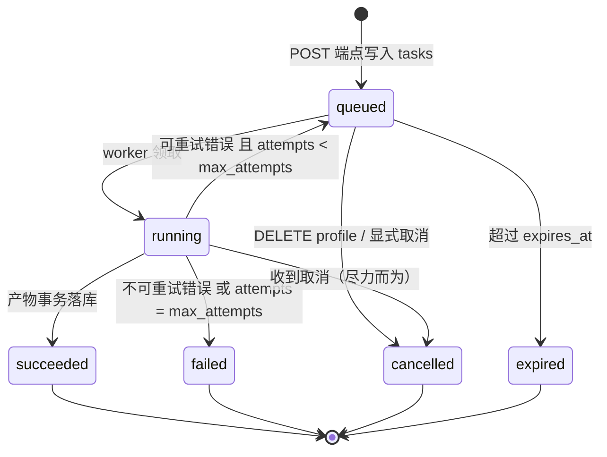

# 04 · API 与数据契约（API & Data Contract）

> 文档编号：04 ｜ 版本：v0.3 ｜ 日期：2026-10-31 ｜ 状态：待评审
> 上游事实源：[`00-baseline.md`](./00-baseline.md)（下称 baseline）。本文以 baseline §8（Report 契约）与 §9（API 契约）为基础补齐工程细节，冲突以 baseline 为准。
> 关联文档：02（系统架构，定义异步任务/幂等/降级的实现语义）、03（规则引擎与评分，定义 `base_score`、D1–D5 公式、`delta_applied` 与预算截断）。

---

## 1. 定位

本文是**前后端与外部集成方的唯一契约**。原则：

1. **可执行优先**：能用 Pydantic 表达的，就不写散文（§6）；Pydantic 是契约的**权威形态**，JSON Schema 由它生成（§7），文档示例只是它的渲染。
2. **字段必须精确**：类型、必填、约束、枚举值、错误码全部写死，不留"视情况而定"。
3. **降级形态也是契约**：`template_only` 渲染、`anchors=[]`、`degraded=true` 都是**正常返回**，不是错误（02 号文档 AI-5）。
4. **契约变更必须有版本语义**：见 §9。

---

## 2. 通用约定

### 2.1 传输层

| 项 | 规定 |
|---|---|
| Base URL | `https://api.chuangyi.example/v1` |
| 协议 | 仅 HTTPS（TLS 1.2+）；HTTP 一律 308 重定向到 HTTPS |
| 内容类型 | 请求 `application/json; charset=utf-8`；响应同 |
| 图片传输 | **不经过 JSON body**。两步：先 `POST /v1/uploads/presign` 拿预签名 URL，直传对象存储，再用 `image_key` 引用（§5.1） |
| 字符编码 | UTF-8；响应不转义中文（`ensure_ascii=false`） |
| 时间格式 | RFC 3339，**必须带时区偏移**，统一输出 `+08:00`，例：`2026-10-31T19:30:00+08:00` |
| 时长单位 | 毫秒（`*_ms` 后缀），整数 |
| 分数精度 | `total_score` / `score` 保留 1 位小数；`delta_*` 保留 2 位小数；`confidence` / `similarity` 保留 3 位小数。**舍入规则**：内部整厘点运算，输出边界 `round_half_up` 一次（03 号文档 §2.4） |

### 2.2 认证与授权

```
Authorization: Bearer <access_token>
```

- 所有 `/v1/*` 端点（除 `/v1/health`）必需。
- **对象归属校验**：任何 `profile_id` / `outfit_id` / `report_id` / `task_id` 必须属于 token 对应的 `user_id`；不属于 → `404`（**不用 403**，避免 ID 存在性泄漏）。

### 2.3 请求头

| Header | 必填 | 说明 |
|---|---|---|
| `Authorization` | ✅ | 见 §2.2 |
| `Idempotency-Key` | 建议 | 客户端生成的稳定幂等键（UUIDv4 或 32 字符随机串），用于 `POST`（§10） |
| `X-Request-Id` | 可选 | 客户端链路 ID；服务端回显在响应头，并作为 `trace_id` 的父级 |
| `X-Api-Version` | 可选 | 显式钉住次版本（如 `2026-10-31`）。缺省为服务端当前版本 |
| `Accept-Language` | 可选 | MVP 仅支持 `zh-CN`，其他值忽略（不报错） |

### 2.4 响应头

| Header | 说明 |
|---|---|
| `X-Request-Id` | 回显或服务端生成 |
| `X-Trace-Id` | 服务端 trace（排障时提供给支持团队） |
| `X-Api-Version` | 实际生效的 API 次版本 |
| `X-RateLimit-Limit` / `-Remaining` / `-Reset` | 限流信息（`Reset` 为 Unix 秒） |
| `Retry-After` | 仅 `429` / `503`，秒数 |
| `Idempotent-Replayed` | 仅幂等重放时出现，值 `true` |

### 2.5 ID 规范

所有 ID 是**带前缀的 ULID**（`前缀_` + 26 字符 Crockford Base32，时间有序）：

| 实体 | 前缀 | 例 |
|---|---|---|
| Report | `rpt_` | `rpt_01JBQ4K7Z8N2V3W5X6Y7Z8A9B0` |
| Outfit | `oft_` | `oft_01JBQ4K7Z8N2V3W5X6Y7Z8A9B1` |
| StyleProfile | `prf_` | `prf_01JBQ4K7Z8N2V3W5X6Y7Z8A9B2` |
| Task | `tsk_` | `tsk_01JBQ4K7Z8N2V3W5X6Y7Z8A9B3` |
| Garment | `gar_` | `gar_01JBQ4K7Z8N2V3W5X6Y7Z8A9B4` |
| 预设图册锚点 | `anc_` | `anc_01JBQ4K7Z8N2V3W5X6Y7Z8A9B5` |

> 选 ULID 而非 UUIDv4：`created_at` 从 ID 可解出（排障友好）、按 ID 排序即按时间排序、索引局部性好。

### 2.6 约束上限（超限 → `422 ERR_VALIDATION_FAILED`）

| 项 | 上限 | 依据 |
|---|---|---|
| 单张图片字节数 | 12 MB | 移动端原图上限 |
| 单张图片分辨率 | 短边 ≥ 480 px，长边 ≤ 8 000 px | 低于 480 关键点不可靠；高于 8k 无收益 |
| 单套穿搭图片数 | 1–5 | baseline P0-1 |
| 参考穿搭套数 | 1–5（建议 3–5） | baseline P0-1 + R-05 |
| 图片格式 | `image/jpeg` `image/png` `image/webp` `image/heic` | HEIC 服务端转码 |
| `note`（文字标签）长度 | ≤ 200 字符 | — |
| `callback_url` | 必须 https，≤ 512 字符 | — |
| 请求体总大小 | ≤ 256 KB（JSON） | — |

### 2.7 分页

列表类端点（本文只有 `GET /v1/reports` 用到）统一：

```
GET /v1/reports?limit=20&cursor=rpt_01JBQ...
```

- `limit`：1–100，默认 20。
- `cursor`：上一页最后一个 ID（**不透明**，客户端不得解析）。
- 响应带 `next_cursor`（末页为 `null`）。**不使用 offset**（并发插入会跳项/重复）。

### 2.8 限流

| 维度 | 默认 | 超限 |
|---|---|---|
| 按 `user_id` | 120 req / min，突发 30 | `429 ERR_RATE_LIMITED` |
| 报告生成（按用户） | 20 / h | `429 ERR_REPORT_QUOTA_EXCEEDED` |
| 按 IP（未认证） | 30 req / min | `429` |

---

## 3. 统一错误模型

### 3.1 响应体结构

所有非 2xx 响应**只有**这一个形状（不再有第二种）：

```jsonc
{
  "error": {
    "code": "ERR_VLM_UNAVAILABLE",
    "message": "图片解析服务暂时不可用，请稍后重试。",
    "http_status": 503,
    "retryable": true,
    "retry_after_ms": 6000,
    "details": {
      "stage": "vlm",
      "attempts": 3
    }
  },
  "request_id": "req_01JBQ4K7Z8N2V3W5X6Y7Z8A9C0",
  "trace_id": "4bf92f3577b34da6a3ce929d0e0e4736"
}
```

- `error.message` 是**面向用户的简体中文**，可直接展示（不含内部术语、不含堆栈、不含 ID）。
- `error.details` 是**面向开发者**的结构化补充，不保证字段稳定（但保证是 object）。
- `error.retryable` 是**契约的一部分**：客户端据此决定是否自动重试。禁止客户端"猜"。
- 堆栈与内部异常只进服务端日志，绝不返回。

### 3.2 错误码枚举（封闭集合）

`code` 是契约枚举，新增=次版本升级（§9.2）。**客户端必须按 `http_status` + `retryable` 分支，不得穷举 `code`**（前向兼容要求，见 §9.3）。

| code | HTTP | retryable | 语义 | 客户端应做什么 |
|---|---|---|---|---|
| `ERR_VALIDATION_FAILED` | 422 | ❌ | 请求体不合法（类型/枚举/长度/约束） | 修正请求；`details.fields[]` 给出字段路径与原因 |
| `ERR_UNAUTHORIZED` | 401 | ❌ | token 缺失/过期 | 重新登录 |
| `ERR_FORBIDDEN` | 403 | ❌ | 无权访问该资源类型（归属不符用 404） | 提示无权限 |
| `ERR_NOT_FOUND` | 404 | ❌ | 资源不存在或不属于当前用户 | 引导回列表页 |
| `ERR_IDEMPOTENCY_CONFLICT` | 409 | ❌ | 同 `Idempotency-Key` 不同请求体 | 生成新 key 重试 |
| `ERR_IMAGE_TOO_LARGE` | 413 | ❌ | 图片超出 §2.6 上限 | 压缩后重传 |
| `ERR_IMAGE_UNREADABLE` | 422 | ❌ | 图片损坏 / 无法解码 / 尺寸不合规 | 换图 |
| `ERR_IMAGE_FETCH_FAILED` | 502 | ✅ | 无法从对象存储取图（预签名过期/网络） | 重新 presign 后重试 |
| `ERR_VLM_UNAVAILABLE` | 503 | ✅ | VLM 超时/5xx（重试后仍失败） | 稍后重试；`retry_after_ms` |
| `ERR_PARSE_INSUFFICIENT` | 422 | ✅（换图后） | 解析置信度过低（`confidence < 0.35`），不足以出分 | 提示换更清晰/更完整的图 |
| `ERR_PROFILE_INSUFFICIENT` | 422 | ❌ | 参考穿搭不足 1 套有效解析 | 补充参考穿搭 |
| `ERR_RULE_EVAL_FAILED` | 500 | ❌ | 规则引擎内部错误（纯函数失败 = bug） | 上报；**不要自动重试** |
| `ERR_RULESET_UNAVAILABLE` | 503 | ✅ | 规则集制品缺失/校验失败（02 F-13） | 稍后重试；服务端 P0 告警 |
| `ERR_PERSIST_FAILED` | 503 | ✅ | 落库失败/死锁 | 原 `Idempotency-Key` 重试（幂等安全） |
| `ERR_TASK_TIMEOUT` | 504 | ✅ | 任务超过硬超时 | 重试 |
| `ERR_TASK_RETRY_EXHAUSTED` | 502 | ❌ | 任务级重试已用尽 | 展示错误码，支持介入 |
| `ERR_TASK_CANCELLED` | 409 | ❌ | 任务被取消（用户操作/画像删除） | 重新发起 |
| `ERR_TASK_EXPIRED` | 410 | ❌ | 任务超过 `expires_at`（24h） | 重新发起 |
| `ERR_RATE_LIMITED` | 429 | ✅ | 触发限流 | 按 `Retry-After` 退避 |
| `ERR_REPORT_QUOTA_EXCEEDED` | 429 | ✅（次日/升级后） | 报告生成配额用尽 | 提示配额 |
| `ERR_VERSION_UNSUPPORTED` | 400 | ❌ | `X-Api-Version` 不被支持 | 降级到支持版本 |
| `ERR_PAYLOAD_TOO_LARGE` | 413 | ❌ | JSON body 超 256 KB | 拆请求 |
| `ERR_INTERNAL` | 500 | ✅ | 未分类内部错误 | 报障；`trace_id` 必带 |

> **能力型错误**（不是失败，是"部分能力不可用"）**不出现在错误里**，而是出现在成功响应的 `meta` 中：`degraded`、`degraded_reasons[]`、`parse_warnings[]`、`render_mode`。这是 AI-5 的契约表达。

### 3.3 错误 vs 降级的判定规则（实现必读）

```
能出分 → 成功响应（200），把不确定性写进 meta
不能出分 → 错误响应（4xx/5xx），code 必须能定位到唯一原因
```

反例（禁止）：VLM 单图失败但仍出了报告 → 应返回 **200 + meta.parse_warnings**，绝不允许返回 `ERR_VLM_UNAVAILABLE`。
反例（禁止）：规则集损坏却返回 200 + 零命中 70 分 → 必须 `ERR_RULESET_UNAVAILABLE`（02 §8.5 末条）。

---

## 4. 异步任务协议

### 4.1 三个异步端点

| 端点 | task_type | 典型耗时 | 返回 |
|---|---|---|---|
| `POST /v1/profiles` | `build_profile` | P95 ≈ 8 s | `202` + task |
| `POST /v1/outfits/parse` | `parse_outfit` | P95 ≈ 5 s | `202` + task |
| `POST /v1/reports` | `generate_report` | P95 ≈ 16 s | `202` + task |

（baseline §9 已规定 `/v1/profiles` 与 `/v1/reports` 为异步；`/v1/outfits/parse` 同为耗时解析，一并异步，保持一致性。）

### 4.2 202 响应体

```jsonc
{
  "task_id": "tsk_01JBQ4K7Z8N2V3W5X6Y7Z8A9B3",
  "task_type": "generate_report",
  "status": "queued",
  "created_at": "2026-10-31T19:30:00+08:00",
  "expires_at": "2026-11-01T19:30:00+08:00",
  "estimated_ms": 9000,
  "poll_url": "/v1/tasks/tsk_01JBQ4K7Z8N2V3W5X6Y7Z8A9B3",
  "result": null,
  "error": null
}
```

- 若同 `Idempotency-Key` 或同 `dedup_key` 命中**已完成**的任务 → 仍返回 `202`，但 `status` 直接是终态，`result` 已填充（避免客户端多一次往返）。
- `estimated_ms` 是**建议轮询间隔的下界提示**（服务端按 P50 估），客户端应 `max(estimated_ms/2, 500ms)` 起轮询。

### 4.3 任务对象（`Task`）

| 字段 | 类型 | 必填 | 说明 |
|---|---|---|---|
| `task_id` | string | ✅ | `tsk_` 前缀 |
| `task_type` | enum | ✅ | `build_profile｜parse_outfit｜generate_report` |
| `status` | enum | ✅ | `queued｜running｜succeeded｜failed｜cancelled｜expired` |
| `created_at` | string(date-time) | ✅ | — |
| `started_at` | string(date-time)\|null | — | 进入 `running` 时填 |
| `finished_at` | string(date-time)\|null | — | 进入终态时填 |
| `expires_at` | string(date-time) | ✅ | `created_at + 24h` |
| `estimated_ms` | integer\|null | — | 仅非终态给出 |
| `progress` | object\|null | — | `{stage, percent}`；`percent` 仅粗粒度（0/25/50/75/100），**不承诺单调精确** |
| `result` | object\|null | — | 终态且成功时非 null，形状由 `task_type` 决定（§5） |
| `error` | object\|null | — | 终态且失败时非 null，形状同 §3.1 的 `error` |
| `poll_url` | string | ✅ | 相对路径 |

**各 task_type 的 `result` 形状**

| task_type | result |
|---|---|
| `build_profile` | `{ "profile_id": "prf_...", "reference_count": 4, "confidence": 0.86 }` |
| `parse_outfit` | `{ "outfit_id": "oft_...", "slot_mask": 47, "parse_confidence": 0.88, "parse_warnings": [] }` |
| `generate_report` | `{ "report_id": "rpt_...", "total_score": 78.8, "verdict": "suitable", "vetoed": false }` |

### 4.4 任务状态机



- 终态：`succeeded｜failed｜cancelled｜expired`，**不可逆**。
- `attempts` 变化会在 `GET /v1/tasks/{id}` 的 `progress` 里以 `retrying: true` 体现（不作为独立字段，属 `details`）。
- 状态转移必须写 `audit_log`（`task.transition`），便于排障。

### 4.5 轮询模式

```
GET /v1/tasks/{task_id}
```

- 非终态返回 `200`（不是 202），`status` = `queued` / `running`。
- 终态返回 `200`，`result` 或 `error` 填充。
- **建议轮询节奏**：1 s → 1 s → 2 s → 3 s → 5 s（指数到 5 s 封顶），总时长 ≤ 25 s；之后改为低频（15 s）直到 `expires_at`。
- 支持 `ETag` + `If-None-Match`；未变化返回 `304`（省流量，非必需）。

### 4.6 回调（Callback）模式

请求里带 `callback_url` 时，任务进入终态后服务端主动 POST：

```jsonc
POST {callback_url}
X-Signature: t=1761912000,v1=8f2c...b7  
Content-Type: application/json

{
  "event": "task.succeeded",           // task.succeeded | task.failed | task.cancelled | task.expired
  "task_id": "tsk_01JBQ...",
  "task_type": "generate_report",
  "occurred_at": "2026-10-31T19:30:16+08:00",
  "result": { "report_id": "rpt_01JBQ...", "total_score": 78.8, "verdict": "suitable", "vetoed": false },
  "error": null
}
```

**签名校验（接收方必做）**

```
signed_payload = f"{t}." + raw_body            # 时间戳 + 点 + 原始字节
expected = hmac_sha256(shared_secret, signed_payload).hex()
校验：hmac.compare_digest(expected, v1)  且  |now - t| <= 300s
```

**投递语义**

| 项 | 规定 |
|---|---|
| 至少一次（at-least-once） | 接收方必须用 `task_id` 幂等 |
| 重试 | 非 2xx → 重试 3 次，退避 2 s / 10 s / 60 s |
| 超时 | 5 s |
| 全部失败 | 落 `callback_dead_letter` 表，**不影响任务状态**（任务已 `succeeded`） |
| 安全 | 仅 https；不跟随 3xx；不回调私网地址（SSRF 防护，与文档无关但必须实现） |

> 轮询与回调**可同时使用**：回调用于"用户切走 App 也能收到"，轮询是兜底。

---

## 5. 端点详设

### 5.1 `POST /v1/uploads/presign` — 获取图片直传凭证

> baseline §9 未列此端点，但"不通过 JSON 传图"是工程必需（§2.1）。记入 §11 修订建议 B-18。

**Request**

```jsonc
{
  "files": [
    { "content_type": "image/jpeg", "byte_size": 2481920, "sha256": "9f2c...b7" }
  ]
}
```

**Response 200**

```jsonc
{
  "uploads": [
    {
      "upload_url": "https://oss.example/bucket/raw/usr_.../img_01JBQ.jpg?X-Amz-Signature=...",
      "method": "PUT",
      "headers": { "Content-Type": "image/jpeg" },
      "image_key": "raw/usr_01JBQ4K7/img_01JBQ4K7Z8.jpg",
      "expires_in": 300
    }
  ]
}
```

- `image_key` 是后续所有端点的图片引用；**不含签名，可安全落库**。
- 上传后服务端异步校验 `sha256` 与格式；不合规在后续端点返回 `ERR_IMAGE_UNREADABLE`。

---

### 5.2 `POST /v1/profiles` — 建立风格画像（异步）

**Request**

```jsonc
{
  "reference_outfits": [
    {
      "image_keys": ["raw/usr_01JBQ4K7/img_a.jpg"],
      "occasion": "business",
      "season": "autumn",
      "note": "上班常穿的一套"
    },
    {
      "image_keys": ["raw/usr_01JBQ4K7/img_b.jpg"],
      "occasion": "casual",
      "season": "autumn",
      "note": ""
    },
    {
      "image_keys": ["raw/usr_01JBQ4K7/img_c.jpg", "raw/usr_01JBQ4K7/img_d.jpg"],
      "occasion": "date",
      "season": "spring"
    }
  ],
  "declared_styles": ["极简", "通勤知性"],
  "forbidden_styles": ["甜美"],
  "explore_tags": ["法式"],
  "callback_url": "https://client.example/hooks/cy"
}
```

| 字段 | 类型 | 必填 | 约束 | 说明 |
|---|---|---|---|---|
| `reference_outfits` | array | ✅ | 1–5 项，**建议 3–5** | 少于 3 时触发 baseline R-05（`profile.confidence` 下降 + D2 特征按 `min(1,n/3)` 缩放） |
| `reference_outfits[].image_keys` | array[string] | ✅ | 1–5 项，key 必须属于当前用户 | — |
| `reference_outfits[].occasion` | enum | ❌ | §6.1 `Occasion`；默认 `unspecified` | 仅作解析提示，不参与 D4（参考穿搭不评场合） |
| `reference_outfits[].season` | enum | ❌ | `spring｜summer｜autumn｜winter｜unknown`；默认 `unknown` | — |
| `reference_outfits[].note` | string | ❌ | ≤ 200 字符 | 原样存入 `outfits.note`，**不进模型**（避免 prompt 注入） |
| `declared_styles` | array[string] | ❌ | ≤ 6 项，必须在 `StyleTag` 受控词表内 | 冷启动辅助；与解析结果冲突时以解析为准并记 `parse_warnings` |
| `forbidden_styles` | array[string] | ❌ | ≤ 6 项，同上 | 直接写入 `profile.forbidden_styles`，驱动 `R-STYLE-001`（hard） |
| `explore_tags` | array[string] | ❌ | ≤ 6 项 | 驱动 `R-STYLE-009`（boost） |
| `callback_url` | string | ❌ | §2.6 | — |

**Response 202** — `Task`（§4.2）

**错误**

| HTTP | code | 触发 |
|---|---|---|
| 422 | `ERR_VALIDATION_FAILED` | 数组长度/枚举/字符数越界 |
| 413 | `ERR_IMAGE_TOO_LARGE` | 预检发现图片超限 |
| 422 | `ERR_IMAGE_UNREADABLE` | 图片解码失败 |
| 429 | `ERR_RATE_LIMITED` | — |
| 503 | `ERR_VLM_UNAVAILABLE` | 全图解析失败（异步任务内失败，见 §4.3 `error`） |

> **注意**：解析失败通常是**任务失败**而非 HTTP 错误——`202` 已经返回，失败体现在 `GET /v1/tasks/{id}` 的 `error` 上。HTTP 层错误只覆盖"请求本身就进不来"的情况。

---

### 5.3 `GET /v1/profiles/{profile_id}` — 读画像

**Response 200**

```jsonc
{
  "profile_id": "prf_01JBQ4K7Z8N2V3W5X6Y7Z8A9B2",
  "user_id": "usr_01JBQ4K7",
  "version": 1,
  "status": "active",
  "created_at": "2026-10-31T19:31:10+08:00",

  "reference_count": 3,
  "confidence": 0.71,
  "confidence_note": "参考穿搭 3 套，达到可信下限；再补 2 套可提升风格判断准确度。",

  "tag_distribution": [
    { "tag": "极简",     "weight": 0.42, "count": 5 },
    { "tag": "通勤知性", "weight": 0.31, "count": 4 },
    { "tag": "法式",     "weight": 0.15, "count": 2 },
    { "tag": "运动休闲", "weight": 0.12, "count": 1 }
  ],
  "top_styles": ["极简", "通勤知性", "法式"],
  "forbidden_styles": ["甜美"],
  "explore_tags": ["法式"],

  "style_vector": {
    "dim": 256,
    "embedding_version": "emb-2026.10.0",
    "preview": [0.0412, -0.0087, 0.1391]
  },

  "reference_outfits": [
    { "outfit_id": "oft_01JBQ...", "image_count": 1, "completeness": 0.92 }
  ],

  "ruleset_version": "rs-2026.10.1",
  "meta": { "parse_warnings": ["OCCASION_DEFAULTED_FOR_REFERENCE"] }
}
```

- **`style_vector.preview` 只给前 3 维**：完整 256 维不下发给客户端（无用途，且是可被反推的画像指纹）。
- `confidence_note` 是给 UI 直接展示的中文提示（与 §3.1 的 `error.message` 同一套"可直接展示"标准）。

**错误**：`404 ERR_NOT_FOUND`（不存在或不属于当前用户）、`404 ERR_NOT_FOUND`（已删除）。

---

### 5.4 `DELETE /v1/profiles/{profile_id}` — 删除画像（隐私权，baseline R-06）

**Query**：`?mode=soft|hard`（默认 `soft`）

**Response 200**

```jsonc
{
  "profile_id": "prf_01JBQ4K7Z8N2V3W5X6Y7Z8A9B2",
  "deleted": true,
  "mode": "soft",
  "purge_scheduled_at": "2026-11-30T19:31:10+08:00",
  "note": "画像已立即不可访问；原始图片将在 30 天内物理删除。"
}
```

| mode | 语义 | 影响 |
|---|---|---|
| `soft`（默认） | 立即 `deleted_at` 置位，所有接口不可见；30 天后硬删（含原图、向量、报告） | 可支持"误删恢复"（客服） |
| `hard` | 立即物理删除原图 + 向量；结构化数据 24 h 内清除 | 不可恢复；异步任务执行，返回 `202` + `Task` |

**幂等**：重复删除同一 ID 返回 `200`（`deleted: true`），不返回 404。

---

### 5.5 `POST /v1/outfits/parse` — 解析一套穿搭（异步）

**Request**

```jsonc
{
  "image_keys": ["raw/usr_01JBQ4K7/img_e.jpg", "raw/usr_01JBQ4K7/img_f.jpg"],
  "occasion": "date",
  "season": "autumn",
  "callback_url": "https://client.example/hooks/cy"
}
```

| 字段 | 类型 | 必填 | 约束 |
|---|---|---|---|
| `image_keys` | array[string] | ✅ | 1–5 项；多图视为**同一套**搭配的不同角度 |
| `occasion` | enum `Occasion` | ✅ | **必填**（与 profiles 不同：评审必须声明场合，否则 D4 无法评分）。若客户端确实不知道，传 `unspecified`，服务端会降级 D4 并在 `parse_warnings` 记 `OCCASION_UNSPECIFIED` |
| `season` | enum | ❌ | 默认 `unknown` |

**Response 202** — `Task`

**result 的产物**：`GET /v1/outfits/{outfit_id}` 可取完整结构。

---

### 5.6 `GET /v1/outfits/{outfit_id}` — 读结构化搭配

**Response 200**

```jsonc
{
  "outfit_id": "oft_01JBQ4K7Z8N2V3W5X6Y7Z8A9B1",
  "role": "review",
  "created_at": "2026-10-31T19:31:05+08:00",
  "occasion": "date",
  "season": "autumn",
  "slot_mask": 47,

  "structure": {
    "has_outer": false,
    "has_shoes": true,
    "layer_depth": 1,
    "accessory_count": 1,
    "is_tucked": false,
    "hem_pooling": false,
    "visual_waist_y": 0.50,
    "visual_center_y": 0.58,
    "has_closed_shoes": true,
    "assessability": { "D1": 1.0, "D2": 1.0, "D3": 1.0, "D4": 1.0, "D5": 1.0 }
  },

  "colors": {
    "main_colors": ["neutral_white", "blue", "neutral_black"],
    "n_main_colors": 3,
    "n_chromatic": 1,
    "hue_span": 0.0,
    "max_saturation": 0.55,
    "mean_saturation": 0.24,
    "lightness_range": 0.83,
    "has_neutral_anchor": true,
    "temperature_mix": "balanced",
    "warm_area_ratio": 0.0,
    "cool_area_ratio": 0.34,
    "pattern_types": ["solid"],
    "n_patterns": 0,
    "metal_hues": [],
    "n_same_family_max": 2,
    "luminance_monotonic": false,
    "dominant_family": "neutral_white",
    "smallest_family": "blue"
  },

  "materials": {
    "families": ["cotton", "wool", "leather"],
    "n_families": 3,
    "has_summer_fabric": false,
    "has_winter_item": false,
    "max_family_count": 1,
    "family_slot_count": 1
  },

  "formality": 0.62,
  "formality_span": 0.10,
  "style_tags": ["极简", "通勤知性"],

  "garments": [
    // 此处仅展示第 1 件；实际返回全部 4 件，按 (slot, ord) 确定性排序
    {
      "garment_id": "gar_01JBQ4K7Z8N2V3W5X6Y7Z8A9B4",
      "slot": "top",
      "ord": 0,
      "category": "棉质衬衫",
      "bbox": [0.21, 0.08, 0.42, 0.36],
      "area_ratio": 0.31,
      "color": { "hue": null, "saturation": 0.02, "lightness": 0.95, "family": "neutral_white", "is_neutral": true, "temperature": "neutral", "confidence": 0.94 },
      "fit": "regular",
      "length_class": "regular",
      "length_ratio": 0.48,
      "waist": "mid",
      "material": "cotton",
      "material_family": "cotton",
      "pattern": "solid",
      "style_tags": ["极简", "通勤知性"],
      "formality": 0.65,
      "flags": { "is_sport_derived": false, "is_structured": false, "metal": false },
      "confidence": 0.91
    }
  ],

  "parse_confidence": 0.88,
  "parse_warnings": [],

  "meta": {
    "vlm_version": "vlm-2026.10",
    "model_versions": { "vlm": "vlm-2026.10", "embedding": "emb-2026.10.0" }
  }
}
```

**错误**：`404 ERR_NOT_FOUND`。

> `structure.assessability` 与 03 号文档 §4.8 的 `assessability_d` 同源；此处提前暴露便于前端在解析阶段就提示"比例信息不足"。**降级形态**（`assessability < 1`、`parse_warnings` 非空）的完整样例见 §7 的 `report.golden.degraded.json`，此处保持"全部可评估"以便与 §5.8 的报告示例对齐。

---

### 5.7 `POST /v1/reports` — 生成评审报告（异步，核心端点）

**Request**

```jsonc
{
  "outfit_id": "oft_01JBQ4K7Z8N2V3W5X6Y7Z8A9B1",
  "profile_id": "prf_01JBQ4K7Z8N2V3W5X6Y7Z8A9B2",
  "options": {
    "detail_level": "standard",
    "max_suggestions": 3,
    "include_anchors": true,
    "render_mode_preference": "hybrid"
  },
  "callback_url": "https://client.example/hooks/cy"
}
```

| 字段 | 类型 | 必填 | 约束 | 说明 |
|---|---|---|---|---|
| `outfit_id` | string | ✅ | `oft_` 前缀，归属当前用户，`role` 必须为 `review` | 参考穿搭不可用于评审 |
| `profile_id` | string | ✅ | `prf_` 前缀，归属当前用户，`status = active` | — |
| `options.detail_level` | enum | ❌ | `brief｜standard｜detailed`，默认 `standard` | 只影响 `rule_hits` 的条数上限与 `explanation` 长度，**不影响任何分数** |
| `options.max_suggestions` | int | ❌ | 1–5，默认 3 | 最多返回几条改进建议 |
| `options.include_anchors` | bool | ❌ | 默认 `true` | 关掉可省一次向量检索（`anchors` 返回 `[]`） |
| `options.render_mode_preference` | enum | ❌ | `template_only｜hybrid｜llm_polished`，默认 `hybrid` | **强制**渲染模式（评测用）。取值不可能时会降级并在 `meta.render_mode` 反映真实值 |
| `callback_url` | string | ❌ | §2.6 | — |

**Response 202** — `Task`

**错误**

| HTTP | code | 触发 |
|---|---|---|
| 422 | `ERR_VALIDATION_FAILED` | `role != review`、枚举越界等 |
| 404 | `ERR_NOT_FOUND` | outfit/profile 不存在或不属于当前用户 |
| 422 | `ERR_PARSE_INSUFFICIENT` | `outfit.parse_confidence < 0.35` |
| 429 | `ERR_REPORT_QUOTA_EXCEEDED` | — |
| 409 | `ERR_IDEMPOTENCY_CONFLICT` | 同 key 不同 body |

---

### 5.8 `GET /v1/reports/{report_id}` — 读评审报告（**本契约的核心**）

**Response 200**（示例与 03 号文档 §5.1 算例 A 完全对应，可交叉验算）

```jsonc
{
  "report_id": "rpt_01JBQ4K7Z8N2V3W5X6Y7Z8A9B0",
  "schema_version": "1.1",
  "outfit_id": "oft_01JBQ4K7Z8N2V3W5X6Y7Z8A9B1",
  "profile_id": "prf_01JBQ4K7Z8N2V3W5X6Y7Z8A9B2",
  "created_at": "2026-10-31T19:30:16+08:00",

  "verdict": "suitable",
  "vetoed": false,
  "veto_reasons": [],
  "total_score": 78.8,
  "total_centi": 7879,
  "base_score": 70.00,
  "confidence": 0.914,

  "dimension_scores": [
    { "code": "D1", "name": "色彩和谐度", "score": 15.60, "base": 15.60, "max": 20, "weight": 0.20, "assessability": 1.00, "penalty_used": 0.00, "boost_used": 0.00 },
    { "code": "D2", "name": "风格一致性", "score": 23.50, "base": 18.00, "max": 25, "weight": 0.25, "assessability": 1.00, "penalty_used": 0.00, "boost_used": 5.50 },
    { "code": "D3", "name": "身形与比例", "score": 10.80, "base": 13.20, "max": 20, "weight": 0.20, "assessability": 1.00, "penalty_used": 3.00, "boost_used": 0.60 },
    { "code": "D4", "name": "场合适配",   "score": 19.29, "base": 13.60, "max": 20, "weight": 0.20, "assessability": 1.00, "penalty_used": 0.00, "boost_used": 5.69 },
    { "code": "D5", "name": "细节完成度", "score": 9.60,  "base": 9.60,  "max": 15, "weight": 0.15, "assessability": 1.00, "penalty_used": 0.00, "boost_used": 0.00 }
  ],

  "rule_hits": [
    {
      "seq": 1,
      "kind": "rule",
      "rule_id": "R-STYLE-008",
      "rule_version": 1,
      "category": "STYLE",
      "title": "命中 top-1 风格",
      "severity": "boost",
      "dimension": "D2",
      "delta_schema": 4.00,
      "delta_applied": 4.00,
      "clipped": false,
      "suppressed_by": null,
      "triggered_value": { "outfit_style": "极简", "profile_top1": "极简" },
      "evidence": "本套主基调「极简」正是你最常穿的风格。",
      "explanation": "本套主基调「极简」与你最常穿的风格一致，方向很稳。",
      "suggestion": null,
      "reinforce": "这个方向可以保持：换季时优先在「极简」里找同款不同色的单品。",
      "source": "domain_expert"
    },
    {
      "seq": 2,
      "kind": "rule",
      "rule_id": "R-PROP-004",
      "rule_version": 1,
      "category": "PROPORTION",
      "title": "五五分",
      "severity": "soft",
      "dimension": "D3",
      "delta_schema": -3.00,
      "delta_applied": -3.00,
      "clipped": false,
      "suppressed_by": null,
      "triggered_value": { "visual_waist_y": 0.50, "range": [0.46, 0.54] },
      "evidence": "视觉腰线位于身高 50% 处（0.50），接近中分。",
      "explanation": "视觉腰线落在 0.50，上下比例接近五五分，没有占到显高的便宜。建议把衬衫塞入，并换高腰直筒下装，把腰线提到 0.40–0.42。",
      "suggestion": {
        "priority": 1,
        "target_slot": "top",
        "action": "把衬衫塞入，并把下装换成高腰直筒款，把腰线提到 0.42 以上",
        "expected_gain": 7.0,
        "reason_rule_ids": ["R-PROP-004"]
      },
      "reinforce": null,
      "source": "domain_expert"
    },
    {
      "seq": 3,
      "kind": "rule",
      "rule_id": "R-OCC-009",
      "rule_version": 1,
      "category": "OCCASION",
      "title": "场合正式度精确匹配",
      "severity": "boost",
      "dimension": "D4",
      "delta_schema": 4.00,
      "delta_applied": 4.00,
      "clipped": false,
      "suppressed_by": null,
      "triggered_value": { "required": 0.70, "range": [0.58, 0.82], "garment_count": 4 },
      "evidence": "4 件单品正式度均在通勤目标 0.70 的 ±0.10 内。",
      "explanation": "4 件单品的正式度都精准落在通勤场合的区间内，很像「准备好了才出门」。",
      "suggestion": null,
      "reinforce": "这个正式度配比可以固定下来：以后通勤按「外套 0.72 / 上装 0.65 / 下装 0.70 / 鞋 0.75」配。",
      "source": "domain_expert"
    }
  ],

  "feature_deltas": [
    {
      "seq": 4,
      "kind": "feature",
      "feature_key": "feat.style_cosine",
      "dimension": "D2",
      "raw_value": 0.70,
      "delta_schema": 1.50,
      "delta_applied": 1.50,
      "clipped": false,
      "evidence": "画像与这套搭配的向量相似度为 0.70（中性点 0.60）。",
      "explanation": "这套搭配和你的风格向量相似度 0.70，属于「像你但不算照抄」。"
    },
    {
      "seq": 5,
      "kind": "feature",
      "feature_key": "feat.visual_center_offset",
      "dimension": "D3",
      "raw_value": 0.08,
      "delta_schema": 0.60,
      "delta_applied": 0.60,
      "clipped": false,
      "evidence": "视觉重心与画面中线偏差 0.08（阈值 0.10）。",
      "explanation": "视觉重心接近中线，整体重心稳定。"
    },
    {
      "seq": 6,
      "kind": "feature",
      "feature_key": "feat.occasion_fit_prob",
      "dimension": "D4",
      "raw_value": 0.74,
      "delta_schema": 1.69,
      "delta_applied": 1.69,
      "clipped": false,
      "evidence": "场合分类器判定「适合通勤」的概率为 0.74（中性点 0.55）。",
      "explanation": "从场合匹配度看，这套有 74% 的概率会被读成「通勤装」。"
    }
  ],

  "score_ledger": {
    "base_score": 70.00,
    "base_by_dimension": { "D1": 15.60, "D2": 18.00, "D3": 13.20, "D4": 13.60, "D5": 9.60 },
    "budget_by_dimension": {
      "D1": { "penalty": 15.60, "boost": 4.40 },
      "D2": { "penalty": 18.00, "boost": 7.00 },
      "D3": { "penalty": 13.20, "boost": 6.80 },
      "D4": { "penalty": 13.60, "boost": 6.40 },
      "D5": { "penalty": 9.60,  "boost": 5.40 }
    },
    "sum_rule_delta": 5.00,
    "sum_feature_delta": 3.79,
    "sum_dimension_scores": 78.79,
    "total_centi": 7879,
    "invariants": {
      "INV2_additive_ok": true,
      "INV4_bounded_ok": true,
      "computed_total_centi": 7879
    },
    "skipped_rules": []
  },

  "style_match": {
    "user_top_styles": ["极简", "通勤知性", "法式"],
    "outfit_styles": ["极简", "通勤知性"],
    "cosine": 0.700,
    "matched": ["极简", "通勤知性"],
    "drifted": []
  },

  "anchors": [
    { "anchor_id": "anc_01JBQ4K7Z8N2V3W5X6Y7Z8A9B5", "similarity": 0.910, "thumb_url": "https://cdn.example/thumb/anc_01JBQ.jpg", "style_tags": ["极简", "通勤知性"] }
  ],

  "suggestions": [
    {
      "priority": 1,
      "target_slot": "top",
      "action": "把衬衫塞入，并把下装换成高腰直筒款，把腰线提到 0.42 以上",
      "reason_rule_ids": ["R-PROP-004"],
      "expected_gain": 7.0,
      "reference_anchor_id": null
    }
  ],

  "summary": "这套搭配方向很稳：极简、通勤两项都在你的主风格里，正式度也刚好。唯一明显吃亏的是比例——腰线落在 0.50，接近五五分。把衬衫塞进高腰下装里，就能把这套从「适合」推到「强烈推荐」。",

  "render_mode": "hybrid",

  "meta": {
    "ruleset_version": "rs-2026.10.1",
    "engine_version": "re-1.0.0",
    "embedding_version": "emb-2026.10.0",
    "embedding_config": {
      "embedding_version": "emb-2026.10.0",
      "alpha": 0.60,
      "beta": 0.40,
      "img_dim": 160,
      "struct_dim": 96,
      "projection_sha256": "7d1c0f5a2e9b4c8d6f3a1e0b5c9d2f7a4e8b1c3d5f0a2e6b9c4d7f1a3e5b8c0d"
    },
    "model_versions": { "vlm": "vlm-2026.10", "llm": "llm-2026.10", "embedding": "emb-2026.10.0" },
    "assessability": { "D1": 1.00, "D2": 1.00, "D3": 1.00, "D4": 1.00, "D5": 1.00 },
    "degraded": false,
    "degraded_reasons": [],
    "anchor_count": 1,
    "parse_warnings": [],
    "detail_level": "standard",
    "generated_in_ms": 8420
  }
}
```

#### 5.8.1 字段级契约要点（易错处逐条说明）

| 字段 | 契约含义 | 常见实现错误 |
|---|---|---|
| `total_score` | 1 位小数；`= round_half_up(sum(dimension_scores[].score), 1)` | 用 float 累加导致 `78.79999` |
| `total_centi` | 整数厘点，是**审计真值**；`total_score*100` 与之必定在 ±0.5 厘点内 | 省略该字段导致无法逐位校验 |
| `base_score` | 本文 ruleset 下恒为 `70.00`（03 §3.1） | 按穿搭类型算 base（破坏可比性，03 §3.3） |
| `dimension_scores[].base` | 每维度基准分，必须满足 `base + boost_used − penalty_used + Σ特征 = score` | 只给 `score` 不给 `base`，导致报告无法自证（baseline B-02） |
| `penalty_used` / `boost_used` | 该维度实际消耗的预算（绝对值），用于解释截断 | 与 `rule_hits` 的 delta 不一致 |
| `rule_hits[].delta_schema` | 规则原始影响分（可能是 `−3.00`） | 只给 `delta`，无法区分"本应扣 3"还是"实际扣 1.6" |
| `rule_hits[].delta_applied` | 实际生效分（预算截断/压制后可为 0） | 缺该字段 → 违反 INV-2 可校验性 |
| `clipped` | 是否被预算截断（03 §4.7） | 静默截断不提，用户会觉得分数算错 |
| `suppressed_by` | 被哪条规则压制（03 §10.2） | 命中却不扣分又不解释 = 用户认为 bug |
| `rule_hits[].suggestion` | 非 boost 规则**必须**非 null（INV-3） | boost 规则给了"建议"（boost 应给 `reinforce`） |
| `reinforce` | boost 规则**必须**非 null（03 §9.7.5） | 两者都缺 → 用户不知道自己哪里做对了 |
| `explanation` | **可独立成句、可脱离 LLM 直接展示**（INV-5） | 写成"此处解释撞色问题"这类占位 |
| `expected_gain` | `= −Σ(delta_applied of cleared hits)`，保留 1 位小数（§5.8.2） | 编造一个"看起来合理"的数 |
| `render_mode` | 真实生效的模式，可能与请求的 `render_mode_preference` 不同 | 回声请求值 → 前端误判"LLM 可用" |
| `vetoed && total_score` | **两个都要给**，`vetoed=true` 不意味着 `total_score=0`（baseline §5.2） | veto 时把分数置成 0，丢失可解释性 |
| `anchors` | 允许 `[]`；`similarity ≥ 0.60` 才出现（02 §6.4.3） | 把 0.4 相似度也当锚点，与 D2 中性点矛盾 |

#### 5.8.2 `expected_gain` 的确定性算法（baseline 未定义，本文补）

MVP 采用**可手算的近似**（03 §13 记录）：

```
expected_gain = round_half_up( Σ over cleared_hits |delta_applied| , 1 )
其中 cleared_hits = 该 suggestion 的 reason_rule_ids 对应的命中项，
      且仅当"执行该动作后该规则必不再命中"时计入（由规则作者在 §9.6 矩阵中声明）
另加：被该动作新触发的 boost 规则的 delta_schema（上限受该维度剩余加分预算约束）
```

- 示例（算例 A）：`R-PROP-004` 被清除 → `+3.00`；`R-PROP-009` 可能新命中 → `+4.00`（D3 加分余量 6.20 足够）→ `expected_gain = 7.0`。
- **不承诺**为真实反事实重算值；二期改为"在反事实 Outfit 上重跑引擎"（`POST /v1/reports/{id}/replay` 的扩展）。
- 契约要求：`expected_gain` 与 `reason_rule_ids` **必须自洽**——脚本校验 `|expected_gain − Σ|delta_applied|| ≤ 0.05`。

---

### 5.9 `GET /v1/reports` — 报告列表（分页）

```
GET /v1/reports?limit=20&cursor=rpt_01JBQ...&outfit_id=oft_...&verdict=suitable
```

**Response 200**

```jsonc
{
  "items": [
    { "report_id": "rpt_01JBQ...", "outfit_id": "oft_01JBQ...", "created_at": "2026-10-31T19:30:16+08:00", "total_score": 78.8, "verdict": "suitable", "vetoed": false, "thumb_url": "https://cdn.example/thumb/oft_01JBQ.jpg" }
  ],
  "next_cursor": null
}
```

列表项**不含** `rule_hits` / `dimension_scores`（体积考虑）；需要详情请 `GET /v1/reports/{id}`。

---

### 5.10 `POST /v1/reports/{report_id}/feedback` — 用户反馈（二期训练数据）

**Request**

```jsonc
{
  "helpful": false,
  "agree_score": 85.0,
  "tags": ["颜色判断错", "建议不可执行"],
  "comment": "我觉得这套挺好看的"
}
```

| 字段 | 类型 | 必填 | 约束 |
|---|---|---|---|
| `helpful` | bool | ✅ | — |
| `agree_score` | number | ❌ | 0–100，最多 1 位小数 |
| `tags` | array[string] | ❌ | ≤ 5 项，枚举见 §6.6 |
| `comment` | string | ❌ | ≤ 500 字符；**只落库，不进模型** |

**Response 201**：`{ "feedback_id": "...", "created_at": "..." }`

> 反馈**不改变**已生成报告的任何字段（审计要求：Report 不可变）。

---

### 5.11 `GET /v1/rulesets/{version}` — 读规则集元信息（报告可复现所需）

**Response 200**

```jsonc
{
  "ruleset_version": "rs-2026.10.1",
  "dsl_version": "dsl-1.0",
  "sha256": "3c9f...a41",
  "created_at": "2026-10-20T00:00:00+08:00",
  "status": "active",
  "rule_count": 50,
  "severity_distribution": { "hard": 3, "soft": 36, "boost": 11 },
  "category_distribution": { "COLOR": 12, "STYLE": 10, "PROPORTION": 10, "OCCASION": 10, "DETAIL": 8 },
  "base_score": 70.00,
  "rho_table": { "D1": 0.78, "D2": 0.72, "D3": 0.66, "D4": 0.68, "D5": 0.64 },
  "engine_version": "re-1.0.0"
}
```

- 公开该端点是为了让 Report 的"可复现"可被外部审计（拿到 `sha256` + 版本号即可核对）。
- **不返回**规则正文（防止规则资产被爬取）；正文只在内部工具与 `/v1/admin/*` 提供。
- 规则集的**启停/回滚**（`POST /v1/admin/rulesets/{version}/activate`，见 03 号文档 §12.5）属内部运维端点，只对内部角色开放、不在本公开契约范围内，本文不定义其请求/响应。

---

### 5.12 `GET /v1/health` — 健康检查

**Response 200（健康）/ 503（不健康）**

```jsonc
{
  "status": "ok",
  "version": "1.0.0",
  "checks": {
    "db": { "status": "ok", "latency_ms": 3 },
    "redis": { "status": "ok", "latency_ms": 1 },
    "vector_store": { "status": "ok", "latency_ms": 6 },
    "ruleset": { "status": "ok", "version": "rs-2026.10.1", "sha256_ok": true },
    "vlm": { "status": "degraded", "note": "p95 9.4s, 熔断计数 2" },
    "llm": { "status": "ok" }
  },
  "checked_at": "2026-10-31T19:30:00+08:00"
}
```

- 外部依赖的 `degraded` **不影响**整体 `status`（因为 AI-5 保证可降级），只有 `db` / `ruleset` 失败才返回 503。
- `/v1/health` 不需要认证，但**不返回任何内部地址与凭据**。

---

### 5.13 `POST /v1/reports/{report_id}/replay` — 按历史规则集重算（内部/审计用）

**Request**

```jsonc
{
  "ruleset_version": "rs-2026.10.1",
  "engine_version": "re-1.0.0",
  "dry_run": true
}
```

**Response 200**

```jsonc
{
  "replay_of": "rpt_01JBQ...",
  "identical": true,
  "diff": [],
  "total_score": 78.8,
  "total_centi": 7879,
  "ruleset_version": "rs-2026.10.1",
  "engine_version": "re-1.0.0"
}
```

- 用途：① 每日黄金样本重放（02 §9.4）② 规则集回归 ③ 审计质疑分数时的复核。
- `identical=false` 时 `diff` 给出 `[{field, old, new}]`。
- 历史 Report **不因 replay 而改变**（不可变原则）。

---

### 5.14 `POST /v1/privacy/purge` — 立即硬删（隐私权加强）

**Request**

```jsonc
{ "scope": "all", "confirm": "DELETE_MY_DATA" }
```

| 字段 | 约束 |
|---|---|
| `scope` | `all｜profiles｜outfits｜reports` |
| `confirm` | 必须字面量 `"DELETE_MY_DATA"`（防误触） |

**Response 202** + `Task`（`task_type` 复用 `privacy_purge`，§6.2 枚举需含此值）

---

### 5.15 端点总表

| Method | Path | 同步/异步 | 认证 | 幂等键 | 文档 |
|---|---|---|---|---|---|
| POST | `/v1/uploads/presign` | 同步 | ✅ | 可选 | §5.1 |
| POST | `/v1/profiles` | 异步 202 | ✅ | ✅ 建议 | §5.2 |
| GET | `/v1/profiles/{id}` | 同步 | ✅ | — | §5.3 |
| DELETE | `/v1/profiles/{id}` | 同步/异步（hard 时 202） | ✅ | ✅ 建议 | §5.4 |
| POST | `/v1/outfits/parse` | 异步 202 | ✅ | ✅ 建议 | §5.5 |
| GET | `/v1/outfits/{id}` | 同步 | ✅ | — | §5.6 |
| POST | `/v1/reports` | 异步 202 | ✅ | ✅ 建议 | §5.7 |
| GET | `/v1/reports/{id}` | 同步 | ✅ | — | §5.8 |
| GET | `/v1/reports` | 同步 | ✅ | — | §5.9 |
| POST | `/v1/reports/{id}/feedback` | 同步 | ✅ | ✅ 建议 | §5.10 |
| POST | `/v1/reports/{id}/replay` | 同步 | ✅（内部角色） | — | §5.13 |
| GET | `/v1/tasks/{id}` | 同步 | ✅ | — | §4.5 |
| GET | `/v1/rulesets/{version}` | 同步 | ✅ | — | §5.11 |
| GET | `/v1/health` | 同步 | ❌ | — | §5.12 |
| POST | `/v1/privacy/purge` | 异步 202 | ✅ | ✅ | §5.14 |

---

## 6. Pydantic 模型定义（契约的可执行形态）

> 以下即 `app/contracts/v1.py` 的权威内容。JSON Schema（§7）由 `Report.model_json_schema()` 生成。

```python
from __future__ import annotations

from datetime import datetime
from enum import Enum
from typing import Annotated, Literal, Optional

from pydantic import BaseModel, ConfigDict, Field, confloat, conint, field_validator, model_validator


# ============================================================
# 6.1 枚举（封闭集合；扩展 = 次版本升级，见 §9.2）
# ============================================================

class Occasion(str, Enum):
    business = "business"
    formal = "formal"
    date = "date"
    casual = "casual"
    sport = "sport"
    party = "party"
    travel = "travel"
    home = "home"
    unspecified = "unspecified"


class Season(str, Enum):
    spring = "spring"
    summer = "summer"
    autumn = "autumn"
    winter = "winter"
    unknown = "unknown"


class Verdict(str, Enum):
    strongly_recommended = "strongly_recommended"
    suitable = "suitable"
    neutral = "neutral"
    unsuitable = "unsuitable"


class Severity(str, Enum):
    hard = "hard"
    soft = "soft"
    boost = "boost"


class DimensionCode(str, Enum):
    D1 = "D1"
    D2 = "D2"
    D3 = "D3"
    D4 = "D4"
    D5 = "D5"


class TaskStatus(str, Enum):
    queued = "queued"
    running = "running"
    succeeded = "succeeded"
    failed = "failed"
    cancelled = "cancelled"
    expired = "expired"


class TaskType(str, Enum):
    build_profile = "build_profile"
    parse_outfit = "parse_outfit"
    generate_report = "generate_report"
    privacy_purge = "privacy_purge"


class RenderMode(str, Enum):
    template_only = "template_only"
    hybrid = "hybrid"
    llm_polished = "llm_polished"


class SlotKind(str, Enum):
    top = "top"
    bottom = "bottom"
    outer = "outer"
    dress = "dress"
    shoes = "shoes"
    bag = "bag"
    accessory = "accessory"


class ErrorCode(str, Enum):
    """§3.2 的封闭枚举。客户端禁止穷举，必须按 http_status + retryable 分支。"""
    ERR_VALIDATION_FAILED = "ERR_VALIDATION_FAILED"
    ERR_UNAUTHORIZED = "ERR_UNAUTHORIZED"
    ERR_FORBIDDEN = "ERR_FORBIDDEN"
    ERR_NOT_FOUND = "ERR_NOT_FOUND"
    ERR_IDEMPOTENCY_CONFLICT = "ERR_IDEMPOTENCY_CONFLICT"
    ERR_IMAGE_TOO_LARGE = "ERR_IMAGE_TOO_LARGE"
    ERR_IMAGE_UNREADABLE = "ERR_IMAGE_UNREADABLE"
    ERR_IMAGE_FETCH_FAILED = "ERR_IMAGE_FETCH_FAILED"
    ERR_VLM_UNAVAILABLE = "ERR_VLM_UNAVAILABLE"
    ERR_PARSE_INSUFFICIENT = "ERR_PARSE_INSUFFICIENT"
    ERR_PROFILE_INSUFFICIENT = "ERR_PROFILE_INSUFFICIENT"
    ERR_RULE_EVAL_FAILED = "ERR_RULE_EVAL_FAILED"
    ERR_RULESET_UNAVAILABLE = "ERR_RULESET_UNAVAILABLE"
    ERR_PERSIST_FAILED = "ERR_PERSIST_FAILED"
    ERR_TASK_TIMEOUT = "ERR_TASK_TIMEOUT"
    ERR_TASK_RETRY_EXHAUSTED = "ERR_TASK_RETRY_EXHAUSTED"
    ERR_TASK_CANCELLED = "ERR_TASK_CANCELLED"
    ERR_TASK_EXPIRED = "ERR_TASK_EXPIRED"
    ERR_RATE_LIMITED = "ERR_RATE_LIMITED"
    ERR_REPORT_QUOTA_EXCEEDED = "ERR_REPORT_QUOTA_EXCEEDED"
    ERR_VERSION_UNSUPPORTED = "ERR_VERSION_UNSUPPORTED"
    ERR_PAYLOAD_TOO_LARGE = "ERR_PAYLOAD_TOO_LARGE"
    ERR_INTERNAL = "ERR_INTERNAL"


class FeedbackTag(str, Enum):
    color_wrong = "颜色判断错"
    proportion_wrong = "比例判断错"
    occasion_wrong = "场合判断错"
    style_wrong = "风格判断错"
    advice_unactionable = "建议不可执行"
    advice_expensive = "建议买不起"
    too_harsh = "打分太严"
    too_generous = "打分太松"


# baseline §5.1 的固定维度参数：code -> (max, weight)。运行时校验用，禁止被配置覆盖。
DIMENSION_EXPECT: dict[str, tuple[int, float]] = {
    "D1": (20, 0.20),
    "D2": (25, 0.25),
    "D3": (20, 0.20),
    "D4": (20, 0.20),
    "D5": (15, 0.15),
}
assert sum(w for _, w in DIMENSION_EXPECT.values()) == 1.0

# rule_id 的「分类段」使用 3–5 字符短码，与 category 全称一一对应。
# 短码存在的理由：R-PROPORTION-012 这类 17 字符 ID 在日志、表格、埋点标签里都过长，
# 而 category 字段本身用全称（可读性优先）。两者由本表强制绑定，禁止只改一边。
CATEGORY_SHORT: dict[str, str] = {
    "COLOR": "COLOR",
    "STYLE": "STYLE",
    "PROPORTION": "PROP",
    "OCCASION": "OCC",
    "DETAIL": "DET",
}
assert set(CATEGORY_SHORT.values()) == {"COLOR", "STYLE", "PROP", "OCC", "DET"}


# ============================================================
# 6.2 错误模型
# ============================================================

class ErrorBody(BaseModel):
    model_config = ConfigDict(extra="forbid")
    code: ErrorCode
    message: str = Field(..., description="面向用户的中文文案，可直接展示")
    http_status: conint(ge=400, le=599)
    retryable: bool
    retry_after_ms: Optional[conint(ge=0)] = None
    details: dict = Field(default_factory=dict)


class ErrorResponse(BaseModel):
    model_config = ConfigDict(extra="forbid")
    error: ErrorBody
    request_id: str
    trace_id: str


# ============================================================
# 6.3 任务
# ============================================================

class TaskProgress(BaseModel):
    model_config = ConfigDict(extra="forbid")
    stage: str
    percent: conint(ge=0, le=100)


class TaskResultRef(BaseModel):
    """不同 task_type 的 result 形状（§4.3）"""
    model_config = ConfigDict(extra="forbid")
    profile_id: Optional[str] = None
    outfit_id: Optional[str] = None
    report_id: Optional[str] = None
    reference_count: Optional[int] = None
    confidence: Optional[float] = None
    slot_mask: Optional[int] = None
    parse_confidence: Optional[float] = None
    parse_warnings: Optional[list[str]] = None
    total_score: Optional[float] = None
    verdict: Optional[Verdict] = None
    vetoed: Optional[bool] = None


class Task(BaseModel):
    model_config = ConfigDict(extra="forbid")
    task_id: str = Field(..., pattern=r"^tsk_[0-9A-HJKMNP-TV-Z]{26}$")
    task_type: TaskType
    status: TaskStatus
    created_at: datetime
    started_at: Optional[datetime] = None
    finished_at: Optional[datetime] = None
    expires_at: datetime
    estimated_ms: Optional[int] = None
    progress: Optional[TaskProgress] = None
    result: Optional[TaskResultRef] = None
    error: Optional[ErrorBody] = None
    poll_url: str

    @model_validator(mode="after")
    def _terminal_consistency(self):
        terminal = {TaskStatus.succeeded, TaskStatus.failed,
                    TaskStatus.cancelled, TaskStatus.expired}
        if self.status == TaskStatus.succeeded and self.result is None:
            raise ValueError("succeeded 必须有 result")
        if self.status == TaskStatus.failed and self.error is None:
            raise ValueError("failed 必须有 error")
        if self.status in terminal and self.finished_at is None:
            raise ValueError("终态必须有 finished_at")
        return self


# ============================================================
# 6.4 上传
# ============================================================

class PresignFile(BaseModel):
    model_config = ConfigDict(extra="forbid")
    content_type: Literal["image/jpeg", "image/png", "image/webp", "image/heic"]
    byte_size: conint(gt=0, le=12 * 1024 * 1024)
    sha256: str = Field(..., pattern=r"^[0-9a-f]{64}$")


class PresignRequest(BaseModel):
    model_config = ConfigDict(extra="forbid")
    files: list[PresignFile] = Field(..., min_length=1, max_length=10)


class PresignItem(BaseModel):
    model_config = ConfigDict(extra="forbid")
    upload_url: str
    method: Literal["PUT"] = "PUT"
    headers: dict[str, str]
    image_key: str
    expires_in: conint(gt=0)


class PresignResponse(BaseModel):
    model_config = ConfigDict(extra="forbid")
    uploads: list[PresignItem]


# ============================================================
# 6.5 画像
# ============================================================

class ReferenceOutfitIn(BaseModel):
    model_config = ConfigDict(extra="forbid")
    image_keys: list[str] = Field(..., min_length=1, max_length=5)
    occasion: Occasion = Occasion.unspecified
    season: Season = Season.unknown
    note: str = Field(default="", max_length=200)


class CreateProfileRequest(BaseModel):
    model_config = ConfigDict(extra="forbid")
    reference_outfits: list[ReferenceOutfitIn] = Field(..., min_length=1, max_length=5)
    declared_styles: list[str] = Field(default_factory=list, max_length=6)
    forbidden_styles: list[str] = Field(default_factory=list, max_length=6)
    explore_tags: list[str] = Field(default_factory=list, max_length=6)
    callback_url: Optional[str] = Field(default=None, max_length=512)

    @field_validator("callback_url")
    @classmethod
    def _https_only(cls, v: Optional[str]) -> Optional[str]:
        if v is not None and not v.startswith("https://"):
            raise ValueError("callback_url 必须使用 https")
        return v


class TagWeight(BaseModel):
    model_config = ConfigDict(extra="forbid")
    tag: str
    weight: confloat(ge=0, le=1)
    count: conint(ge=0)


class StyleVectorPreview(BaseModel):
    model_config = ConfigDict(extra="forbid")
    dim: Literal[256] = 256
    embedding_version: str
    preview: list[float] = Field(..., min_length=1, max_length=8)


class ProfileResponse(BaseModel):
    model_config = ConfigDict(extra="forbid")
    profile_id: str
    user_id: str
    version: int
    status: Literal["active", "deleted"]
    created_at: datetime
    reference_count: conint(ge=0, le=5)
    confidence: confloat(ge=0, le=1)
    confidence_note: str
    tag_distribution: list[TagWeight]
    top_styles: list[str] = Field(..., min_length=0, max_length=3)
    forbidden_styles: list[str]
    explore_tags: list[str]
    style_vector: Optional[StyleVectorPreview] = None
    reference_outfits: list[dict]
    ruleset_version: str
    meta: dict


# ============================================================
# 6.6 穿搭与单品
# ============================================================

class GarmentColor(BaseModel):
    model_config = ConfigDict(extra="forbid")
    hue: Optional[confloat(ge=0, lt=360)] = None
    saturation: confloat(ge=0, le=1)
    lightness: confloat(ge=0, le=1)
    family: str
    is_neutral: bool
    temperature: Literal["warm", "cool", "neutral"]
    confidence: confloat(ge=0, le=1)


class GarmentFlags(BaseModel):
    model_config = ConfigDict(extra="forbid")
    is_sport_derived: bool = False
    is_structured: bool = False
    metal: bool = False


class Garment(BaseModel):
    model_config = ConfigDict(extra="forbid")
    garment_id: str
    slot: SlotKind
    ord: int = 0
    category: str
    bbox: Optional[list[confloat(ge=0, le=1)]] = Field(default=None, min_length=4, max_length=4)
    area_ratio: Optional[confloat(ge=0, le=1)] = None
    color: GarmentColor
    fit: Optional[Literal["tight", "slim", "regular", "loose", "oversized"]] = None
    length_class: Optional[Literal["crop", "short", "regular", "long", "maxi"]] = None
    length_ratio: Optional[confloat(ge=0, le=1)] = None
    waist: Optional[Literal["high", "mid", "low", "na"]] = None
    material: Optional[str] = None
    material_family: Optional[str] = None
    pattern: Optional[Literal["solid", "stripe", "check", "floral", "graphic"]] = None
    style_tags: list[str] = Field(default_factory=list)
    formality: Optional[confloat(ge=0, le=1)] = None
    flags: GarmentFlags = Field(default_factory=GarmentFlags)
    confidence: confloat(ge=0, le=1)


class OutfitStructure(BaseModel):
    model_config = ConfigDict(extra="forbid")
    has_outer: bool
    has_shoes: bool
    layer_depth: conint(ge=0, le=3)
    accessory_count: conint(ge=0, le=10)
    is_tucked: bool
    hem_pooling: bool
    visual_waist_y: Optional[confloat(ge=0, le=1)] = None
    visual_center_y: Optional[confloat(ge=0, le=1)] = None
    has_closed_shoes: bool = False          # 03 §7.7 预计算字段，驱动 R-OCC-002
    assessability: dict[DimensionCode, confloat(ge=0, le=1)]


class OutfitColors(BaseModel):
    model_config = ConfigDict(extra="forbid")
    main_colors: list[str]
    n_main_colors: conint(ge=1, le=8)
    n_chromatic: conint(ge=0, le=8)
    hue_span: confloat(ge=0, le=180)
    max_saturation: confloat(ge=0, le=1)
    mean_saturation: confloat(ge=0, le=1)
    lightness_range: confloat(ge=0, le=1)
    has_neutral_anchor: bool
    temperature_mix: Literal["balanced", "warm_only", "cool_only", "conflicting"]
    warm_area_ratio: confloat(ge=0, le=1)
    cool_area_ratio: confloat(ge=0, le=1)
    pattern_types: list[str]
    n_patterns: conint(ge=0, le=6)
    metal_hues: list[float]
    # --- 03 §7.7 的引擎预计算聚合字段（DSL 不支持分组/单调性，故由引擎算好）---
    n_same_family_max: conint(ge=1, le=8) = 1
    luminance_monotonic: bool = False
    dominant_family: str = "neutral"
    smallest_family: str = ""


class OutfitMaterials(BaseModel):
    model_config = ConfigDict(extra="forbid")
    families: list[str]
    n_families: conint(ge=1, le=8)
    has_summer_fabric: bool = False
    has_winter_item: bool = False
    # --- 03 §7.7 预计算字段 ---
    max_family_count: conint(ge=1, le=8) = 1
    family_slot_count: conint(ge=1, le=7) = 1


class OutfitResponse(BaseModel):
    model_config = ConfigDict(extra="forbid")
    outfit_id: str
    role: Literal["reference", "review", "anchor"]
    created_at: datetime
    occasion: Occasion
    season: Season
    slot_mask: conint(ge=0, le=127)
    structure: OutfitStructure
    colors: OutfitColors
    materials: OutfitMaterials
    formality: confloat(ge=0, le=1)
    formality_span: confloat(ge=0, le=1)
    style_tags: list[str]
    garments: list[Garment]
    parse_confidence: confloat(ge=0, le=1)
    parse_warnings: list[str]
    meta: dict


class ParseOutfitRequest(BaseModel):
    model_config = ConfigDict(extra="forbid")
    image_keys: list[str] = Field(..., min_length=1, max_length=5)
    occasion: Occasion
    season: Season = Season.unknown
    callback_url: Optional[str] = Field(default=None, max_length=512)


# ============================================================
# 6.7 报告（核心契约）
# ============================================================

class DimensionScore(BaseModel):
    model_config = ConfigDict(extra="forbid")
    code: DimensionCode
    name: str
    score: confloat(ge=0, le=25)          # 上限由 max 约束，见 validator
    base: confloat(ge=0, le=25)
    max: Literal[20, 25, 15]
    weight: Literal[0.20, 0.25, 0.15]
    assessability: confloat(ge=0, le=1)
    penalty_used: confloat(ge=0) = 0
    boost_used: confloat(ge=0) = 0

    @model_validator(mode="after")
    def _bounds(self):
        exp_max, exp_w = DIMENSION_EXPECT[self.code.value]
        if self.max != exp_max or abs(self.weight - exp_w) > 1e-9:
            raise ValueError(f"{self.code}: max/weight 必须为 baseline 固定值")
        if not (0 <= self.score <= self.max):
            raise ValueError(f"{self.code}: score 越界")
        if not (0 <= self.base <= self.max):
            raise ValueError(f"{self.code}: base 越界")
        return self


class SuggestionBlock(BaseModel):
    model_config = ConfigDict(extra="forbid")
    priority: conint(ge=1, le=5)
    target_slot: SlotKind
    action: str = Field(..., min_length=6, max_length=120,
                        description="必须是「把 X 换成 Y」级动作（03 §9.6 / baseline §5.3）")
    expected_gain: confloat(ge=0, le=30)
    reason_rule_ids: list[str] = Field(..., min_length=1)
    reference_anchor_id: Optional[str] = None


class RuleHit(BaseModel):
    model_config = ConfigDict(extra="forbid")
    seq: int = Field(..., ge=1)
    kind: Literal["rule"] = "rule"
    rule_id: str = Field(..., pattern=r"^R-(COLOR|STYLE|PROP|OCC|DET)-\d{3}$",
                         description="分类段为短码，见 CATEGORY_SHORT")
    rule_version: int = Field(..., ge=1)
    category: Literal["COLOR", "STYLE", "PROPORTION", "OCCASION", "DETAIL"]
    title: str
    severity: Severity
    dimension: DimensionCode
    delta_schema: confloat(ge=-9.0, le=9.0)      # 03 §6.6：|delta| ≤ 0.5×base_d ≤ 9.0
    delta_applied: confloat(ge=-9.0, le=9.0)
    clipped: bool
    suppressed_by: Optional[str] = None
    triggered_value: dict
    evidence: str = Field(..., min_length=4)
    explanation: str = Field(..., min_length=8, max_length=90,
                            description="必须可独立成句、可脱离 LLM 直出（INV-5）")
    suggestion: Optional[SuggestionBlock] = None
    reinforce: Optional[str] = None
    source: Literal["domain_expert", "paper", "reverse_engineered", "learned"]

    @model_validator(mode="after")
    def _inv3_inv5(self):
        # rule_id 短码必须与 category 全称一致（CATEGORY_SHORT 单一事实源）
        if self.rule_id.split("-")[1] != CATEGORY_SHORT[self.category]:
            raise ValueError(
                f"{self.rule_id}: rule_id 短码与 category={self.category} 不一致")
        # 03 §1.3 INV-3：非 boost 必须有可执行建议；boost 必须有正向反馈
        if self.severity == Severity.boost:
            if self.reinforce is None:
                raise ValueError(f"{self.rule_id}: boost 规则必须有 reinforce")
            if self.suggestion is not None:
                raise ValueError(f"{self.rule_id}: boost 规则不应有 suggestion")
        else:
            if self.suggestion is None:
                raise ValueError(f"{self.rule_id}: penalty/hard 规则必须有 suggestion")
            if self.delta_schema >= 0:
                raise ValueError(f"{self.rule_id}: penalty/hard 的 delta_schema 必须为负")
        # INV-2：压制/截断时 applied 必须为 0 或与 schema 同号且绝对值更小
        if abs(self.delta_applied) > abs(self.delta_schema) + 1e-9:
            raise ValueError(f"{self.rule_id}: delta_applied 不能大于 delta_schema")
        return self


class FeatureDelta(BaseModel):
    model_config = ConfigDict(extra="forbid")
    seq: int = Field(..., ge=1)
    kind: Literal["feature"] = "feature"
    feature_key: Literal["feat.style_cosine", "feat.visual_center_offset", "feat.occasion_fit_prob"]
    dimension: DimensionCode
    raw_value: float
    delta_schema: confloat(ge=-6.0, le=6.0)
    delta_applied: confloat(ge=-6.0, le=6.0)
    clipped: bool
    evidence: str
    explanation: str = Field(..., min_length=8, max_length=90)


class ScoreLedger(BaseModel):
    model_config = ConfigDict(extra="forbid")
    base_score: float
    base_by_dimension: dict[DimensionCode, float]
    budget_by_dimension: dict[DimensionCode, dict[str, float]]
    sum_rule_delta: float
    sum_feature_delta: float
    sum_dimension_scores: float
    total_centi: int
    invariants: dict[str, bool | int]
    skipped_rules: list[dict]


class StyleMatch(BaseModel):
    model_config = ConfigDict(extra="forbid")
    user_top_styles: list[str]
    outfit_styles: list[str]
    cosine: confloat(ge=-1, le=1)
    matched: list[str]
    drifted: list[str]


class Anchor(BaseModel):
    model_config = ConfigDict(extra="forbid")
    anchor_id: str
    similarity: confloat(ge=0.60, le=1.0)   # 02 §6.4.3：≥0.60 才可以是锚点
    thumb_url: str
    style_tags: list[str]


class EmbeddingConfig(BaseModel):
    """双塔拼接参数快照。α/β 可在线调，不记录就无法归因 P0-3（见 02 §6.1 / 05 §5.3）。"""
    model_config = ConfigDict(extra="forbid")
    embedding_version: str
    alpha: confloat(gt=0, le=1)
    beta: confloat(gt=0, le=1)
    img_dim: Literal[160] = 160
    struct_dim: Literal[96] = 96
    projection_sha256: str = Field(..., pattern=r"^[0-9a-f]{64}$")

    @model_validator(mode="after")
    def _dims(self):
        if self.img_dim + self.struct_dim != 256:
            raise ValueError("img_dim + struct_dim 必须为 256（baseline §7.1）")
        return self


class Diagnostic(BaseModel):
    """人可读解析诊断（契约 1.3.0 / docs/10 F-16）。与 parse_warnings 并存，不替代。"""
    model_config = ConfigDict(extra="forbid")
    code: str                                   # 归并键：IMAGE_TOKENS / SUBJECT:OCCLUDED ...
    severity: Literal["info", "warn", "error"]
    label: str = ""                             # 中文一句话
    detail: str = ""                            # 同 code 多条原始值聚合后的人话
    impact: str = ""                            # 对分数/结论的影响（warn 必填）
    count: int = 1                              # 原始告警出现次数
    refs: list[int] = Field(default_factory=list)   # 归属的第几张（1-based）；空 = 全局


class ReportMeta(BaseModel):
    model_config = ConfigDict(extra="forbid")
    ruleset_version: str
    engine_version: str
    embedding_version: Optional[str] = None
    embedding_config: Optional[EmbeddingConfig] = None
    model_versions: dict[str, str]
    assessability: dict[DimensionCode, confloat(ge=0, le=1)]
    degraded: bool
    degraded_reasons: list[str]
    anchor_count: conint(ge=0, le=10)
    parse_warnings: list[str]
    diagnostics: list[Diagnostic] = Field(default_factory=list)
    evidence_summary: str = ""
    detail_level: Literal["brief", "standard", "detailed"]
    generated_in_ms: conint(ge=0)


class Report(BaseModel):
    model_config = ConfigDict(extra="forbid")
    report_id: str = Field(..., pattern=r"^rpt_[0-9A-HJKMNP-TV-Z]{26}$")
    schema_version: Literal["1.1"] = "1.1"
    outfit_id: str
    profile_id: str
    created_at: datetime

    verdict: Verdict
    vetoed: bool
    veto_reasons: list[dict]
    total_score: confloat(ge=0, le=100)
    total_centi: conint(ge=0, le=10000)
    base_score: float
    confidence: confloat(ge=0, le=1)

    dimension_scores: list[DimensionScore] = Field(..., min_length=5, max_length=5)
    rule_hits: list[RuleHit]
    feature_deltas: list[FeatureDelta]
    score_ledger: ScoreLedger
    style_match: StyleMatch
    anchors: list[Anchor]
    suggestions: list[SuggestionBlock]
    summary: str
    render_mode: RenderMode
    meta: ReportMeta

    # ---------- 跨字段一致性（把 03 号文档的 4 条不变量变成可执行断言）----------
    @model_validator(mode="after")
    def _invariants(self):
        dims = {d.code: d for d in self.dimension_scores}
        if set(dims) != {DimensionCode.D1, DimensionCode.D2,
                         DimensionCode.D3, DimensionCode.D4, DimensionCode.D5}:
            raise ValueError("INV: dimension_scores 必须恰好含 D1..D5")

        # INV-2 加法性
        sum_dims = round(sum(d.score for d in self.dimension_scores), 2)
        if abs(sum_dims - self.score_ledger.sum_dimension_scores) > 0.011:
            raise ValueError("INV-2: Σdimension_scores 与 ledger 不一致")
        if self.total_centi != round(sum_dims * 100):
            raise ValueError("INV-2: total_centi 与 Σdimension_scores 不一致")
        if abs(self.base_score - self.score_ledger.base_score) > 0.001:
            raise ValueError("INV-2: base_score 与 ledger 不一致")

        # INV-4 有界性
        for d in self.dimension_scores:
            if not (0 <= d.score <= d.max):
                raise ValueError(f"INV-4: {d.code} 越界")

        # verdict 与 vetoed 的 baseline §5.2 关系
        if self.vetoed and self.verdict != Verdict.unsuitable:
            raise ValueError("vetoed=true 时 verdict 必须为 unsuitable")
        if self.vetoed and not self.veto_reasons:
            raise ValueError("vetoed=true 时 veto_reasons 不得为空")

        # anchors 数量与 meta 一致
        if self.meta.anchor_count != len(self.anchors):
            raise ValueError("meta.anchor_count 与 anchors 长度不一致")

        # 序列 seq 必须严格递增且唯一（确定性输出）
        seqs = [h.seq for h in self.rule_hits] + [f.seq for f in self.feature_deltas]
        if len(set(seqs)) != len(seqs):
            raise ValueError("seq 必须唯一")
        return self


class ReportOptions(BaseModel):
    model_config = ConfigDict(extra="forbid")
    detail_level: Literal["brief", "standard", "detailed"] = "standard"
    max_suggestions: conint(ge=1, le=5) = 3
    include_anchors: bool = True
    render_mode_preference: RenderMode = RenderMode.hybrid


class CreateReportRequest(BaseModel):
    model_config = ConfigDict(extra="forbid")
    outfit_id: str
    profile_id: str
    options: ReportOptions = Field(default_factory=ReportOptions)
    callback_url: Optional[str] = Field(default=None, max_length=512)


class ReportListItem(BaseModel):
    model_config = ConfigDict(extra="forbid")
    report_id: str
    outfit_id: str
    created_at: datetime
    total_score: confloat(ge=0, le=100)
    verdict: Verdict
    vetoed: bool
    thumb_url: Optional[str] = None


class ReportListResponse(BaseModel):
    model_config = ConfigDict(extra="forbid")
    items: list[ReportListItem]
    next_cursor: Optional[str] = None
```

**转换与校验纪律（实现必遵）**

1. 所有 `*Response` 模型 `extra="forbid"`：**多传字段即报错**，防止"客户端依赖未声明字段"的隐性耦合。
2. `Report` 的 `model_validator` 是**契约的运行时守护**：任何一条不变量失败 → `500 ERR_RULE_EVAL_FAILED`（这是 bug，不是用户问题），且**不允许**降级成"忽略校验直接返回"。
3. `float` 一律用 `confloat` 约束范围；**不用 `Decimal`**（JSON 序列化成本高），靠 §2.1 的厘点整数策略保证精度。
4. 所有 `datetime` 输出必须带时区（Pydantic 默认会保留；序列化时用 `model_config = ConfigDict(json_encoders=...)` 或自定义 `field_serializer` 统一 `+08:00`）。

---

## 7. Report JSON Schema（严格版，由 Pydantic 生成）

**生成方式（禁止手写 schema，避免与 Pydantic 漂移）**

```bash
python -m scripts.gen_schema --model app.contracts.v1.Report \
  --out schemas/report.v1.1.schema.json --draft 2020-12
```

**必须满足的 schema 级约束（生成后校验，CI 门禁）**

| # | 约束 | 校验脚本断言 |
|---|---|---|
| S-1 | `additionalProperties: false`（全部对象） | 遍历 schema，所有 `"type":"object"` 节点必须有 `"additionalProperties": false` |
| S-2 | `required` 覆盖全部非 Optional 字段 | 与 Pydantic `model_fields` 比对 |
| S-3 | `verdict` / `severity` / `render_mode` / `code` 为 `enum`，取值与 §6.1 完全一致 | 集合比对 |
| S-4 | `dimension_scores` 的 `items` 中 `code` 为 enum，且 `max`/`weight` 为 `const`（按 code 用 `oneOf` + 各分支 const） | 存在 5 个分支且 const 正确 |
| S-5 | `rule_id` 有 `pattern`，且 `title`/`explanation` 有 `maxLength` | 存在性检查 |
| S-6 | `total_score` `minimum: 0` `maximum: 100`；`delta_schema` `minimum: -9` `maximum: 9` | 数值约束检查 |
| S-7 | `anchors[].similarity` `minimum: 0.60` | 数值约束检查 |
| S-8 | `$schema` = `https://json-schema.org/draft/2020-12/schema`，`$id` 含 `1.1` | 存在性检查 |

**契约的黄金夹具（golden fixtures）**

`schema/` 目录下必须有 5 份手写并通过校验的样例，CI 每次运行都做 `validate(fixture, schema)`：

| 文件 | 覆盖场景 |
|---|---|
| `report.golden.normal.json` | 无 veto、无降级（03 §5.1 算例 A） |
| `report.golden.veto.json` | hard veto（03 §5.2 算例 B） |
| `report.golden.clipped.json` | 预算截断（03 §5.3 算例 C） |
| `report.golden.degraded.json` | VLM 部分失败 + `render_mode=template_only` + `anchors=[]` |
| `report.golden.zero_hit.json` | 零命中（`base_score=70.0`、`sum_rule_delta=0`）——最容易被实现漏掉的边界 |

---

## 8. 兼容 03 号文档的关键映射（防两份文档漂移）

| 03 号文档概念 | 04 号文档字段 | 一致性要求 |
|---|---|---|
| `base_score = 70.00` | `base_score` / `score_ledger.base_score` | 必须相等；`!= 70.00` 说明 ruleset 的 ρ 表变过（需升 MAJOR 版本） |
| `base_d` 表 | `dimension_scores[].base` | 逐维度相等 |
| `budget_pen_d` / `budget_boost_d` | `score_ledger.budget_by_dimension` | 相等 |
| `delta_schema` / `delta_applied` / `clipped` | `rule_hits[]` 同名字段 | 相等；`clipped=true` 时 `|delta_applied| < |delta_schema|` |
| `feature_delta` | `feature_deltas[]` | 与 `Σ feat_*` 一致 |
| `assessability_d` | `dimension_scores[].assessability`、`meta.assessability`、`structure.assessability` | 三处同源 |
| `skipped_rules` | `score_ledger.skipped_rules` | 与 03 §4.8 一致 |
| INV-1..INV-5 | `score_ledger.invariants` + `model_validator` | 运行时校验 |
| `suggestion_template` 渲染结果 | `rule_hits[].suggestion.action` | 必须来自 03 §9.6 矩阵，非自由文本 |
| `explain_template` 渲染结果 | `rule_hits[].explanation` | 必须通过 03 §9.7.4 的 8 条 lint |

---

## 9. 版本化与向后兼容

### 9.1 三层版本

| 版本 | 载体 | 变更粒度 | 兼容性含义 |
|---|---|---|---|
| **API 主版本** | URL `/v1` | 破坏性变更 | `/v2` 并行提供 ≥ 6 个月 |
| **API 次版本** | `X-Api-Version` 头 + 响应 `X-Api-Version` | 增量（可加字段/枚举值/错误码） | 客户端不传 = 跟最新；传了 = 钉住 |
| **Report schema 版本** | `report.schema_version` | 报告结构 | 旧报告**永不重写**，读时按其 `schema_version` 解释 |
| **ruleset 版本** | `rs-YYYY.M.N` | 规则 + ρ 表 + 词表 | 跟随 Report 存储；`ρ` 变更 = MAJOR（`rs-2027.1.0`） |
| **engine 版本** | `re-MAJOR.MINOR.PATCH` | 求值器实现 | 必须与 ruleset 组合可复现 |

### 9.2 允许 / 禁止的变更（次版本内）

| ✅ 允许（向后兼容） | ❌ 禁止（必须升主版本） |
|---|---|
| 响应新增字段（客户端必须忽略未知字段） | 删除/重命名字段 |
| 新增枚举值 **仅当** 客户端按 §3.2 的"按 `http_status`+`retryable` 分支"实现 | 修改已有枚举值的字面量（如 `suitable` → `ok`） |
| 新增错误码 | 改变已有错误码的 `http_status` |
| 放宽约束（如 `max_length` 变大） | 收紧约束（会让已通过的请求开始失败） |
| 新增端点 | 改变端点的同步/异步语义 |
| `details` 内新增键 | 修改 `details` 已有键的类型 |
| `explanation` 文案优化 | 修改 `delta_applied` 的语义（如改成"归一化后"） |

### 9.3 客户端兼容规则（写进 SDK 与文档）

1. **必须**忽略未知字段（服务端会加字段）。
2. **必须**按 `error.http_status` + `error.retryable` 分支，**禁止** `switch(error.code)` 穷举（新错误码会让你崩）。
3. **必须**对 `verdict` / `render_mode` / `severity` 等枚举做 `default` 兜底（未知值降级展示原文）。
4. **禁止**依赖 `rule_hits` 的**顺序**（顺序是确定性的，但可能随 ruleset 变化）；依赖 `priority`。
5. **禁止**依赖 `seq` 的连续性（它是确定性 order_index，不是数组下标）。

### 9.4 弃用流程

```
1. 标记弃用：响应头加 Deprecation: true + Link: <successor>; rel="deprecation"
2. 通知：至少提前 90 天（SDK/邮件/变更日志三处）
3. 过渡期：旧字段继续返回（可能恒为默认值）
4. 移除：仅在 **主版本** 变更时
```

`Sunset` 头给出具体下线日期（RFC 8594）。

---

## 10. 幂等键设计

### 10.1 客户端规则

| 规则 | 说明 |
|---|---|
| 何时必须传 | `POST /v1/profiles`、`POST /v1/reports`、`POST /v1/outfits/parse`、`POST /v1/privacy/purge` 强烈建议 |
| 怎么生成 | UUIDv4 或 32 字符随机串；**同一次用户意图复用同一个**，重试不要换 key |
| 何时换 | 用户改了输入（换了图/换了 outfit）→ **必须换 key** |
| 有效期 | 24 h（服务端 TTL）；过期后同 key 视为新请求 |
| 长度 | 8–128 字符，`[A-Za-z0-9_-]` |

### 10.2 服务端语义

```
key_hash = sha256( endpoint || client_key )

命中记录？
├─ 否 → 处理请求：
│     成功（2xx/202）→ 写 {key_hash, endpoint, request_hash, status, body, task_id}
│     失败（4xx）   → **不写**（客户端可用同 key 重试修正后的请求）
└─ 是 →
     request_hash 相同？
     ├─ 是 → 返回首次响应（响应头 Idempotent-Replayed: true）
     └─ 否 → 409 ERR_IDEMPOTENCY_CONFLICT（details: {first_request_hash, this_request_hash}）
```

**`request_hash` 的规范化（必须实现一致，否则误判冲突）**

```
request_hash = sha256( canonical_json ) 
canonical_json:
  1. 对象键按字典序递归排序
  2. 数组保序
  3. 数字统一为字符串且去尾零（1.0 → "1"）
  4. 空白全部剔除
  5. 排除易变字段：无（请求体本身应稳定）
  6. 不包含 header（除了 endpoint 名）
```

### 10.3 与任务级去重的关系

接口层幂等（本文）管"同一次意图不重复建任务"；任务层去重（02 §8.2）管"多入口不并行跑同一份工作"。二者组合后的行为矩阵：

| 场景 | 接口层 | 任务层 | 实际结果 |
|---|---|---|---|
| 客户端网络重试（同 key 同 body） | 命中 → 回放 | 不重新入队 | 返回同一 `task_id` / `report_id` |
| 客户端换 key 提交同样内容 | 未命中 → 建新记录 | `dedup_key` 命中 | 返回**已有** task（不重复跑） |
| 用户改了顺序（不同 outfit） | 未命中 | 不同 `dedup_key` | 正常新建 |
| 同 key 不同 body | **409** | 不涉及 | 客户端 bug，必须失败显式暴露 |
| 任务已成功，用户再点一次"生成" | 新 key → 新任务 | `reports` 唯一索引命中 | 返回既有 `report_id`（`202` + 终态） |

---

## 11. 对 baseline 的修订建议（本文部分）

> 编号接续 02 号文档的 B-11…B-17。

| ID | 涉及 baseline 章节 | 建议 | 理由 / 影响 |
|---|---|---|---|
| **B-18** | §9 API 表 | 新增 `POST /v1/uploads/presign`（图片直传凭证）、`GET /v1/outfits/{id}`、`GET /v1/reports`（列表）、`POST /v1/privacy/purge`（立即硬删） | 图片不能走 JSON body（12MB × 5 会撑爆网关）；`GET /v1/reports` 是任何真实 App 的必需页；`privacy/purge` 是 R-06 的加强实现 |
| **B-19** | §8 Report 契约 | 明确 `total_score` 的**舍入与精度**：内部整厘点运算 + 输出边界 `round_half_up` 一次 + 新增 `total_centi` 整数审计字段 | baseline 未定义舍入 → 不同实现会在 `79.95` 这类边界给出不同 verdict，直接违反 INV-1 |
| **B-20** | §8 Report 契约 | 新增 `schema_version`（如 `"1.1"`）；历史 Report **永不重写**，读取时按 `schema_version` 解释 | 没有 schema 版本就无法迭代报告结构（§9.4 的弃用流程也无处挂靠） |
| **B-21** | §9 API 表 | 明确所有 `id` 为**带前缀 ULID**（`rpt_` / `oft_` / `prf_` / `tsk_`），并在文档中给出前缀表 | baseline 示例里是 `rpt_01HXY...`，但未规定格式；不规定会导致多服务各自生成不同形态 ID |
| **B-22** | §9 API 表 | 明确"归属不符一律返回 `404` 而非 `403`" | `403` 会泄漏"该 ID 存在但不属于你"，是可枚举的资源探测面 |
| **B-23** | §9 API 表 | 补 `POST /v1/reports/{id}/feedback` 与 `POST /v1/reports/{id}/replay` | 前者是二期训练的**唯一**数据入口（baseline §7.2 提到"二期用用户反馈对做对比学习"，但没有采集通道）；后者是"分数可复现"的审计手段（03 §12.5 已承诺） |
| **B-24** | §10 评测 | 增加契约层门槛：① 5 份黄金夹具 100% 通过 JSON Schema；② `Report` 的 Pydantic `model_validator` 在 CI 中无一次触发；③ 契约兼容性检查（对比上一版 schema，禁止出现 §9.2 的禁用变更） | 现有门槛全是"效果指标"，没有一个保护**契约本身**；契约漂移是线上事故的常见来源 |
| **B-25** | §9 | 明确"降级是成功响应的一部分"：`degraded` / `degraded_reasons[]` / `render_mode` / `anchors=[]` 属正常返回，客户端不得当错误处理 | 否则会出现"VLM 部分失败 → 客户端弹错误 → 用户以为系统坏了"的体验事故（02 AI-5、03 §9.7.8） |
| **B-26** | §6.1 Rule Schema | 明确 `rule_id` 的**分类段用短码**：`COLOR｜STYLE｜PROP｜OCC｜DET`，正则 `^R-(COLOR\|STYLE\|PROP\|OCC\|DET)-\d{3}$`；`category` 字段仍用全称，两者由 `CATEGORY_SHORT` 表强制绑定（`PROPORTION→PROP`、`OCCASION→OCC`、`DETAIL→DET`），并新增 lint 码 `DSL_CATEGORY_SHORTCODE` | baseline 的 `R-{CATEGORY}-{NNN}` 未说明"分类段用全称还是短码"。若用全称，`R-PROPORTION-012` 达 17 字符，在埋点标签、日志列、表格列宽上都过长；若用短码而不绑定，则 `rule_id` 与 `category` 可能长期不一致且无人发现。**本文实现时正因未绑定而抓到一个真实不一致**（正则写全称、实际 ID 用短码），已在 04 §6.1 的 validator 里加断言固化 |

---

## 12. 变更记录

| 版本 | 日期 | 变更 | 作者 |
|---|---|---|---|
| v0.1 | 2026-10-31 | 初稿：通用约定（ULID/时间/精度/限流）、22 个错误码的统一错误模型与"错误 vs 降级"判定规则、异步任务协议（状态机/轮询/回调签名）、15 个端点详设（含与 03 算例 A 完全对应的 Report 示例）、Pydantic 契约（含 INV-1..INV-5 运行时守护）、Report JSON Schema 生成与 8 条 schema 约束 + 5 份黄金夹具、三层版本化与弃用流程、两层幂等键设计、8 条 baseline 修订建议 | tech-arch |
| v0.2 | 2026-10-31 | 契约代码**已实测**（Pydantic 2.13 下 import 通过、正样本 `model_validate` 通过、9 个负样本全部被 validator 拦截）；修正 `rule_id` 正则（分类段为短码 → 新增 `CATEGORY_SHORT` 绑定与断言，并记入 B-26）；补 `OutfitMaterials` 模型与 7 个预计算聚合字段（对齐 03 §7.7）；`Report` 示例与 03 §5.1 算例 A 逐位对齐（78.79 → 78.8 / 7879 厘点）；`DimensionScore` 改用模块级 `DIMENSION_EXPECT`（避免 Pydantic 私有属性歧义）；`ReportOptions` 前置定义 | tech-arch |
| v0.3 | 2026-10-31 | 与 05 号文档对齐：新增 `EmbeddingConfig` 模型与 `meta.embedding_config`（`alpha`/`beta`/`img_dim=160`/`struct_dim=96`/`projection_sha256`），并对 `img_dim + struct_dim == 256` 加断言；契约代码重新实测通过（1 正样本 + 9 负样本） | tech-arch |
| v0.4 | 2026-11-01 | **`CONTRACT_VERSION` 1.2.0 → 1.3.0**（次版本，纯增量）：新增 `Diagnostic` 模型与 `ReportMeta.diagnostics` / `ReportMeta.evidence_summary`，画像与解析响应同步新增 `diagnostics` / `evidence_summary`。`parse_warnings` 语义与内容**完全不变**（仍是规则引擎输入），诊断只是它的人可读投影：分级（info/warn/error）、归属（`refs` = 第几张）、影响（`impact`）。动机见 docs/10 F-16：8 张参考产生约 30 条机器码告警被拼成一行，用户把「已缩放 token / 已裁主体 / 已提视觉向量」误读成"全都失败了" | tech-arch |
| v0.5 | 2026-11-01 | **`CONTRACT_VERSION` 1.3.0 → 1.4.0**（次版本，纯增量）：`Garment` 新增 `style_words`（细粒度风格线索，如 低腰/露脐/厚底/波点）、`pattern_detail`（图案细节自由词，波点/豹纹/拼接——`pattern` 仍是受控 5 值）、`merchant_title`（商家标题，用于零成本复刻"商品标签"信号）；`StyleProfile` 新增 `family_tags`（风格家族分布，只用于展示，不参与 256 维向量）。同时修正 `formality` 的方向定义：prompt 改输出 `loungewear/casual/smart_casual/business/formal`，数字路径按品类关键词夹逼。动机见 docs/10 F-17 | tech-arch |
