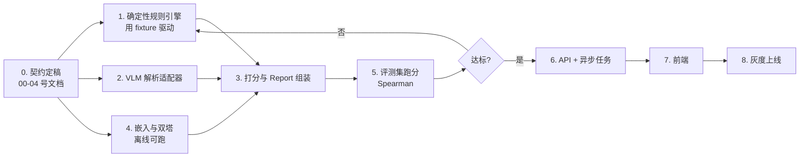

# 08 · 评测与实施手册

> 本文回答**「怎么证明它是对的」和「按什么顺序把它做出来」**。
> 评分模型见 [00-baseline](./00-baseline.md) §5，规则细节见 [03-rule-engine-and-scoring](./03-rule-engine-and-scoring.md)。

版本：v0.1 ｜ 日期：2026-10-31

---

## 1. 为什么评测必须先行

这类产品最容易死在"演示时惊艳、上线后翻车"：

- 大模型**永远能说出听起来对的话**，所以"看起来能跑"毫无意义
- 规则引擎一旦有 50 条，人工无法靠肉眼判断它是否到处误触发
- 用户对错误打分的容忍度是**一次**——一次离谱打分就流失

因此：**先建评测集，再写规则；先有回归，再接前端。**

---

## 2. 人工标注评测集

### 2.1 规模与采样

| 阶段 | 规模 | 用途 |
|---|---|---|
| 冒烟 | 20 套 | 验证方向、算 Spearman（对应 baseline H3 门槛） |
| 迭代 | 100 套 | 规则调优、维度权重校准 |
| 稳定 | 300+ 套 | 上线 A/B 前的置信区间 |

**20 套的采样必须覆盖**（否则相关性没有意义）：

| 维度 | 覆盖要求 |
|---|---|
| 场景 | 通勤 / 约会 / 运动休闲 / 正式 / 居家 各 ≥ 3 套 |
| 风格 | 极简 / 法式 / 美式复古 / 日系 / 甜酷 各 ≥ 3 套（可重叠） |
| 用户画像 | 至少 4 个不同"虚拟用户"画像，每画像 ≥ 4 套 |
| 难度 | 明显好 / 明显差 / 边界模糊 各约 1/3（**边界样本最有价值**） |
| 质量 | 含 3–5 张低质量图（过曝/背景杂乱/半身截断）用于测降级路径 |

> **关键**：评测集必须包含"同一套衣服、两个不同画像"的配对样本（至少 5 对）。这是验证 P3「个人化」原则的唯一硬手段——如果两个画像给出几乎相同的分数，产品失去存在意义。

### 2.2 标注协议

**标注者**：3 名，其中至少 2 名有形象顾问/搭配师背景，1 名普通用户（代表真实视角）。

**流程**：
1. 独立打分，禁止讨论（避免锚定）
2. 每套给出：5 维度分（按 baseline 权重）+ 总分 + verdict + 一句话理由
3. 汇总后计算标注者一致性；一致性 < 0.5 的样本进"争议池"
4. 争议池由第 4 人仲裁，或直接剔除（保留仲裁记录）

**必须遵守**：
- 标注者**不知道**系统分数（盲评）
- 标注须知中必须给出维度定义与扣分基准，否则各人标准不同
- 每 20 套插入 1 套重复样本，用于检测标注者自身稳定性

### 2.3 一致性检验

| 指标 | 用途 | 门槛 |
|---|---|---|
| Krippendorff's α（序数） | 3 人总分一致性 | ≥ 0.6 才可用该集做基准 |
| ICC(2,k) | 维度分一致性 | ≥ 0.6 |
| 重复样本自身偏差 | 标注者稳定性 | ≤ 5 分 |

> 如果 α < 0.6，说明**不是系统不准，而是任务本身定义不清**——先修维度定义，别改算法。

### 2.4 数据格式

```jsonl
{"case_id":"c001","profile_id":"p01","outfit_id":"o01",
 "image_refs":["s3://.../a.jpg"],
 "annotators":[{"id":"a1","d":[16,18,15,15,13],"total":77,"verdict":"suitable","note":"..."},
               {"id":"a2","d":[15,17,16,14,12],"total":74,"verdict":"suitable","note":"..."},
               {"id":"a3","d":[17,19,14,16,13],"total":79,"verdict":"suitable","note":"..."}],
 "consensus":{"d":[16,18,15,15,13],"total":77,"verdict":"suitable"},
 "difficulty":"boundary","scenario":"commute","style_ref":"minimal",
 "tags":["pair_check:p01_vs_p02"]}
```

---

## 3. 离线评测指标

| 指标 | 定义 | 门槛 |
|---|---|---|
| **总分 Spearman ρ** | 系统总分 vs 人工共识总分 | ≥ 0.6 |
| **维度 Spearman ρ_d** | 各维度分别算，识别哪个维度最弱 | 每维 ≥ 0.5 |
| **Verdict 准确率** | 4 分类准确率 | ≥ 65% |
| **Verdict 混淆矩阵** | 重点看"不适合"被误判为"强烈推荐"的次数 | 该格 ≤ 5% |
| **可追溯率** | 扣分项有 rule_id 的比例 | **100%** |
| **建议可执行率** | 建议含明确替换动作（"把 X 换成 Y"）的比例 | ≥ 90% |
| **画像区分度** | 同一 outfit 对两个不同画像的分数差 | 中位数 ≥ 8 分 |
| **确定性** | 同输入重复运行总分完全一致率 | **100%** |
| **降级正确率** | 低质量图未给出强判断的比例 | 100% |

### 3.1 最重要的两个指标

1. **总分 Spearman** —— 决定"准不准"
2. **画像区分度** —— 决定"是否真的个性化"。若区分度 < 8 分，系统退化成通用审美打分器，产品价值归零。

---

## 4. 规则回归测试

### 4.1 规则用例格式

每条规则在规则文件里自带用例（baseline §6.1 的 `test_cases`）：

```jsonc
"test_cases": {
  "positive": [
    { "outfit_fixture": "fx_red_green_hi_sat", "expect_hit": true,  "expect_delta": -8 }
  ],
  "negative": [
    { "outfit_fixture": "fx_monochrome_neutral", "expect_hit": false }
  ]
}
```

`outfit_fixture` 是**不依赖模型的确定性特征快照**（直接给定 `outfit.colors.hue_span = 186`），这样规则回归完全不调用 VLM，可在 CI 中秒级跑完。

> 这是关键设计：**规则回归与模型解耦**。否则每次模型升级都会让全部规则用例失效。

### 4.2 CI 门禁

```
提交规则/代码
  → 规则 DSL schema 校验
  → 全量规则用例回归（必须 100%）
  → 顺序确定性检查（同输入两次输出 diff 必须为空）
  → 扣分可追溯检查（100%）
  → 评测集跑分，Spearman 不得比主干下降超过 0.03
  → 通过才可合并
```

### 4.3 规则上线灰度

| 阶段 | 流量 | 观察指标 |
|---|---|---|
| 影子模式 | 全量流量但不上报分数 | 命中率、规则冲突率 |
| 5% | 小流量 | 用户反馈、投诉 |
| 50% | — | 有效报告率变化 |
| 100% | — | 持续监控 |

**规则热更新**：规则存 DB（带版本号），引擎每次请求读缓存版本，可实现不重启生效 + 秒级回滚。回滚必须能把"某条规则误触发导致的大面积负反馈"在 1 分钟内止损。

---

## 5. 线上监控

| 监控项 | 告警阈值 | 含义 |
|---|---|---|
| 单规则命中率 | > 60% 或 < 0.5% | 条件过宽/过窄 |
| 规则间冲突率 | > 5% | 规则互相打架 |
| 报告生成失败率 | > 1% | 依赖故障 |
| P95 延迟 | > 25s | 性能退化 |
| "无用"反馈率 | 环比升 20% | 质量下滑 |
| 强判断占比异常 | 强烈推荐 > 25% 或 不适合 > 15% | 打分分布漂移 |
| VLM 解析置信度均值 | < 0.6 | 输入质量或模型退化 |

**每次报告必须落库的审计字段**：`model_versions`（vlm/llm/embedding）、`ruleset_version`、`prompt_version`、`parse_warnings`、`rule_hit_ids`。没有这些，线上问题无法归因。

---

## 6. 实施顺序（依赖驱动）



**关键顺序决策**：**规则引擎先做，且用 fixture 驱动，完全不依赖 VLM**。
理由：规则引擎是确定性的、可测试的、是产品判断力的来源；VLM 是不稳定的外部依赖。先把确定性的部分做对，VLM 只是往里喂数据。反过来做（先接模型）会陷入"模型输出不稳定 → 无法判断规则对不对"的死循环。

### 6.1 建议的仓库结构

```
/
├── docs/                     # 本套文档
├── rules/                    # 规则资产（内容团队可直接编辑）
│   ├── color/*.yaml
│   ├── style/*.yaml
│   ├── proportion/*.yaml
│   ├── occasion/*.yaml
│   └── detail/*.yaml
├── fixtures/                 # 确定性特征快照（规则测试用）
├── eval/                     # 评测集与跑分脚本
├── src/
│   ├── contracts/            # Pydantic 模型（04 号文档的可执行形态）
│   ├── parsing/              # VLM 适配器
│   ├── profiling/            # 画像构建
│   ├── towers/               # 双塔 + 向量存储
│   ├── rules/                # 引擎（求值器，不含规则内容）
│   ├── scoring/              # 维度打分与总分
│   ├── synthesis/            # LLM 解释生成
│   └── api/                  # FastAPI 路由
└── tests/
```

> `rules/` 与 `src/rules/` 分开是刻意的：前者是**内容**（搭配师编辑），后者是**代码**（工程维护）。混在一起会导致内容团队无法自主迭代。

### 6.2 开发优先级（若只能做三件事）

1. **确定性规则引擎 + fixture 测试** —— 产品判断力的地基
2. **评测集 20 套 + Spearman 脚本** —— 没有它就无法迭代
3. **Report 组装**（结构化结果 → 符合契约的 JSON）—— 交付物本体

VLM、双塔、前端都可以先粗糙。

---

## 7. 上线 Checklist

- [ ] 规则集版本号已打 tag，可回滚
- [ ] 20 套评测 Spearman ≥ 0.6 且已留档
- [ ] 画像区分度中位数 ≥ 8 分
- [ ] 低质量图降级路径已验证（不硬给强判断）
- [ ] 隐私说明、数据删除接口就绪
- [ ] 每份报告落入审计字段
- [ ] 单规则命中率监控告警已配
- [ ] 成本监控（单份报告模型成本）已配
- [ ] 规则热回滚演练过一次
- [ ] "可反驳"入口（用户可反馈判断错误）已上线

---

## 8. 常见坑（提前避雷）

| 坑 | 症状 | 解法 |
|---|---|---|
| 用 LLM 打分 | 分数每次不一样、无法解释、无法回归 | 分数必须确定性计算，LLM 只做解释（baseline §4 约束） |
| 规则与模型耦合 | 换个 VLM 版本，全量规则用例失效 | fixture 驱动，规则只吃结构化特征 |
| 评测集自评自测 | Spearman 虚高 | 盲评 + 标注者不知系统结果 |
| 只测"明显好/明显差" | 边界样本表现差但指标好看 | 采样强制 1/3 边界样本 |
| 建议越多越好 | 用户不行动 | 反指标卡住（≤ 3 条） |
| 追规则数量 | 1000 条但互相冲突、命中率异常 | 先做治理流程再扩量 |
| 忽略"同一套给不同画像" | 个性化退化成通用打分 | 配对样本必须进评测集 |

---

## 9. 变更记录

| 版本 | 日期 | 变更 | 作者 |
|---|---|---|---|
| v0.1 | 2026-10-31 | 初稿 | Lead |
